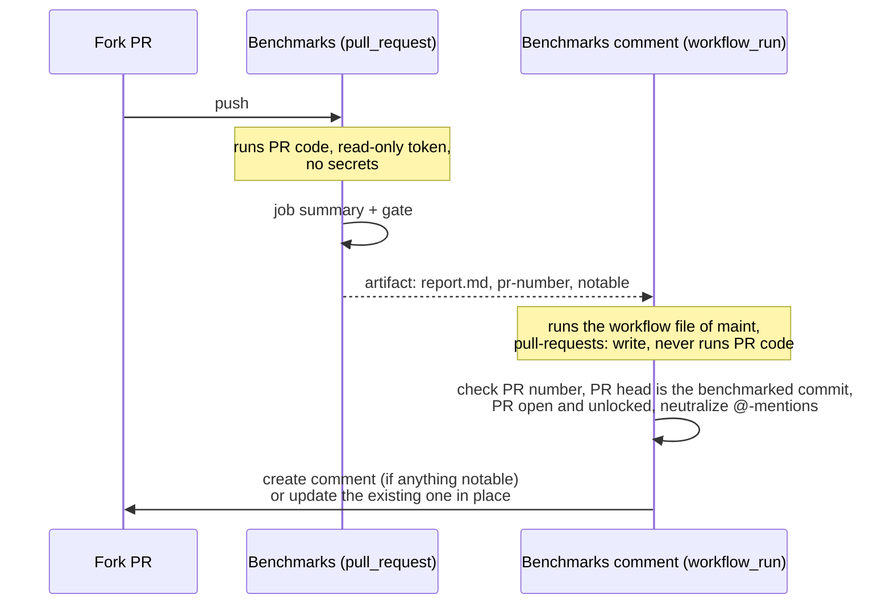

# Issue

**Title:** CI: report benchmark comparison to PRs (also from forks), compare PR's new benchmarks too

## Description

### PR checklist

- [x] Provide an overview of the changes you're making and explain why you're proposing them.
- [x] Create a changelog snippet: `changelog.d/pr-<this PR>.md` (committed right after opening, as AGENTS.md asks).
- [x] Include `Fixes #NNN`: no issue; motivated by

## Why

The benchmark comparison was only visible in the job log, so contributors had to compare and post numbers by hand, as in #7986. Worse, the CI could not show that PR's speedup at all: the merge target was benchmarked with *its own* `benchmarks/`, so the benchmarks the PR added had no "before" numbers (`n/a`).

## What

1. **`tools/ci/benchmark-travis-pr.sh`**: run the PR's benchmark suite against both the PR and its merge target, the way `asv continuous` does. If the PR's suite cannot be imported for the merge target (e.g. a module-level import of new functionality), fall back to the target's own suite and say so.
2. **`tools/ci/benchmark-report.py`** (new): turn `asv compare --split` into a succinct Markdown report. It has a headline, the slower/faster/failing tables, and the full table collapsed. It fails on unexpected output instead of missing a regression. The **job summary** shows it, and the gate uses its counts (the gate is at least as strict as before).
3. **`.github/workflows/benchmarks-comment.yml`** (new): posts the report as a PR comment, also for PRs from forks.

## How the PR comment works for forks

A `pull_request` run from a fork gets a read-only token, so it cannot comment. The report therefore goes through an artifact to a second workflow:

The artifact is untrusted, since a fork controls it fully. So the commenter only posts it as text, on the PR whose head is the benchmarked commit. UXARRAY/uxarray and NCAR/geocat-comp use the same split for their asv reports.

## Testing

- Ran the script end to end locally on a synthetic merge commit (slower, faster, and new-API benchmarks), including the fallback path.
- Three independent review passes (security/Actions, script/asv, report/wiring) iterated until all approved.
- **[yarikoptic/benchmarks-comment-sandbox](https://github.com/yarikoptic/benchmarks-comment-sandbox)** runs the very same `benchmarks-comment.yml` and `benchmark-report.py`, with `benchmarks.yml` identical from "Summarize" on but fed canned real asv outputs:

| Scenario | Result |
|---|---|
| same-repo PR, slower | comment created (), gate failed |
| same PR, later push without changes | same comment edited in place, no new comment |
| no significant changes | no comment () |
| fallback note | comment with the note () |
| report containing `@user` and its HTML entities | no mentions or notifications |
| PR closed, run re-run | comment left untouched |
| **PR from a fork**, slower | job had `Contents: read`, no secrets; comment posted () |
| PR from a fork, no changes | no comment () |

`benchmarks-comment.yml` only takes effect once it is on `maint`, the default branch. This PR therefore shows the report only in its job summary, and the first PR after merge gets the first comment.

---
_Generated by [Claude Code](https://claude.ai/code/session_01PvaGRbkyHA76LBLg4i7D2Z)_

## Task

Modify the repository so that the issue described above is resolved. The repository is checked out at base commit `1813fa5c88a5`. Edit files in place; the verifier captures your changes via `git diff` and scores them against an oracle patch using SWE-RL-style diff-similarity reward.