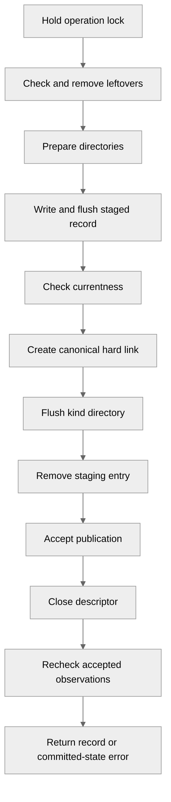

# Issue

**Title:** [MAR-2920] Simplify canonical record publication

## Description

## Summary

Record publication is now a short, linear sequence: staged write, fsync, currentness check, hard link, kind-directory fsync, staging unlink, authority acceptance. Staging cleanup becomes a plain removal of leftovers while the operation lock is held. The defences against same-user processes replacing directories in the middle of publication are removed.

## Problem

`publishPlannedRecordInternal` was about 300 lines with 12 mutable flags, nested try/catch/finally and about 20 fault-injection points. Together with the quarantine-based staging cleanup in `src/staging.ts` (about 440 lines), it defended against directory replacement during a local, single-user write. It was the most critical write path and the hardest to review or change safely.

## Design

- Publication keeps the canonical publication authority unchanged: planning currentness, layout limits, `acceptPreparation` and `acceptPublication`. Cache hydration after an add still uses the verified mutation snapshot without rescanning.
- The record is committed at the hard link. Flush, staging cleanup, acceptance and descriptor close then run independently. Each failure is captured with the existing post-commit priority and the link is never rolled back.
- `removeStagingLeftovers` replaces the quarantine machinery. Writers stage only while holding the operation lock, so every staging entry the next holder sees is a leftover. It checks all entries first (recognised writer names, including earlier releases' crash-quarantine names, and only files or symlinks), then removes them. Overflow or an unrecognised entry removes nothing. Removing a hard-linked leftover still re-inspects the affected canonical observations.
- Directory witnesses, staging identity checks, final revalidation, staging emptiness probes and staging directory flushes are removed, along with their fault points.

## Compatibility

Public results, error codes and `postCommitPhase` values are unchanged. Leftovers from 0.3/0.4 writers, including `.quarantine` names, are still recognised and removed. The contract's staging cleanup paragraph now describes the lock-based model; the general filesystem guarantees (exclusive publication, no-follow reads, regular-file flush, post-link identity acceptance) still hold.

## Deleted tests

These tests covered only the removed defences or the fault points that disappeared with them:

`test/records.test.ts`
- record publication outcome retains staging when canonical publication is displaced after verification fails
- does not follow a staging directory replaced during cleanup
- preserves a staging replacement observed immediately before unlink
- preserves an entry that arrives after staging cleanup preflight
- preserves an entry that arrives before the final staging emptiness probe
- preserves a replacement installed at the immediate staging deletion boundary
- replans after an in-place canonical rewrite during stale staging cleanup
- preserves a stale entry whose incarnation changes after cleanup preflight
- preserves a quarantine pathname replacement at the immediate unlink boundary
- does not unlink through a staging directory generation replaced before entry inspection
- fails a staging cleanup flush before canonical publication
- retries staging durability after cleanup before publishing
- rejects changed staging bytes and preserves a late unknown child before publication
- does not accept a canonical successor across final publication verification
- reports operational final directory revalidation failure as committed I/O
- classifies a staging entry disappearance without leaking its name
- reports a late staging child after linking as a committed repository change
- does not accept a late child introduced during current-operation cleanup
- does not accept a late staging child after publication authority acceptance
- does not flush a staging-root replacement after cleanup
- does not link a replacement at the current staging pathname

`test/staging.test.ts`
- advances a hard-link group to a verified surviving alias incarnation

Two tests were adapted rather than deleted: the crash-quarantine leftover test now writes the leftover directly and checks it is removed, and the first-post-link-failure test injects its later failure at `after-publication-accept`.

## Verification

- Tests kept as regressions while rewriting caught two mistakes, now fixed: cleanup must reject an unrecognised entry before removing anything, and the pre-link currentness check must run after the `before-canonical-link` fault point (three pre-link churn tests).
- `bun run lint`, `bun run typecheck`, `bun run build`, `bun run check:generated` and `bun run test:all` (883 tests: 880 passed, 3 platform skips) pass locally.

## Encephalon

Adds decision `7015be70-1daf-4ddf-85a2-b7921ab666e5` (`canonical.record-publication`).

## Linear

Closes [MAR-2920](https://linear.app/marcoappio/issue/MAR-2920).

<!-- greptile_comment -->

<!-- greptile_summary -->

<h2><a href="https://app.greptile.com/api/retrigger?id=77766633"><picture><source media="(prefers-color-scheme: dark)" srcset="https://greptile-static-assets.s3.amazonaws.com/badges/RetriggerDark.svg?v=2"><source media="(prefers-color-scheme: light)" srcset="https://greptile-static-assets.s3.amazonaws.com/badges/Retrigger.svg?v=2"></picture></a>Confidence Score: 5/5</h2>

<!-- greptile-impact-verdict --> The PR appears safe to merge under its stated lock-based model.

<h3>Summary</h3>

Simplifies record publication into staged write, file flush, currentness check, hard link, directory flush, staging removal, and authority acceptance.

- Checks all staging leftovers before removing any, including older crash-quarantine names.
- Preserves committed-state errors and rechecks accepted records after descriptor close.
- isaachinman explicitly accepted the risk of same-user processes replacing staging files or directories during publication and cleanup.
- No new actionable issues found.

<h3>Diagram</h3>

<!-- greptile_confidence_score:5 -->

Reviews (3) · Last reviewed commit:  · [Reviewed by Greptile](https://www.greptile.com/?utm_source=greptile_expert&utm_medium=github&utm_campaign=code_reviews&utm_content=isaachinman/encephalon)

<!-- /greptile_comment -->

## Task

Modify the repository so that the issue described above is resolved. The repository is checked out at base commit `f93d0127c9e1`. Edit files in place; the verifier captures your changes via `git diff` and scores them against an oracle patch using SWE-RL-style diff-similarity reward.