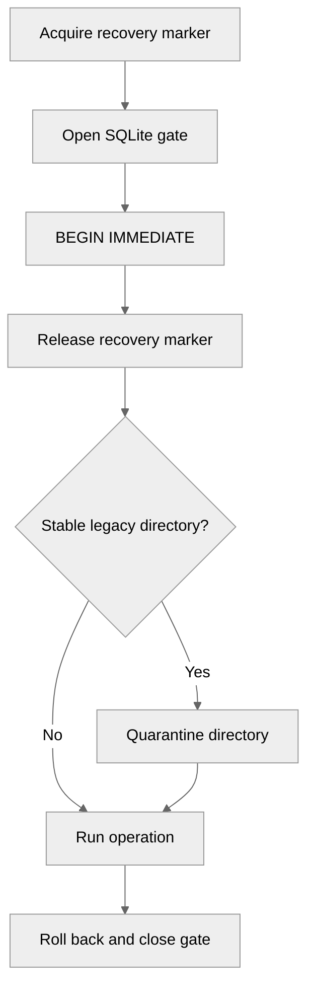

# Issue

**Title:** [MAR-2921] Rely on the SQLite operation gate without a directory lock

## Description

## Summary

The operation lock is now the SQLite `BEGIN IMMEDIATE` gate on `operation-lock.sqlite` plus the existing short-lived recovery marker. The `operation.lock` directory lock, its per-attempt candidate directories and candidate maintenance are removed.

## Problem

`withOperationLock` already treated the SQLite gate as authoritative (the operating system releases it when a holder exits). On top of it, every operation created a candidate directory, wrote an owner file, promoted it to `operation.lock`, kept checking its exact contents, and ran bounded maintenance over abandoned candidates. That accounted for `src/lock-candidates.ts` (359 lines) and most of `src/lock.ts`, and the code's own comment noted the directory metadata was not authoritative.

## Design

- Acquisition takes the recovery marker, opens the gate and begins the immediate transaction, exactly as before. Corrupt-gate recovery is unchanged.
- **Deviation from the ticket:** the ticket also proposed removing the recovery marker. I kept it because every gate opener takes it briefly, and that is what makes automatic replacement of a corrupt gate safe. Without it, two processes could each quarantine and recreate the gate and both believe they hold the lock (Encephalon `review.lock-corrupt-gate-recovery`).
- After acquiring the gate, a stable leftover `operation.lock` directory from an earlier release is quarantined. One that changes while being observed is ignored instead of failing the operation. Leftover `operation.lock.<uuid>` candidates are inert: nothing enumerates them.
- Cache-location helpers used only by the directory lock are removed (`promoteCacheOwnedDirectory`, `observeCacheOwnedDirectoryForMaintenance`, `cacheOwnedDirectoryMtimeNanoseconds`, the candidate-name pattern and the promotion hook), along with candidate-name redaction of error causes.

## Compatibility

0.3.0 and 0.4.0 both take the same gate (checked against their release commits), so an upgraded process and an older process sharing a cache still exclude each other. The lock's public behaviour (60-second acquisition bound, `CACHE_BUSY`, recovery policy) is unchanged, so the contract needs no update; its implementation is documented as not a public format.

## Deleted tests

`test/lock-candidates.test.ts` (whole file, 28 tests) and its fixture `test/fixtures/abandon-lock-candidate.ts`:
  - asserts the current lock before opening the maintenance cursor
  - preserves the first one-shot current-lock failure at a candidate suppression boundary
  - preserves the first one-shot cache-location failure at a candidate suppression boundary
  - runs under the gate and visits at most 64 lazy entries without private diagnostics
  - releases the native Windows directory reader after a bounded maintenance pass
  - enforces exact inspection and reclamation-attempt budgets
  - rejects exact current-lock replacements during maintenance and at its reporting boundary
  - stops maintenance when candidate quarantine failure reveals current-lock replacement
  - retains a moved candidate when current-lock authority changes before cleanup
  - asserts the current lock in the final candidate ownership callback before rename
  - resumes a retained reader until a reclaimable suffix is reached
  - closes cursors on EOF, reader failure, injected-reader change, and cache identity replacement
  - keeps a reentrant replacement cursor when the stale reader closes
  - refreshes cursor recency and evicts the true least-recently-used repository
  - reclaims only exact abandoned candidates and preserves live or ambiguous evidence
  - uses a strict malformed-owner grace boundary and preserves oversized owners without exact bytes
  - retains exact raw bytes for bounded owner evidence
  - preserves a candidate when its captured directory mtime changes before quarantine
  - routes unsupported candidate observations through the current-lock authority boundary
  - reports current-candidate promotion failures with the fixed public lock entry
  - redacts the private candidate token from a promotion filesystem cause chain
  - never unlinks post-validation file successor inodes from candidate quarantine
  - preserves unsupported and ambiguous candidates with exact evidence
  - converges after a transient candidate sharing failure
  - converges after a Windows-style candidate quarantine sharing violation
  - preserves candidate symlinks and their external targets
  - converges candidates abandoned before and after owner publication
  - preserves exact owner and directory replacements before candidate quarantine

`test/cache.test.ts`
- serialises two contenders that both observed the same stale lock (relied on the removed stale-directory observation hook; its fixture `test/fixtures/contend-for-stale-lock.ts` is removed too). Multi-process exclusion stays covered by the corrupt-gate contender and held-lock tests.

Adapted: "tolerates an operation lock that changes before gate acquisition" is now "tolerates a legacy operation lock directory that changes during cleanup", with the same scenario and expectation.

## Verification

- `bun run lint`, `bun run typecheck`, `bun run build`, `bun run check:generated` and `bun run test:all` (876 tests: 873 passed, 3 platform skips) pass locally. `scripts/test-selection.ts` drops the deleted file's classification.

## Encephalon

Adds decision `de53b83a-87c8-48e4-9140-ae5f1550fea5` (`cache.operation-lock`).

## Linear

Closes [MAR-2921](https://linear.app/marcoappio/issue/MAR-2921).

<!-- greptile_comment -->

<!-- greptile_summary -->

<h2><a href="https://app.greptile.com/api/retrigger?id=77771547"><picture><source media="(prefers-color-scheme: dark)" srcset="https://greptile-static-assets.s3.amazonaws.com/badges/RetriggerDark.svg?v=2"><source media="(prefers-color-scheme: light)" srcset="https://greptile-static-assets.s3.amazonaws.com/badges/Retrigger.svg?v=2"></picture></a>Confidence Score: 5/5</h2>

<!-- greptile-impact-verdict --> The PR appears safe to merge; no actionable defects were found.

<h3>Summary</h3>

The PR removes the `operation.lock` directory lock and candidate maintenance. Operations still use the SQLite gate and the short-lived recovery marker.

- Stable legacy lock directories are quarantined after gate acquisition.
- Legacy directories that change during observation are left alone.
- Removed helpers, tests, fixtures, and test-selection entries match the deleted behavior.

No actionable issues were found. This review used code inspection; tests were not run.

<h3>Diagram</h3>

<!-- greptile_confidence_score:5 -->

Reviews (2) · Last reviewed commit:  · [Reviewed by Greptile](https://www.greptile.com/?utm_source=greptile_expert&utm_medium=github&utm_campaign=code_reviews&utm_content=isaachinman/encephalon)

<!-- /greptile_comment -->

## Task

Modify the repository so that the issue described above is resolved. The repository is checked out at base commit `c6847052d16b`. Edit files in place; the verifier captures your changes via `git diff` and scores them against an oracle patch using SWE-RL-style diff-similarity reward.