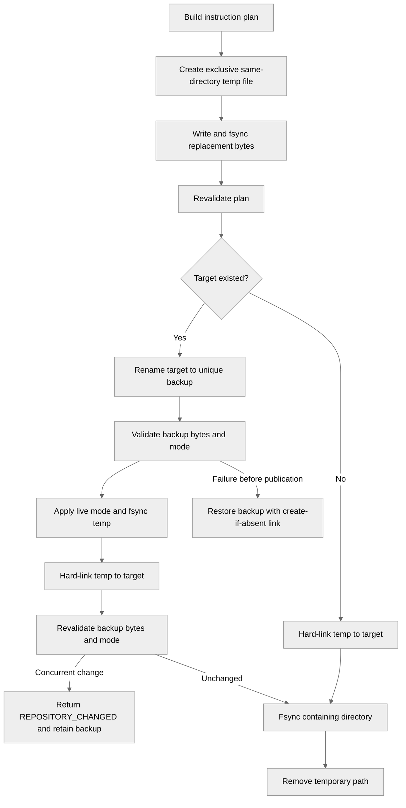

# Issue

**Title:** [MAR-2509] Make instruction writes atomic

## Description

## Human summary

Makes Encephalon update managed instruction files safely, so write failures and concurrent edits do not leave AGENTS.md or CLAUDE.md empty, partial, or silently overwritten.

## Summary

This PR fixes MAR-2509 by replacing in-place managed instruction-file rewrites with an atomic publication path:

- writes replacement content to an exclusive temporary file in the same directory as the target
- flushes temporary file bytes before publication, including Windows-compatible temp-file flushing
- publishes newly-created managed files with `linkSync` so concurrent creators are not overwritten
- publishes existing-file replacements only after moving the current target aside, revalidating its contents and file type, and preserving the current target mode
- returns `REPOSITORY_CHANGED` when content changes are observed during the publication window
- keeps the moved-aside old file recoverable so descriptor-based writes cannot disappear during backup cleanup
- best-effort flushes containing directories on platforms that support directory fsync
- removes temporary files after success without masking the original write error on cleanup failure

The test coverage adds deterministic fault injection for each required failure point: before temp creation, during temp writes, during file flush, during publication, immediately after publication, and during temp cleanup. Each case asserts the target contains either the exact old bytes or exact new bytes, never truncated or mixed content.

This branch also:

- adds regression coverage for publication-window content changes, publication-time mode changes, old-descriptor writes, and backup-restore races
- documents the Linear-prefixed commit and PR title rules in `AGENTS.md`
- saves the review learnings as an Encephalon memory record in this repository
- aligns `package.json` export key order with the package-contract checker
- limits the CI workflow to push events, as intended for this repository

<!-- greptile_comment -->

<h3>Greptile Summary</h3>

The PR replaces in-place managed-instruction rewrites with same-directory atomic publication and explicit concurrent-change recovery.
- Writes and flushes replacement bytes through exclusive temporary files before publication.
- Revalidates moved-aside existing files, preserves their live mode, and retains recoverable backups when concurrent descriptor changes are detected.
- Uses create-if-absent hard links for publication and restoration to avoid overwriting concurrent files.
- Adds deterministic fault-injection and concurrency regression coverage.
- Updates CI triggers, package export ordering, repository guidance, and workflow memory.

<h3>Confidence Score: 5/5</h3>

The PR appears safe to merge.

No blocking failure remains.

<h3>Important Files Changed</h3>

| Filename | Overview |
|----------|----------|
| src/instructions.ts | Replaces destructive in-place rewrites with flushed temporary files, create-if-absent publication, live backup validation, mode preservation, and recoverable failure handling. |
| test/init.test.ts | Adds deterministic coverage for write and publication failures, concurrent content and mode changes, old-descriptor mutations, and backup-restoration races. |
| .github/workflows/ci.yml | Restricts CI execution to push events. |
| package.json | Reorders conditional export keys without changing their paths. |
| AGENTS.md | Adds repository coding standards and Linear-prefixed commit and pull-request title guidance. |
| encephalon/workflow/77f71585-914f-4acf-8116-884c688abed5.json | Records durable workflow lessons derived from the atomic-write review. |

<h3>Flowchart</h3>

Reviews (5): Last reviewed commit: ["\[MAR-2509\] Avoid stale final mode writes"]() | [Re-trigger Greptile](https://app.greptile.com/api/retrigger?id=51364203)

<!-- /greptile_comment -->

## Task

Modify the repository so that the issue described above is resolved. The repository is checked out at base commit `946228d71513`. Edit files in place; the verifier captures your changes via `git diff` and scores them against an oracle patch using SWE-RL-style diff-similarity reward.