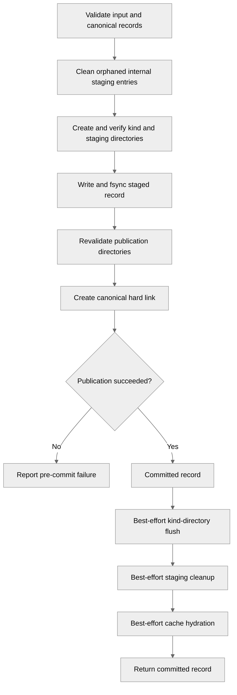

# Issue

**Title:** [MAR-2510] Make record staging recoverable

## Description

## Human summary

Moves record staging out of artifact folders and makes interrupted record publication recoverable, so orphaned staging aliases are cleaned without risking committed records.

## Summary

This PR fixes MAR-2510 by hardening canonical record creation:

- moves temporary record staging into the reserved internal `encephalon/_staging` namespace
- keeps record staging out of caller-managed `_artifacts/<kind>/<id>` directories
- creates canonical and staging directory chains one component at a time and verifies each component is a real non-symlink directory
- revalidates the kind and staging directories immediately before hard-link publication
- writes and flushes staged record bytes before publishing the canonical record
- keeps no-overwrite `linkSync` publication semantics and preserves `RECORD_EXISTS` for destination collisions
- treats successful hard-link publication as the commit point, so post-publication directory flush failures cannot make a committed mutation look failed
- flushes the canonical kind directory after publication where supported
- removes stale internal staging entries on the next record mutation without deleting committed canonical records
- suppresses cleanup, post-publication flush, and cache hydration failures after canonical publication so the committed record outcome is not misreported
- avoids creating empty artifact directories for records that have no artifacts
- saves the MAR-2510 review lessons in Encephalon workflow memory so future publication work tests both sides of the commit point, including derived cache hydration

The test coverage adds regression cases for symlinked internal staging ancestry, kind-directory replacement at the publication boundary, orphaned staging alias cleanup, cleanup failure after canonical publication, post-publication directory flush failure, cache hydration failure after canonical publication, destination collisions, and artifact-first creation with an existing legitimate artifact directory.

<!-- greptile_comment -->

<h3>Greptile Summary</h3>

This PR moves record staging into a reserved internal namespace and makes canonical hard-link publication the mutation commit point.
- Builds and revalidates non-symlink canonical and staging directory chains.
- Cleans orphaned staging entries on later mutations while preserving committed records.
- Suppresses cleanup, directory-flush, and cache-hydration errors after publication.
- Adds regression coverage for staging recovery, publication-boundary replacement, collisions, and post-commit failures.

<h3>Confidence Score: 5/5</h3>

The PR appears safe to merge.

No blocking failure remains.

<h3>Important Files Changed</h3>

| Filename | Overview |
|----------|----------|
| src/records.ts | Moves staging into the reserved internal namespace, validates directory ancestry, establishes hard-link publication as the commit point, and suppresses subsequent derived-state failures. |
| test/records.test.ts | Adds focused regression coverage for symlink rejection, publication-boundary replacement, orphan cleanup, destination collisions, and failures after publication. |
| encephalon/workflow/a46c2d81-6579-4f27-a927-5dc07644cf38.json | Records the publication commit-point and derived-cache recovery lessons from this review cycle. |

<h3>Flowchart</h3>

Reviews (3): Last reviewed commit: ["\[MAR-2510\] Record hydration review learn..."]() | [Re-trigger Greptile](https://app.greptile.com/api/retrigger?id=51371798)

<!-- /greptile_comment -->

## Task

Modify the repository so that the issue described above is resolved. The repository is checked out at base commit `a437dc461635`. Edit files in place; the verifier captures your changes via `git diff` and scores them against an oracle patch using SWE-RL-style diff-similarity reward.