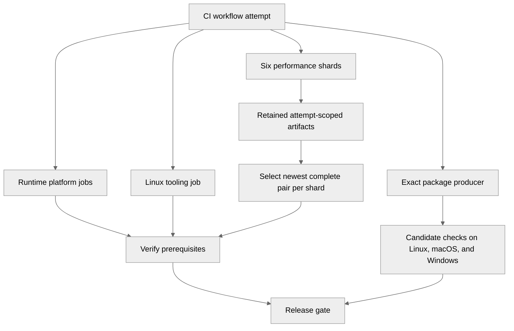

# Issue

**Title:** [MAR-2784] Simplify CI and recheck changed recovery directories

## Description

## Summary

Repair partial workflow reruns and reduce repeated CI work while preserving supported-platform runtime and package checks. Recheck changed recovery-directory identities before treating a resolved-path mismatch as an unsafe stable directory.

## Problem

Merged-main run 34419485608 exposed a noisy one-record timing comparison and a separate aggregation bug: rerunning one failed shard omitted successful evidence from the previous attempt. CI also repeated costly benchmark and release-checker fixtures across platforms. The revised Windows cache job then exposed an existing stale-lock recovery failure at the realpath-mismatch check.

## Design

- Keep native Node testing. Context7 research and an eight-file controlled comparison found Node fastest locally: 1.152s median versus 1.269s for Vitest threads and 1.305s for forks, using four workers on macOS/Node 26.5. This is not a universal framework benchmark.
- Separate runtime tests from benchmark and release-tool fixtures. Run runtime/filesystem/process checks on all supported platforms; run expensive tooling fixtures once on Linux. Build explicitly rather than implicitly through the test command.
- Run the Windows cache file separately. Its union with Windows core is the complete runtime suite, with no duplicate files or omitted assertions.
- Measure all fifteen representative operations at 1,000 records across six Linux shards. Retain twenty samples, two warmups, fresh workers, adjacent same-runner base/candidate pairs and every numerical threshold. Smaller corpora retain behavioural and smoke coverage.
- Let `large-reads` alone own package sizes and packed startup evidence. Aggregate the newest available pair for each shard within the same workflow run, recording its attempt. Never mix sides across attempts or fall back from incomplete newer evidence; failed prerequisite jobs still block aggregation.
- Pass the package producer's actual retained artifact name to dependent jobs, so downstream-only reruns use the correct candidate.
- Move the recovery-directory realpath mismatch check after the existing final type and identity checks. Missing or replaced identity returns `changed` for existing bounded reobservation. Stable wrong realpaths, symlinks and non-directories remain rejected. Add one deterministic regression covering movement, replacement and a stable wrong-path control; retain the genuine two-process stale-lock test.

## Scope

CI scheduling, test selection, benchmark scope, rerun evidence selection, performance documentation and the explicitly owner-approved three-line recovery-directory correctness exception. The owner approved this runtime exception on 10 September 2026.

## Deliberately excluded

Framework migration, broader runtime optimisation, threshold increases, sample filtering, automatic retries and downstream ticket work. The five-sample/diagnostic-p95 proposal remains unapplied.

## Compatibility

Preserve Linux/macOS/Windows on Node 24.15 and Linux on Node 26. Build and check the exact package on Linux 24.15, then check the same bytes on macOS, Windows and Linux Node 26. Published-oracle compatibility and publish dry-run checks remain on Linux. Required contexts, read-only permissions, pinned actions, public bounds and synchronous APIs remain intact. Recovery-directory error precedence now recognises observed identity changes before classifying a path mismatch; stable unsafe layouts still fail closed.

## Performance

| Work | Previous workflow | This branch |
| --- | ---: | ---: |
| Workflow jobs | 35 | 23 |
| Comparison shards | 12 | 6 |
| Raw operation reports | 2,720 | 600 |
| Expensive tooling fixtures | Repeated across OS lanes | Once on Linux |

Final-head [CI 34455295615](https://github.com/isaachinman/encephalon/actions/runs/34455295615) passed all 23 jobs in **6m55s**, with **51.65 summed runner-minutes** versus 100.05 previously. Windows core/cache passed in 157s/280s. The independent artifact audit passed all **600 raw reports and 58 comparisons**, using base `4e1111be7a7b291f6e4f26aee218761e0a82695e`, candidate `5bee06abcf5e2e1be96cbd0a87d87932f8a7ad0a`, and common harness `7143ad061631aba5380340cebdd622c3c1052dd2ea5a861180b94dbb530531a2`. Each operation uses matched Linux ARM64/Node 24.15 measurements within its own shard; different runners are not pooled. Reports retain raw samples, ranges, variances, preparation/query phases and package/startup metrics.

The table shows base → candidate; required limits remain 15% median, 25% p95, 20% RSS and 10% bytes. Values are rounded only for display; gates use unrounded observations.

| Operation (1,000 records) | Median ms | p95 ms | Peak RSS MiB |
| --- | ---: | ---: | ---: |
| gather | 8015.00 → 8012.77 | 8039.97 → 8031.65 | 169.32 → 169.51 |
| maximumPayloadSearch | 7956.97 → 7956.89 | 7969.45 → 7981.60 | 187.09 → 187.75 |
| largePayloadSearch | 8013.90 → 8019.98 | 8043.86 → 8051.94 | 168.83 → 168.84 |
| coldHydrate | 743.13 → 740.13 | 770.26 → 772.67 | 144.97 → 146.45 |
| unchangedPrepare | 485.73 → 481.54 | 501.18 → 497.71 | 166.12 → 167.87 |
| stalePrepare | 966.28 → 961.02 | 1002.08 → 973.55 | 174.93 → 176.32 |
| list | 469.30 → 470.09 | 489.95 → 483.18 | 168.07 → 168.08 |
| show | 468.21 → 468.47 | 491.22 → 491.94 | 167.71 → 167.59 |
| compactSearch | 486.98 → 486.81 | 505.90 → 501.56 | 166.46 → 167.68 |
| fullSearch | 469.82 → 472.71 | 478.05 → 491.84 | 168.99 → 168.73 |
| payloadOnlySearch | 480.56 → 483.90 | 500.01 → 502.99 | 188.00 → 187.30 |
| missingSearch | 463.11 → 465.45 | 482.60 → 485.28 | 168.17 → 167.77 |
| listMaximum | 489.52 → 488.40 | 507.28 → 504.59 | 174.36 → 174.43 |
| validateArtifacts | 252.86 → 254.91 | 258.38 → 267.42 | 123.40 → 123.00 |
| strictCacheValidation | 468.68 → 465.25 | 494.57 → 478.84 | 167.93 → 168.34 |

Narrowing the timed corpus reduces coverage; it does not eliminate hosted-runner noise.

## Verification

- The new deterministic regression failed against the original production function and passed after the correction; the existing two-process stale-lock test passed locally.
- `bun run lint`, all four typecheck projects, build and generated-version checks passed. Runtime: 811 passed plus three platform skips in 50.4s; tooling: 90 passed in 154.5s. Repository validation passed for all 43 records. Benchmark smoke passed in 46.3s. Exact-package, published-0.3.0 compatibility and publish dry-run checks passed; dry-run reported only the expected already-published-version conflict. The retained local tarball is 362,535 bytes with SHA-256 b9e58c5775d686bbd9d402d78a98f71b634c73af2e20e3f6df68440a31f51807. The release worktree check passed.
- Current head: `5bee06abcf5e2e1be96cbd0a87d87932f8a7ad0a`. Exact-head CI passed all 23 jobs. Greptile returned explicit 5/5 on this SHA (review 3; check 102800275929), with no unresolved findings. The Windows regression and original two-process stale-lock test both passed. Merged-main CI remains required before Done.

## Risk and rollback

Platform-neutral tooling fixtures no longer repeat on every OS, and required timing coverage is narrower. The exact original Windows interleaving was not captured; the regression establishes the corrected conditional behaviour and Windows CI must verify integration. Reverting restores the previous scheduling and error precedence, including the known partial-rerun defect and excess repeated work.

## Linear

[MAR-2784](https://linear.app/marcoappio/issue/MAR-2784) — . Mark Done only after squash merge into latest main and successful merged-main CI.

<!-- greptile_comment -->

<h3>Greptile Summary</h3>

The PR simplifies CI test and benchmark scheduling, repairs partial-rerun artifact selection, and adjusts recovery-directory observation so transient movement is rechecked before a stable path mismatch is rejected.

- Splits runtime and tooling tests while preserving supported-platform runtime coverage.
- Reduces performance CI to six 1,000-record shards with uniform sampling.
- Selects the newest same-attempt benchmark evidence pair available for each shard.
- Propagates the retained package artifact name to downstream reruns.
- Reorders recovery-directory validation and adds movement, replacement, and stable-mismatch regression coverage.

<h3>Confidence Score: 5/5</h3>

The PR appears safe to merge, subject to the required fresh Windows CI confirmation.

No blocking failure remains in the reviewed changes.

<h3>Important Files Changed</h3>

| Filename | Overview |
|----------|----------|
| src/cache-location.ts | Moves resolved-path mismatch rejection after final type and identity validation so transient movement is retried while stable mismatches still fail. |
| test/cache.test.ts | Adds focused coverage for moved, replaced, and stable mismatched recovery directories. |
| scripts/benchmark-aggregate.ts | Selects the newest available same-directory base/candidate evidence for each shard and records source attempts. |
| scripts/test-ci.ts | Replaces granular fixture groups with complete runtime, Windows cache, and Linux tooling partitions. |
| .github/workflows/ci.yml | Consolidates CI jobs, supports retained artifacts during downstream reruns, and preserves prerequisite gating. |
| scripts/benchmark-shards.ts | Narrows timed regression coverage to six uniformly sampled 1,000-record shards. |
| test/ci-workflow.test.ts | Updates workflow contract checks for the new test topology, artifact propagation, and platform matrix. |

<h3>Flowchart</h3>

Reviews (3): Last reviewed commit: ["\[MAR-2784\] Recheck recovery identity bef..."]() | [Re-trigger Greptile](https://app.greptile.com/api/retrigger?id=62396909)

<!-- /greptile_comment -->

## Task

Modify the repository so that the issue described above is resolved. The repository is checked out at base commit `4e1111be7a7b`. Edit files in place; the verifier captures your changes via `git diff` and scores them against an oracle patch using SWE-RL-style diff-similarity reward.