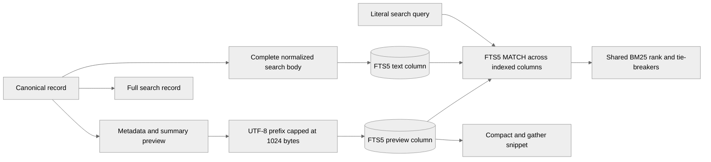

# Issue

**Title:** [MAR-2785] Bound search snippets to metadata previews

## Description

## Summary

Generate compact-search and gather snippets from a deterministic preview of at most 1,024 UTF-8 bytes. Keep the complete searchable body, including payload JSON and `searchText`.

## Problem

SQLite previously chose snippets across the complete payload document. On the 1,000-record duplicate-heavy gather fixture, query/projection took about 3.1 seconds locally, despite returning a small result set.

## Design

Cache schema 3 adds one indexed preview column. The preview is a contiguous prefix of kind, subject, source and summary, cut at an ASCII separator before the byte bound. Table-wide matching retains the existing full body; only snippet generation selects the preview column. Payload-only matches return a deterministic non-empty fallback.

Keeping the prefix contiguous preserves literal underscore phrases: appending `searchText` after omitting intervening payload JSON would invent phrase matches. Existing locked rebuild/retry handles old disposable schemas. Exact canonical preview/body bytes, ID binding, cardinality, SQLite types and byte bounds are validated before results are served.

## Scope

- Add the bounded preview and rebuild schemas 1/2 automatically.
- Cover maximum-size payload and late `searchText` matches, highlighting, Unicode/token boundaries, intentional ranking changes, exact preview corruption and old-schema recovery.
- Update historical compatibility checks for schema 1 → 3 → 1 and the authorised rank/snippet presentation change during upgrade only.
- Document the behaviour and record the decision in Encephalon (`cf2b6472-13e3-449f-9671-e90ed9517dde`).

## Deliberately excluded

The remaining canonical/cache optimisations, build changes and CI restructuring stay in their subsequent tickets. The historical compatibility oracle remains pinned to 0.2.0 until MAR-2796; a separate verified published-0.3.0 round trip covers this ticket's migration requirement.

## Compatibility

Matching IDs, filters, compact fields, complete full-search records, response accounting, synchronous ESM, zero runtime dependencies and supported platforms remain intact. Default BM25 now counts the duplicated preview terms and changes document/corpus length normalisation; ranking can deliberately differ from earlier releases. Full and compact search share the same rank and tie-breakers.

The compatibility exception permits only finite ranks and non-empty bounded snippets at compact/gather search result paths during upgrade. Other values, identities, shapes and fixture ordering remain exact; downgrade comparisons remain fully exact. Actual published 0.3.0 successfully upgraded schema 2 → 3 and downgraded 3 → 2, preserving all canonical records and managed instruction bytes.

## Performance

Base: `f20cb9547cedf06d8cf6c76cffaee9e8cebbea22`.

Head: `3f4bb75f0bf384d4e541fd8fe42a20f3a6b863ac`.

Matched local comparison passed with the accepted common harness `7143ad061631aba5380340cebdd622c3c1052dd2ea5a861180b94dbb530531a2`, the same Apple M5 Pro / macOS arm64 / Node 26.5.0 runner, 1,000 records, two warmups and 20 measured samples per side. No timing tests ran concurrently. Raw samples and spread statistics are retained outside the worktree; exact-head CI will attach the complete Linux campaign.

| Gather metric | Base | Head |
| --- | ---: | ---: |
| Query/projection median | 3,101.117 ms | 7.856 ms |
| Query/projection p95 | 3,431.368 ms | 9.704 ms |
| Query/projection range | 1,180.283 ms | 4.237 ms |
| Query/projection variance | 67,363.453 ms² | 1.066 ms² |
| Total median | 3,543.510 ms | 454.036 ms |
| Total p95 | 4,287.503 ms | 494.406 ms |
| Preparation/integrity median | 305.918 ms | 300.701 ms |
| Preparation/integrity p95 | 414.095 ms | 314.239 ms |
| Maximum peak RSS | 184,549,376 B | 188,956,672 B |
| Disposable cache | 8,294,400 B | 8,364,032 B |
| Packed tarball | 363,566 B | 363,112 B |

The required query/projection median reduction is **99.75%**, exceeding 70%. Total latency fell 87.19%; maximum RSS rose 2.39% and cache size rose 0.84%, within unchanged budgets. Retained candidate: 363,112 bytes, SHA-256 `e6f17424f164f0eff8ca4b7165aada1049346a94614da3015164f22067f0a92b`. All CI comparisons retain the same accepted fixtures, sample counts and median/p95/RSS/byte thresholds.

The hidden FTS `rank` column returned identical results but showed no material speed advantage in paired measurements of the actual joined query, so explicit `bm25()` is retained.

## Verification

- Meaningful red → green regressions for full-payload snippet work, truncated tokens and invented underscore phrases.
- `bun install --frozen-lockfile`; `bun run lint`; `bun run typecheck`; `bun run test` (817 passed, three platform skips); `bun run test:tooling` (91 passed).
- `bun run benchmark:check`; `bun run build`; `bun run check:generated`; exact-tarball package checks and publish dry run; canonical validation; `git diff --check`.
- Historical published-0.2.0 API/CLI/declaration/budget/upgrade/downgrade gate, plus pinned-integrity published-0.3.0 migration round trip.
- Independent implementation review found no runtime defect; final performance acceptance is established separately by the measurements below.
- Exact-head CI and an explicit Greptile 5/5 remain mandatory merge gates.

## Risk and rollback

The first read of an older cache rebuilds it under the existing operation lock. Preview indexing deliberately changes ranking and adds a small amount of disposable cache data. Reverting restores the old schema/projection, and the previous package rebuilds schema 3 automatically; canonical JSON is unchanged.

## Linear

https://linear.app/marcoappio/issue/MAR-2785/search-generate-snippets-from-a-bounded-preview-not-complete-payload

<!-- greptile_comment -->

<h3>Greptile Summary</h3>

The PR adds a bounded FTS preview column for compact and gather snippets while retaining the complete searchable document.
- Advances the disposable cache schema to version 3 and transparently rebuilds schemas 1 and 2.
- Generates snippets from a deterministic metadata-and-summary prefix capped at 1,024 UTF-8 bytes.
- Extends cache integrity validation to verify preview types, bounds, cardinality, and exact bytes.
- Updates release compatibility checks to permit only finite rank and bounded non-empty snippet changes during upgrade.
- Adds migration, corruption, Unicode, token-boundary, payload-only matching, ranking, and compatibility coverage.

<h3>Confidence Score: 5/5</h3>

The PR appears safe to merge with no actionable defects identified.

The bounded preview preserves full-body matching, old disposable caches are rebuilt through the established recovery path, integrity checks validate exact derived data, and the compatibility exception remains narrowly scoped.

<h3>Important Files Changed</h3>

| Filename | Overview |
|----------|----------|
| src/cache.ts | Adds the schema-3 preview column, deterministic byte-bounded preview generation, exact integrity validation, automatic old-cache rebuilds, and preview-based snippet projection. |
| scripts/release-compatibility.ts | Restricts upgrade compatibility exceptions to finite ranks and non-empty bounded snippets at compact and gathered-search result paths. |
| test/cache.test.ts | Adds broad regression coverage for preview bounds, fallback snippets, token boundaries, ranking, corruption detection, and schema-1/2 recovery. |
| scripts/release-compatibility.test.ts | Verifies the narrow presentation exception and updates compatibility fixtures for schema 3. |
| README.md | Documents bounded snippet behavior, full-body matching, fallback snippets, and intentional ranking changes. |
| docs/contract.md | Updates the release compatibility contract for schema 3 and the narrowly authorized upgrade presentation changes. |

<h3>Flowchart</h3>

Reviews (1): Last reviewed commit: ["\[MAR-2785\] Bound search snippets to meta..."]() | [Re-trigger Greptile](https://app.greptile.com/api/retrigger?id=62523221)

<!-- /greptile_comment -->

## Task

Modify the repository so that the issue described above is resolved. The repository is checked out at base commit `f20cb9547ced`. Edit files in place; the verifier captures your changes via `git diff` and scores them against an oracle patch using SWE-RL-style diff-similarity reward.