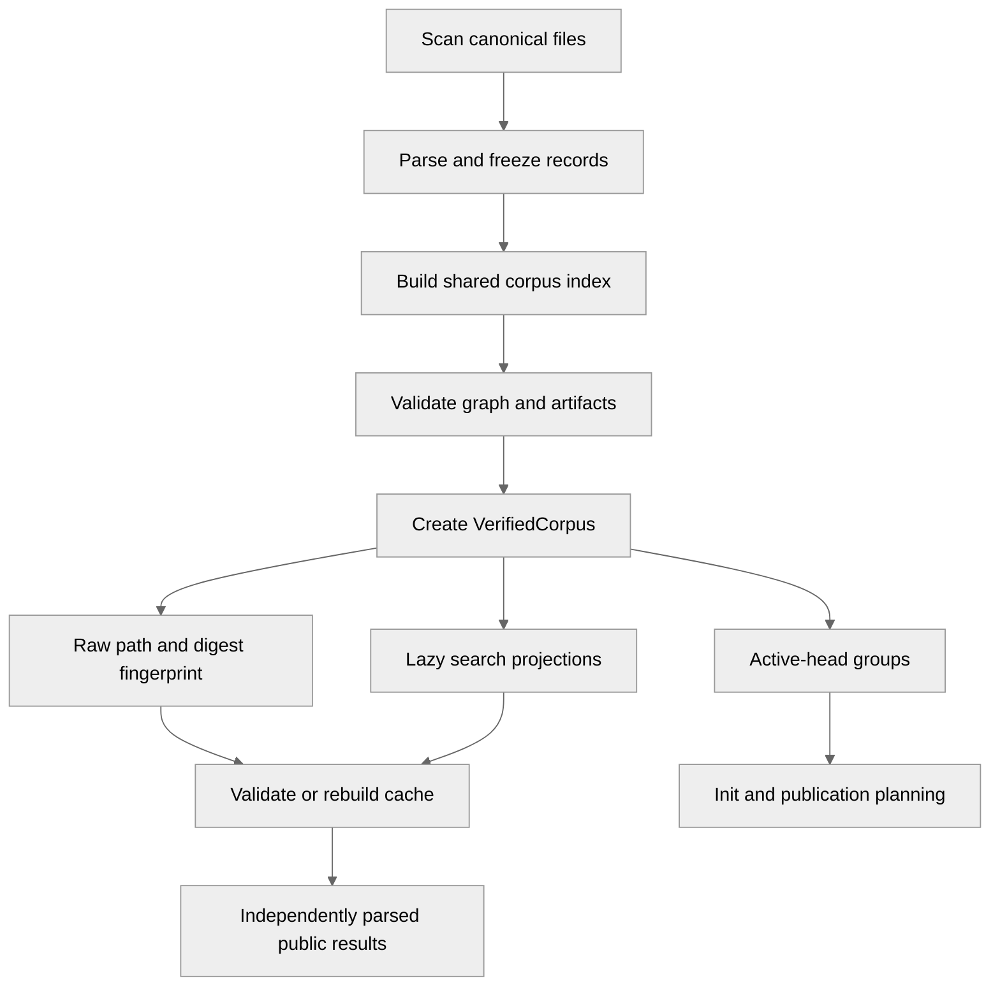

# Issue

**Title:** [MAR-2786] Reuse verified canonical corpus facts

## Description

## Summary

Reuse an immutable `VerifiedCorpus` throughout canonical validation and cache operations. Shared indexes and raw-file digest witnesses replace repeated graph derivation and recursive payload fingerprinting.

## Problem

Validation, generated-head allowances, init planning and cache writing independently rebuilt ID, supersession, active-head and artifact data. Cache equality also serialised and hashed the complete normalised payload corpus again after canonical files had already been hashed through verified descriptors.

## Design

- Build shared ID/case-path lookups, superseded/active membership and active-head groups with the existing validation order and budgets. Generated-head allowances and init planning consume those groups.
- Freeze canonical-owned payloads during the existing parser traversal. Keep public results independently mutable, and copy only newly published records when transferring ownership to the committed corpus.
- Retain exact raw digests, metadata, byte accounting and deterministic path order. Fingerprint framed path/digest pairs under a version-2 domain instead of recursively sorting payload keys.
- Derive summary, full search text and bounded preview once per accepted record when needed. Cache reads and writes reuse these projections; record JSON is serialised only for writing and is not retained as another corpus copy.
- Check writer predecessors as canonical subsets, including their own active flags and raw-member fingerprint. Full reads still require complete metadata/corpus equality and exact FTS bytes. Copied canonical metadata cannot conceal forged cached rows.
- Bind committed assertions to fixed publication evidence. Reuse a replacement corpus during cache recovery only after its generation assertion succeeds.

## Scope

Canonical records, schema parsing, cache validation/writing, init planning, focused regressions, contract/README corrections and durable architecture record `1228daeb-c260-4542-b798-9d828ce95cd9`.

## Deliberately excluded

No public exports, runtime dependencies, SQLite table-layout changes, filesystem-proof reductions, cache-row streaming redesign, benchmark-threshold changes or CI changes. The expected-FTS buffers remain for MAR-2787.

## Compatibility

Successful public API/CLI shapes, canonical files, validation issue order, graph budgets, init repair, retry limits and post-commit error handling remain intact. Schema version 3 remains current. Previous semantic fingerprints are incompatible with the raw-byte fingerprint and recover through the existing locked disposable-cache rebuild; canonical bytes are unchanged.

Retained-package checks passed in both directions. Current-main → candidate → current-main keeps schema 3 throughout, changes and restores the fingerprint, preserves identical list/show/search/compact/gather results and leaves all seven durable files byte-identical. The integrity-pinned published `encephalon@0.3.0` → candidate → published package check also passes (schema 2 → 3 → 2), preserving all six durable files, large nested payloads, Unicode search, payload-only matching and duplicate gather results.

## Performance

Base `7af3deeaafb945938c0ca310535d1bb80fea74d6` → head `669a669135a821ac49958a122e46e6f94d26228f`. Same Apple M5 Pro runner, macOS arm64, Node 26.5.0, accepted harness `7143ad061631aba5380340cebdd622c3c1052dd2ea5a861180b94dbb530531a2`, identical product-limit fixtures, two warmups and 20 alternating measured samples per side. All 600 raw reports and 53 comparisons passed. The required Linux CI comparison remains an independent merge gate.

| Workload (1,000 records) | Median ms, base → head | p95 ms, base → head | Peak RSS MiB, base → head |
|---|---:|---:|---:|
| coldHydrate | 716.78 → 712.81 | 748.63 → 730.99 | 151.66 → 164.22 |
| unchangedPrepare | 417.79 → 415.74 | 437.62 → 432.35 | 177.22 → 179.47 |
| stalePrepare | 972.67 → 977.46 | 1030.91 → 1040.71 | 193.84 → 193.62 |
| list | 418.12 → 415.62 | 429.31 → 426.14 | 177.30 → 177.70 |
| show | 418.89 → 415.99 | 440.34 → 430.10 | 178.66 → 179.95 |
| compactSearch | 429.05 → 425.33 | 442.18 → 455.96 | 180.28 → 180.59 |
| fullSearch | 426.00 → 420.51 | 438.28 → 430.29 | 178.83 → 178.92 |
| gather | 430.12 → 426.32 | 441.34 → 437.14 | 179.30 → 177.03 |
| largePayloadSearch | 426.23 → 424.66 | 437.15 → 437.26 | 177.41 → 176.86 |
| maximumPayloadSearch | 427.02 → 424.73 | 451.75 → 473.82 | 193.22 → 191.11 |
| payloadOnlySearch | 426.32 → 420.73 | 437.55 → 428.39 | 201.20 → 191.05 |
| missingSearch | 421.68 → 417.98 | 428.59 → 437.40 | 176.91 → 176.58 |
| listMaximum | 427.29 → 423.81 | 444.16 → 435.65 | 185.42 → 188.06 |
| validateArtifacts | 241.31 → 242.85 | 250.93 → 250.50 | 123.62 → 129.03 |
| strictCacheValidation | 419.22 → 415.46 | 426.25 → 428.39 | 177.30 → 179.70 |

Preparation/query-projection medians for duplicate-heavy gather: 285.25/7.15 ms → 280.02/7.74 ms. Cold-hydration total-time range/variance: 67.54 ms / 241.29 ms² → 33.09 ms / 72.38 ms². Raw samples and spread for all operations are retained.

Cache size remains 8,364,032 bytes. Controlled benchmark package sizes: JavaScript 905,167 → 913,327 bytes; declarations 25,957 → 26,529; tarball 363,112 → 365,646. All existing 15% median, 25% p95, 20% peak-RSS and 10% byte budgets remain unchanged.

Latency is approximately flat; this change does not claim a material measured speedup. Peak RSS varies from −5.05% to +8.28%, within the accepted regression budget. The structural reduction is directly covered: generated-head group writes fall to zero because validation reuses the accepted groups, and recursive whole-payload fingerprint normalisation/serialisation is removed. Existing projections and indexes now have one operation-local owner.

## Verification

All local gates passed on `669a669135a821ac49958a122e46e6f94d26228f`:

- `bun run build`, `bun run lint`, `bun run typecheck` (all four configurations).
- `bun run test`: 816 passed, three platform-specific skips, 52.03 seconds.
- `bun run test:tooling`: 91 passed.
- `bun run benchmark:check`, `bun run check:generated`.
- `node scripts/check-package.ts --retain-tarball package-artifacts`: retained candidate verified; 365,646 bytes, SHA-256 `32547f2cb4cf9af4677d0cde7c3a70dc7f308c4317aaa446c7024199df2db371`.
- `node scripts/check-publish.ts package-artifacts/encephalon-0.3.0.tgz`: existing-version publication guard passed; no publication.
- `node dist/cli.mjs validate --root .`: 45 valid canonical records.
- `git diff --check`.

Independent ChatGPT Pro implementation review found no substantiated correctness, security or compatibility defects. CI and an explicit Greptile 5/5 on the final head remain mandatory before merge.

The focused regressions cover raw-byte fingerprint changes and immutable shared facts, independently mutable public results, signed-zero predecessor reuse with changing active flags, copied-metadata cache forgery and removal of duplicate generated-head group work. Existing budget, error-order, init-repair and filesystem-race tests remain.

## Risk and rollback

Raw canonical whitespace changes now invalidate the disposable fingerprint deliberately. Predecessor-subset acceptance permits replacement only, never serving an incomplete target. Reverting this change restores the prior implementation; an older binary can rebuild its disposable cache from unchanged canonical records.

## Linear

[MAR-2786 — Build one reusable VerifiedCorpus per stable snapshot](https://linear.app/marcoappio/issue/MAR-2786/canonical-build-one-reusable-verifiedcorpus-per-stable-snapshot)

<!-- greptile_comment -->

<h3>Greptile Summary</h3>

The PR introduces an immutable `VerifiedCorpus` that centralizes canonical-record indexes, raw-byte fingerprints, artifact metadata, and lazily derived cache projections.

- Reuses validated active-head and supersession data during validation and initialization.
- Changes corpus fingerprints to frame canonical paths and raw-file digests under a version-2 domain.
- Validates cache rows against canonical corpus facts and rebuilds schema-version-3 caches with reusable projections.
- Preserves independent mutability of public records while freezing canonical-owned data.

<h3>Confidence Score: 5/5</h3>

The PR appears safe to merge with no concrete correctness, compatibility, or security failures identified.

The shared corpus remains bound to verified canonical observations, mutation paths incorporate newly published records before cache hydration, and cache reads still require complete metadata and row equality before serving results.

<h3>Important Files Changed</h3>

| Filename | Overview |
|----------|----------|
| src/records.ts | Builds and transfers immutable verified corpus facts while preserving validation, publication, and canonical-generation checks. |
| src/cache.ts | Reuses verified canonical records and projections for schema-version-3 cache validation and complete transactional rebuilds. |
| src/record-corpus-fingerprint.ts | Replaces recursive semantic serialization with a domain-separated fingerprint over ordered canonical paths and raw digests. |
| src/record-projection.ts | Centralizes lazily memoized summary, full-search text, and bounded-preview derivation. |
| src/init.ts | Reuses validated active-head groups and publication-bound verified corpora during baseline planning and cache preparation. |
| src/schema.ts | Adds immutable parsing support that recursively freezes canonical-owned records while leaving ordinary parsed results mutable. |

<h3>Flowchart</h3>

Reviews (1): Last reviewed commit: ["\[MAR-2786\] Reuse verified canonical corp..."]() | [Re-trigger Greptile](https://app.greptile.com/api/retrigger?id=62547338)

<!-- /greptile_comment -->

## Task

Modify the repository so that the issue described above is resolved. The repository is checked out at base commit `7af3deeaafb9`. Edit files in place; the verifier captures your changes via `git diff` and scores them against an oracle patch using SWE-RL-style diff-similarity reward.