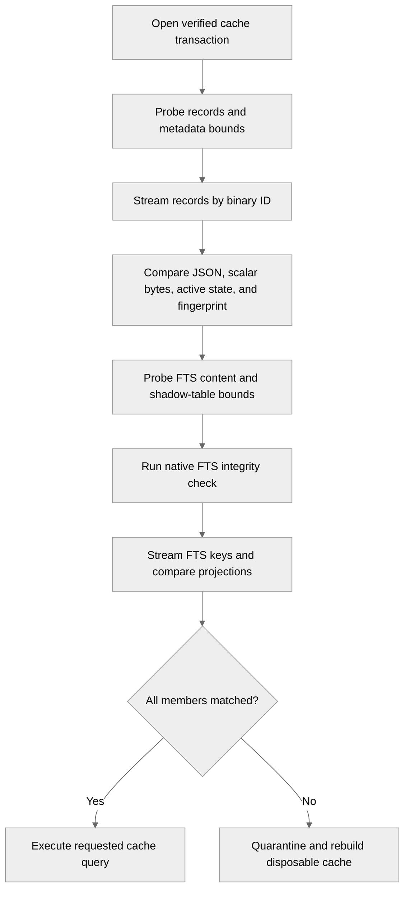

# Issue

**Title:** [MAR-2787] Stream strict cache and FTS equivalence

## Description

## Summary

Cache-backed reads currently retain a second parsed record corpus and a complete map of expected FTS buffers. This change compares records and search projections incrementally against the accepted immutable `VerifiedCorpus`, retaining only bounded membership and active-state information.

Native read-only FTS integrity checking now detects corrupt postings even when stored text still matches the canonical projection. Numeric shadow-storage admission bounds row counts, individual values and aggregate bytes before that check.

## Problem

Strict validation retains both canonical records and their parsed SQLite copies, plus every expected FTS body. The 1,000-record strict-read baseline peaks at 187,793,408 bytes.

## Design

Prepared SQLite predicates compare matching canonical JSON and scalar bytes without transferring document text. Alternative equivalent JSON retains the existing parser and equality checks. Validation and the requested query stay in the existing verified transaction. Direct-column `octet_length` bounds native inputs without loading whole values to count their bytes.

## Scope

- Stream records in primary-key order and sort only FTS IDs/rowids. Compare canonical JSON, scalar fields and search projection bytes inside SQLite; preserve the existing parser for equivalent alternate JSON representations.
- Preserve arbitrary canonical predecessor subsets for writer replacement, including their own active flags and path-ordered raw fingerprints.
- Generate strict-validation body/preview values without warming the corpus-wide memoised projections.
- Reject malformed cached UTF-8 that would otherwise decode to canonical replacement characters, while preserving previous lone-surrogate scalar behaviour.
- Add six complementary regressions for row lifetime, corrupt postings, native input admission, JSON normalisation and encoding boundaries.
- Replace the durable VerifiedCorpus architecture record with `89820a16-b53f-4109-acc8-c656c4fb2b06`.

## Deliberately excluded

Canonical/artifact proof-pass changes belong to MAR-2788. Schema minimisation and removal of `record_json` belong to MAR-2789. Existing proof passes, schema 3, search ranking and snippets remain unchanged.

## Compatibility

The synchronous ESM API, CLI output, Node 24.15.0 minimum, zero runtime dependencies and public product bounds remain unchanged. Minimum-Node tests against the integrity-pinned published `encephalon@0.3.0` passed upgrade and downgrade (schema 2 → 3 → 2), preserving all six durable files byte-for-byte. Packed CLI prepare/list/show/search/gather/hydrate each recovered from wrong postings with intact stored text.

## Performance

Base: `e84074679d3e585dd264db805bcdbf8844c03d3a`. Measured implementation: `5b39970d68dcd09215027f9082acf3daedd94929`. Final local head: `0f5b55ff88a9b01d364101fa3aa9d226ad747750`; its only additional change strengthens a regression test. Production source and benchmark harness are identical to the measured implementation.

One macOS arm64 runner, Node 26.5.0, identical accepted MAR-2784 harness and fixture, 20 alternating samples plus two warmups: 15 workloads, 600 raw reports, all 53 regression metrics passed. Harness SHA-256: `7143ad061631aba5380340cebdd622c3c1052dd2ea5a861180b94dbb530531a2`.

| Metric | Base | Head |
|---|---:|---:|
| Strict-read median | 417.939 ms | 419.388 ms |
| Strict-read p95 | 426.459 ms | 441.474 ms |
| Strict-read peak RSS | 187,793,408 B | 153,075,712 B |
| Cache size | 8,364,032 B | 8,364,032 B |
| Packed JavaScript | 913,327 B | 920,217 B |
| Declarations | 26,529 B | 26,734 B |
| Tarball | 365,646 B | 367,265 B |

Peak RSS fell **18.4872%**. Isaac accepted this measured improvement on 10 September 2026. Linear now records that acceptance for MAR-2787; the combined 30% target carries into MAR-2788 against the same pre-MAR-2787 baseline. Existing regression budgets remain unchanged.

## Verification

All local scripts passed: build, lint, four typechecks, 822 runtime tests (three existing skips), 91 tooling tests, representative benchmark, generated version, package/publish guard and canonical validation (46 records). Additional minimum-Node tests passed.

Maximum-writer admission evidence uses three 1,000-record corpora at 8,192,000 canonical bytes, including unique terms, repeated positions and Unicode expansion. All remain fresh after writing. Twenty-four overwrites of the unique-term corpus also pass; the largest observed posting storage is 53,034,722 bytes, below the admission budget.

- `bun run build`, `bun run lint`, `bun run typecheck`, `bun run test`, `bun run test:tooling`: passed. Fresh lint, all four typechecks and both test scripts also passed after the final test refinement.
- `bun run benchmark:check`, `bun run check:generated`, `node dist/cli.mjs validate --root .`, `git diff --check`: passed.
- `node scripts/check-package.ts --retain-tarball package-artifacts`: exact final-head package retained and verified, 367,265 bytes, SHA-256 `76fd621ed98542bffbd8397ecc53bccb1352af6d1f544bf023adba27cc7d03b5`.
- `node scripts/check-publish.ts package-artifacts/encephalon-0.3.0.tgz`: guard passed with the expected already-published-version refusal; no real publication.
- Matched benchmark audit: 600 raw reports, 53 metrics, no regression-budget violations.
- Native SQL byte-equality oracle: 108 cases on each of Node 24.15.0 and 26.5.0.
- Independent Pro review completed; native input-admission findings were corrected and verified.

Exact-head CI and Greptile 5/5 are required before merging, with the branch containing latest main.

## Risk and rollback

Native FTS admission can rebuild a disposable index whose accumulated storage exceeds its explicit resource budget. Representative maximum corpora and overwrite histories pass; these measurements are not a universal bound on every possible writer history. Malformed cache data follows bounded recovery or fails closed. Rollback restores the previous validator without a canonical migration.

## Linear

Linear: https://linear.app/marcoappio/issue/MAR-2787/cache-stream-strict-cache-and-fts-equivalence-against-verifiedcorpus

<!-- greptile_comment -->

<h3>Greptile Summary</h3>

The PR reduces strict cache-validation memory usage by streaming record and FTS comparisons against the immutable `VerifiedCorpus`.

- Compares canonical records and search projections incrementally inside SQLite.
- Validates FTS shadow-storage bounds and native index integrity before accepting cached search data.
- Preserves predecessor-subset fingerprints, active-state semantics, alternate JSON representations, and encoding boundaries.
- Adds focused regression coverage for row lifetimes, corrupt postings, bounds, normalization, and malformed UTF-8.

<h3>Confidence Score: 5/5</h3>

The PR appears safe to merge with no concrete blocking or independently actionable non-blocking issues identified.

The streaming record comparisons, predecessor-subset handling, encoding checks, and FTS integrity validation remain consistent with the cache writer and recovery contracts.

<h3>Important Files Changed</h3>

| Filename | Overview |
|----------|----------|
| src/cache.ts | Reworks strict cache equivalence into bounded streaming comparisons and adds native FTS integrity and shadow-storage admission checks; no actionable defect was established. |
| src/record-projection.ts | Exports existing projection helpers so strict validation can compute individual projections without warming corpus-wide memoized values. |
| test/cache.test.ts | Adds regressions covering iterator row lifetime, corrupt FTS postings, native-input bounds, JSON equivalence, and malformed encoding behavior. |
| encephalon/architecture/89820a16-b53f-4109-acc8-c656c4fb2b06.json | Records the streaming `VerifiedCorpus` cache-validation architecture and supersedes the previous durable architecture entry. |

<h3>Flowchart</h3>

Reviews (1): Last reviewed commit: ["\[MAR-2787\] Prove posting validation with..."]() | [Re-trigger Greptile](https://app.greptile.com/api/retrigger?id=62613906)

<!-- /greptile_comment -->

## Task

Modify the repository so that the issue described above is resolved. The repository is checked out at base commit `e84074679d3e`. Edit files in place; the verifier captures your changes via `git diff` and scores them against an oracle patch using SWE-RL-style diff-similarity reward.