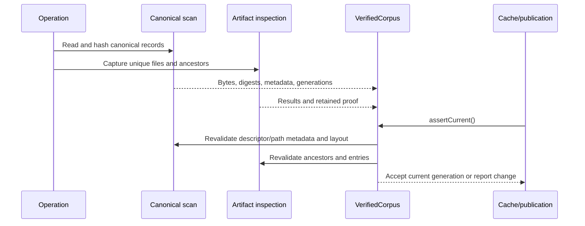

# Issue

**Title:** [MAR-2788] Reuse canonical and artifact filesystem evidence

## Description

## Summary

Reuse canonical byte and artifact filesystem evidence throughout each accepted operation. Unchanged canonical records are read and hashed once, and shared artifact ancestors are captured once.

## Problem

Closing checks repeatedly reread canonical files and rebuilt complete artifact inspection chains. A regression fixture read one canonical file four times across closing assertions; twelve artifacts sharing three directories captured those ancestors 72 times.

## Design

`VerifiedCorpus` owns the initial canonical bytes/digests, fixed generation evidence and one artifact proof. Canonical closing checks retain no-follow descriptor/path comparisons and bounded root/kind generation checks, without allocating another byte buffer or digest. An authorised cleanup-induced change time still requires byte/digest verification; rejected unreadable records still require readability probes.

The artifact proof interns exact pathname evidence and immutable parent-linked directory witnesses. Closing checks visit directories from parent to child, compare each unique leaf or invalid boundary, then return from child to parent. Conflicting observations never overwrite earlier evidence. Exceptional exits settle deferred ancestor checks while preserving primary-error and close-error precedence.

This removes copied ancestor chains, two result/error WeakMaps, repeated complete artifact inspection, and independent cache artifact checks. Query and publication boundaries reuse the same fixed proof.

## Scope

- Canonical, artifact and mutation-cache proof reuse.
- Complementary real-work counts and retained replacement/error regressions.
- Contract wording and append-only architecture record `06a643f1-d077-4556-91e8-0929bb6c3f34`.

## Deliberately excluded

SQLite schema/content projection changes, collection-observer removal, public API changes and build/CI restructuring remain in their later tickets.

## Compatibility

No canonical migration, cache schema change or public API/CLI shape change. The synchronous ESM API, Node 24.15 minimum, zero runtime dependencies and existing filesystem/retry bounds remain.

The exact retained candidate is 366,649 bytes, SHA-256 `766f7630857c1079aba81a3952ecede00c4f888be28df00c6470f7ef2ee97145`. The repository compatibility gate passed. An additional actual published-0.3.0 → candidate → 0.3.0 round trip passed on Node 24.15.0: cache schema 2 → 3 → 2, six durable files byte-identical, payload-only search and gather preserved. Published oracle SHA-256: `4632b0becf232ddad26fde3329bc1b5fcdf90d4b03c9ae7e8f49b4574d296072` (registry shasum/integrity verified). Six packed CLI operations recovered deliberately corrupted FTS postings. Another 32 packed CLI checks covered validate/list/show/search/gather/add/init/hydrate with unchanged, replaced and missing artifact evidence; all passed.

## Performance

Current-main base: `c4934ba6d724ad6ab7bf68170295b7cbb26506e7`.
Combined-target base: `e84074679d3e585dd264db805bcdbf8844c03d3a`.
Current PR head: `9c55103c6f82160235a141666c31d63ffbd1c718`. Measured runtime head: `e7dfe81339e624a7e3ceb834fbe4d147e0ed4056`. The only subsequent change makes the read-counter fixture use native Windows path resolution; runtime, benchmark and package inputs are unchanged, and the retained tarballs are byte-identical. Same Apple M5 Pro, macOS arm64, Node 26.5.0, unchanged harness `7143ad061631aba5380340cebdd622c3c1052dd2ea5a861180b94dbb530531a2`, 20 alternating measured samples plus two warmups per side. Fixture: 1,000 records, 100 artifacts, 100 large payloads, supersession depth 100, 3,580,039 canonical JSON bytes. All 53 ordinary regression metrics passed; 600 raw reports independently audited. Budgets unchanged: median 15%, p95 25%, RSS 20%, bytes 10%.

| Operation | Median ms | p95 ms | Peak RSS MiB |
| --- | ---: | ---: | ---: |
| coldHydrate | 724.97 → 217.16 | 746.72 → 242.95 | 164.78 → 131.14 |
| unchangedPrepare | 422.55 → 137.94 | 435.57 → 140.47 | 146.86 → 124.23 |
| stalePrepare | 966.99 → 292.91 | 986.94 → 296.52 | 193.11 → 149.36 |
| list | 417.62 → 132.74 | 435.74 → 140.97 | 147.83 → 124.59 |
| show | 417.86 → 132.18 | 438.91 → 138.83 | 146.42 → 125.70 |
| compactSearch | 417.83 → 134.92 | 426.43 → 138.46 | 146.03 → 125.02 |
| fullSearch | 421.02 → 135.93 | 433.73 → 139.63 | 149.75 → 126.58 |
| gather | 425.29 → 140.35 | 433.25 → 145.88 | 146.02 → 124.53 |
| largePayloadSearch | 426.48 → 137.88 | 460.74 → 141.16 | 148.31 → 124.64 |
| maximumPayloadSearch | 425.27 → 139.85 | 432.67 → 150.21 | 153.98 → 134.44 |
| payloadOnlySearch | 426.54 → 140.33 | 442.34 → 149.20 | 153.78 → 130.09 |
| missingSearch | 419.62 → 135.11 | 427.71 → 146.19 | 148.03 → 125.70 |
| listMaximum | 428.89 → 142.13 | 438.88 → 150.84 | 150.78 → 129.05 |
| validateArtifacts | 245.33 → 76.90 | 255.75 → 82.02 | 130.94 → 119.19 |
| strictCacheValidation | 419.29 → 134.21 | 428.23 → 142.12 | 146.75 → 125.89 |

- strictCacheValidation: preparation median 283.55 → 114.01 ms; query/projection 0.21 → 0.20 ms; total range 47.30 → 12.32 ms and variance 94.28 → 12.99 ms².
- validateArtifacts: preparation median 245.33 → 76.90 ms; query/projection 0.00 → 0.00 ms; total range 27.60 → 11.19 ms and variance 39.04 → 6.18 ms².
- gather: preparation median 281.58 → 113.28 ms; query/projection 7.20 → 6.96 ms; total range 13.65 → 9.49 ms and variance 13.48 → 5.46 ms².

Combined MAR-2787/MAR-2788 target passed in a separate matched large-validation comparison against e840: strict peak RSS **189,775,872 → 131,792,896 bytes (30.5534% reduction)**; median 418.67 → 133.42 ms, p95 447.87 → 139.95 ms. Independently audited 240 raw reports and 19 metrics; explicit ≥30% assertion passed.

Cache size remains 8,364,032 bytes (2.336× canonical JSON). Matched local tarball 367,265 → 366,649 bytes; JavaScript 920,217 → 916,337 bytes; declarations 26,734 → 26,546 bytes. Production source removes 51 net lines. Deterministic tests prove canonical reads/hashes 4 → 1 across repeated closing assertions and shared ancestor captures 72 → 3 for twelve artifacts, including duplicate references; unchanged add publication also reuses original record bytes.

## Verification

All local gates passed for the final production source:

- `bun install --frozen-lockfile`
- `bun run lint` and `bun run typecheck`
- `bun run test`: 826 passed, three platform skips, 53.21 seconds
- `bun run test:tooling`: 91 passed, 157.83 seconds
- `bun run build`, `bun run check:generated`, `bun run benchmark:check`
- `bun run check:package --retain-tarball package-artifacts`
- `bun run check:publish package-artifacts/encephalon-0.3.0.tgz` (dry run only)
- `bun run check:compatibility package-artifacts/encephalon-0.3.0.tgz`
- `node scripts/benchmark-compare.ts c4934ba6d724ad6ab7bf68170295b7cbb26506e7 e7dfe81339e624a7e3ceb834fbe4d147e0ed4056 <output> 20`
- `node scripts/benchmark-compare.ts e84074679d3e585dd264db805bcdbf8844c03d3a e7dfe81339e624a7e3ceb834fbe4d147e0ed4056 <output> 20 large-validation`
- Published-0.3 round trip and 32 targeted packed CLI checks on Node 24.15.0
- `node dist/cli.mjs validate --root .`: 47 records valid; `git diff --check`

Independent Pro design and implementation review completed. Reproduced and corrected conflicting path-role evidence, higher-ancestor replacement on operational failures, and deferred ancestor checks before late stat/close errors. Existing whole-attempt race/retry coverage remains. The first CI run exposed a Windows-only pathname alias in the new read-counter test: its direct snapshot used `realpathSync`, while the public API resolves through `realpathSync.native`. The fixture now uses the same native resolver; exact read/hash assertions remain. Full local verification passed again. The original head received Greptile 5/5; fresh cross-platform CI and an explicit Greptile 5/5 on the current head remain mandatory merge gates.

## Risk and rollback

Closing currentness compares complete retained filesystem metadata after initial byte verification. It does not claim to detect different bytes when the filesystem reports identical metadata. Every new operation still reads and hashes canonical content; no metadata-only trust is carried between operations. Reverting restores the previous proof sequence without a stored-data migration.

## Linear

[MAR-2788](https://linear.app/marcoappio/issue/MAR-2788/validation-collapse-repeated-canonical-and-artifact-proof-passes)

<!-- greptile_comment -->

<h3>Greptile Summary</h3>

The PR reuses operation-local canonical and artifact filesystem evidence to avoid repeated byte reads, hashing, and ancestor inspection while retaining closing currentness checks. The current head differs from the previously reviewed head only by aligning a Windows test fixture with the production native realpath resolver.
- Introduces reusable artifact inspections with interned ancestor and pathname evidence.
- Replaces repeated canonical byte verification with retained metadata, descriptor, and generation checks.
- Reuses canonical and artifact proof during mutation-cache recovery and publication.
- Updates contract documentation, architecture records, and race/error regression coverage.

<h3>Confidence Score: 5/5</h3>

The current head appears safe to merge.

No blocking failure remains; the sole change since the previously reviewed head corrects the Windows test fixture’s path resolution without changing production or package code.

<h3>Important Files Changed</h3>

| Filename | Overview |
|----------|----------|
| src/artifact-inspection.ts | Replaces repeated artifact reinspection and copied ancestor chains with one immutable inspection containing interned directory/entry evidence and a reusable currentness assertion. |
| src/records.ts | Reuses retained artifact evidence and canonical metadata witnesses across closing and publication checks, with digest verification retained for authorized cleanup-induced metadata changes. |
| src/cache.ts | Removes independent artifact rescans from mutation-cache rebuilding and delegates currentness checks to the validated snapshot’s retained proof. |
| test/artifact-inspection.test.ts | Adds coverage for shared ancestor capture, overlapping path roles, ancestor replacement, and operational-versus-change error precedence. |
| test/records.test.ts | Verifies one-read/one-hash behavior and uses `realpathSync.native` in the Windows-sensitive counter fixture to match production path resolution. |
| docs/contract.md | Documents the operation-local retained-proof model and its currentness guarantees. |
| encephalon/architecture/06a643f1-d077-4556-91e8-0929bb6c3f34.json | Records the architectural decision to reuse canonical corpus and filesystem evidence within an accepted operation. |

<h3>Sequence Diagram</h3>

Reviews (2): Last reviewed commit: ["\[MAR-2788\] Match native Windows paths in..."]() | [Re-trigger Greptile](https://app.greptile.com/api/retrigger?id=62649885)

<!-- /greptile_comment -->

## Task

Modify the repository so that the issue described above is resolved. The repository is checked out at base commit `c4934ba6d724`. Edit files in place; the verifier captures your changes via `git diff` and scores them against an oracle patch using SWE-RL-style diff-similarity reward.