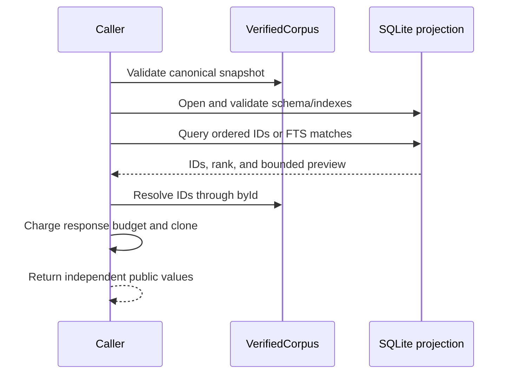

# Issue

**Title:** [MAR-2789] Reduce SQLite to its search and ordering projection

## Description

## Summary

Reduce the disposable SQLite cache to its search and ordering projection. Full records now come from the operation's accepted `VerifiedCorpus`, and the cache no longer stores or reparses complete record JSON.

## Problem

The previous cache duplicated canonical records alongside their FTS documents. Strict reads validated that duplicate store before materialising records from it, despite already holding the authoritative canonical snapshot.

## Design

- Retain integer row identity for FTS joins, public ID for canonical lookup, kind/subject for filters, created time for deterministic ordering, and active state for supersession filtering. Remove cached JSON, source, path and summary columns.
- Stream ordered IDs and resolve them through `VerifiedCorpus.byId`; charge the existing full-record byte budget before cloning independent public values. Compact search combines canonical metadata with the bounded FTS preview and existing rank.
- Keep FTS first in full and compact search joins. A query-plan regression covers the minimum Node/SQLite runtime, whose optimiser otherwise repeats MATCH for each active record.
- Use schema 4 with fixed application ID/user version and an exact, bounded comparison against the schema generated by the trusted writer on the running SQLite version. Remove the semantic DDL tokenizer and cached-record parser.
- Preserve strict scalar, active-state, generation and FTS equivalence. Verify ordinary index contents as well as FTS postings: an index with a missing entry must trigger recovery instead of silently omitting a canonical result.

## Scope

Minimal cache representation, canonical result materialisation, exact schema admission, old-cache recovery, complementary corruption/ordering/budget regressions, release compatibility schema expectations, and three append-only architecture records. The diff removes 591 net lines.

## Deliberately excluded

Gather duplicate pre-charging remains MAR-2790. Production work observers, bundle sharing and CI restructuring remain their subsequent tickets. Ordinary content-bearing FTS already meets the size target; no external/contentless FTS or new durability setting is introduced. WAL remains `synchronous=FULL`.

## Compatibility

Public API/CLI shapes, literal payload matching, rank, preview bounds, ordering, filters, null results, independent mutable values and limits remain compatible. Node 24.15.0 remains the minimum, with zero runtime dependencies. Existing filesystem identity, containment, sidecar, lock, quarantine and one-rebuild protections remain in place.

The exact retained candidate passes published 0.3.0 upgrade/downgrade (schema 2 → 4 → 2), previous-main upgrade/downgrade (3 → 4 → 3), and the existing published 0.2.0 gate (1 → 4 → 1). Canonical records and artifacts remain byte-identical across each migration. Previous-main full, compact and gather outputs compare exactly; six packed CLI operations also recover from forged FTS postings.

## Performance

Base: `b5203c6a49e0deb81a57d630487716633995f4d3`.
Head: `06c3d861a724ddb380a1ba561c7cf2702afa9467`.

Matched local campaign: Apple M5 Pro, darwin/arm64, Node v24.15.0; 20 measured rounds and two warm-ups per operation/side, unchanged harness `7143ad061631aba5380340cebdd622c3c1052dd2ea5a861180b94dbb530531a2`. Both sides use the same 1,000 records, 100 artifacts, 100 large payloads, supersession depth 100 and 3,580,039 canonical JSON bytes. All 600 raw reports and 53 metric comparisons pass.

**Target met:** total SQLite bytes 8,364,032 → 4,689,920 (**43.93% smaller**, required ≥30%); amplification 2.336× → 1.310×. Peak strict-read RSS 141,672,448 → 137,150,464 bytes (3.19% lower; required no increase).

| Operation | Median ms, base → head | p95 ms, base → head | Peak RSS bytes, base → head |
| --- | ---: | ---: | ---: |
| strictCacheValidation | 132.595 → 127.737 | 148.239 → 132.573 | 141,672,448 → 137,150,464 |
| list | 131.861 → 126.329 | 136.147 → 128.909 | 141,623,296 → 136,593,408 |
| show | 131.606 → 126.766 | 138.401 → 132.049 | 143,917,056 → 136,151,040 |
| fullSearch | 136.364 → 129.789 | 156.389 → 156.473 | 144,277,504 → 138,067,968 |
| gather | 139.953 → 133.916 | 145.446 → 137.957 | 142,639,104 → 137,068,544 |
| coldHydrate | 218.279 → 203.753 | 223.833 → 209.204 | 142,540,800 → 136,642,560 |

Strict-read total-time spread: range 28.082 → 7.112 ms; variance 49.382 → 3.563 ms². Median phase breakdown: list: preparation 110.418 → 105.494 ms, query/projection 0.330 → 0.209 ms; show: preparation 110.281 → 105.819 ms, query/projection 0.167 → 0.115 ms; fullSearch: preparation 112.094 → 106.905 ms, query/projection 2.718 → 0.667 ms; gather: preparation 111.637 → 106.737 ms, query/projection 7.009 → 6.166 ms.

javascriptBytes: 916,337 → 880,519 bytes; declarationBytes: 26,546 → 26,546 bytes; tarballBytes: 366,649 → 360,663 bytes.

Raw local evidence and independently checked acceptance floors are retained in `/private/tmp/encephalon-mar2789-matched-06c3d86-node24`. Exact-head CI will repeat the matched campaign on Linux and run platform correctness coverage.

## Verification

- `bun install --frozen-lockfile`.
- `bun run lint`, `bun run typecheck`, `bun run test` (827 passed, three platform skips), and `bun run test:tooling` (91 passed). Runtime tests took 54.0 seconds; tooling tests took 157.2 seconds locally.
- `bun run build`, `bun run check:generated`, `bun run check:package`, and `bun run benchmark:check`.
- `bun run check:package --retain-tarball package-artifacts`, then `bun run check:publish package-artifacts/encephalon-0.3.0.tgz` (dry run only) and `bun run check:compatibility package-artifacts/encephalon-0.3.0.tgz`.
- Additional Node 24.15.0 packed-package checks: published 0.3.0 and previous-main migration round trips, 32 CLI checks, and targeted schema/row-identity/index-integrity regressions.
- `node dist/cli.mjs validate --root .`: 50 valid canonical records; `git diff --check` passed.
- Independent review reproduced an ordinary-index omission; the regression failed before the native index check and passed afterwards. No unresolved local findings remain.

Retained candidate: 360,663 bytes; SHA-256 `eaffe29be64f33e3c1c46cd8960dc3c3b2cd0c93ec8893136f3fe28763fdd9c9`. All package gates use these exact bytes, including the minimum-runtime join-order correction.

## Risk and rollback

The first access rebuilds predecessor cache formats. Malformed projections or index contents follow existing bounded quarantine/rebuild recovery. Rollback restores the previous package, which rebuilds its own disposable schema; canonical data does not require migration.

## Linear

https://linear.app/marcoappio/issue/MAR-2789/cache-reduce-sqlite-to-the-minimal-search-and-ordering-projection

<!-- greptile_comment -->

<h3>Greptile Summary</h3>

The PR reduces SQLite to a disposable search and ordering projection while materialising authoritative records from the accepted canonical corpus.
- Replaces cached full-record JSON with integer-linked record and FTS projections.
- Adds exact schema, ordinary-index, FTS, and canonical-equivalence validation with recovery for predecessor or corrupted caches.
- Forces FTS-first execution for full and compact searches on the minimum supported SQLite runtime.
- Updates schema compatibility expectations and adds corruption, ordering, budget, and query-plan regressions.

<h3>Confidence Score: 5/5</h3>

The PR appears safe to merge.

No blocking failure remains.

<h3>Important Files Changed</h3>

| Filename | Overview |
|----------|----------|
| src/cache.ts | Replaces duplicated record storage with a strictly validated projection, resolves public records from VerifiedCorpus, and preserves FTS-first integer joins. |
| test/cache.test.ts | Adds and updates regressions for schema admission, projection integrity, corruption recovery, ordering, budgets, and minimum-runtime query plans. |
| scripts/release-compatibility.ts | Updates upgrade and downgrade compatibility assertions from cache schema 3 to schema 4. |
| scripts/release-compatibility.test.ts | Updates compatibility fixtures and expected migration reports for schema 4. |
| encephalon/architecture/07a820c8-c399-4c7c-8bbc-7a20be8683f0.json | Records the canonical-corpus and minimal-cache architecture decision. |
| encephalon/architecture/59c66755-8eb0-4808-91cd-5ccc26bcbccc.json | Records the requirement to validate ordinary SQLite indexes before trusting projected results. |
| encephalon/architecture/b7ab828a-ffcc-43f0-9640-5975cc515da1.json | Records the FTS-first join-order decision for the minimum supported runtime. |

<h3>Sequence Diagram</h3>

Reviews (2): Last reviewed commit: ["\[MAR-2789\] Keep FTS first on the minimum..."]() | [Re-trigger Greptile](https://app.greptile.com/api/retrigger?id=62692398)

<!-- /greptile_comment -->

## Task

Modify the repository so that the issue described above is resolved. The repository is checked out at base commit `b5203c6a49e0`. Edit files in place; the verifier captures your changes via `git diff` and scores them against an oracle patch using SWE-RL-style diff-similarity reward.