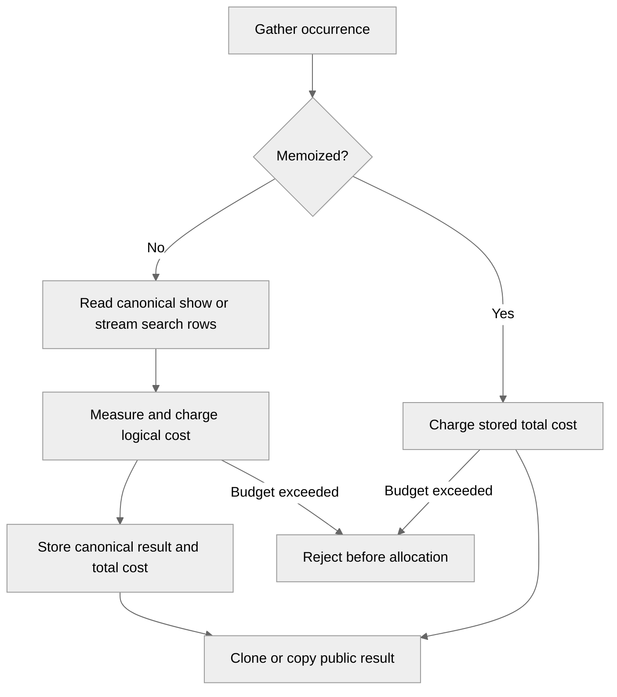

# Issue

**Title:** [MAR-2790] Reserve memoised gather output before cloning

## Description

## Summary

Gather now reserves the complete logical cost of a memoised occurrence before cloning its record or copying its search results. A rejected fifth large show previously cloned the record; it now stops after the four accepted clones. A rejected third large search previously started copying rows; it now rejects before creating that duplicate array.

## Problem

Exact-work memoisation avoided repeated queries but still recursively sized each duplicate output and allocated rejected copies before checking the shared 4 MiB response budget.

## Design

- Memoise the accepted canonical reference and complete show-envelope cost once per requested ID, including missing IDs. Charge each occurrence before cloning its independently mutable public record.
- Return the logical row-byte sum from the existing streaming compact reader. `chargeAndMeasure` keeps one sizing walk and the existing post-success test notification; standalone compact search retains its public array result.
- Charge a first search envelope before streaming its rows. Save that envelope cost plus the admitted row sum, then reserve the complete amount before copying each duplicate query result.
- Keep every memo, measured cost and ledger inside the verified attempt so recovery discards partial state together.

## Scope

Two production modules, one strengthened clone regression, one complementary compact-copy regression and architecture record `f15451c0-ff87-48d6-abb5-40f18accb8cf`.

## Deliberately excluded

No changes to SQL, cache schema, filesystem verification, public limits, canonical storage, benchmark fixtures or later-ticket work.

## Compatibility

The existing logical UTF-8/node/container accounting, exact 4 MiB acceptance, one-byte rejection, public error details, duplicates, ordering, nulls, empty searches, rank/snippet values and independent mutable results are preserved. The first distinct search remains checked row by row before retaining each result. Runtime dependencies remain zero; Node 24.15.0 remains supported.

Actual published 0.3.0 → candidate → 0.3.0 passes with schema 2 → 4 → 2 and all six durable files byte-identical. The exact preceding main package → candidate → preceding main passes with schema 4 throughout and identical full/compact/gather results. Packed CLI checks include six wrong-FTS recovery routes and 32 normal/replacement/missing-artifact checks, plus exact API/CLI equality at 64 shows and 16 searches, accepted near-limit duplicates and exact safe errors for rejected large duplicates. Publish verification is dry-run only.

## Performance

Matched final campaign against base `ad31ee4a3fac1186d0385a55620545702294a2bb` and head `5569fef04495a1aa9eed4d6e9fafc72d3574e967`: Apple M5 Pro, darwin/arm64, Node24.15.0; 20 measured samples plus two warmups per operation/side; unchanged harness `7143ad061631aba5380340cebdd622c3c1052dd2ea5a861180b94dbb530531a2`. Same 1,000 records, 100 artifacts, 100 large payloads, depth 100 and 3,580,039 canonical JSON bytes. All 600 raw reports and 53 metric comparisons pass.

| Operation | Median ms, base → head | p95 ms, base → head | Peak RSS bytes, base → head |
| --- | ---: | ---: | ---: |
| coldHydrate | 206.188 → 205.797 | 232.498 → 231.734 | 136,855,552 → 137,052,160 |
| unchangedPrepare | 135.517 → 137.170 | 153.209 → 147.639 | 138,477,568 → 139,902,976 |
| stalePrepare | 285.876 → 283.753 | 297.231 → 300.816 | 158,515,200 → 158,793,728 |
| list | 127.823 → 128.655 | 134.866 → 135.648 | 137,052,160 → 138,543,104 |
| show | 128.558 → 129.107 | 137.815 → 146.121 | 137,773,056 → 138,608,640 |
| compactSearch | 130.752 → 129.021 | 139.004 → 135.295 | 137,904,128 → 137,707,520 |
| fullSearch | 129.614 → 129.589 | 135.714 → 138.982 | 136,921,088 → 139,247,616 |
| gather | 134.382 → 134.473 | 141.213 → 138.921 | 138,346,496 → 137,461,760 |
| largePayloadSearch | 133.564 → 133.655 | 145.715 → 156.470 | 136,871,936 → 137,527,296 |
| maximumPayloadSearch | 134.210 → 135.172 | 140.311 → 143.518 | 148,324,352 → 146,046,976 |
| payloadOnlySearch | 133.338 → 133.983 | 144.723 → 140.578 | 149,880,832 → 147,144,704 |
| missingSearch | 128.159 → 128.485 | 133.254 → 133.666 | 137,641,984 → 137,822,208 |
| listMaximum | 145.142 → 143.137 | 160.249 → 157.769 | 145,965,056 → 143,179,776 |
| validateArtifacts | 77.363 → 78.353 | 84.599 → 83.088 | 126,369,792 → 128,450,560 |
| strictCacheValidation | 129.234 → 129.383 | 136.606 → 132.274 | 136,626,176 → 137,052,160 |

Gather median query/projection time: 6.191 → 5.948ms; preparation/integrity: 106.932 → 107.425ms. Total-time spread: range 36.334 → 10.350ms; variance 60.875 → 5.523ms².

1000:cache/totalBytes: 4,689,920 → 4,689,920; package/javascriptBytes: 880,519 → 881,633; package/declarationBytes: 26,546 → 26,546; package/tarballBytes: 360,663 → 360,919.

On the accepted 1,000-record fixture with 64 shows and 16 searches:

| Work/allocation evidence | Base | Candidate |
| --- | ---: | ---: |
| Logical-size node visits | 3,204 | 350 |
| Arrays/tuples created by object sizing | 3,236 | 351 |
| Distinct show lookups / search queries | 2 / 2 | 2 / 2 |
| Required successful record clones / compact-row copies | 32 / 280 | 32 / 280 |
| Maximum query-phase heap growth, 20 + 2 matched samples | 777,144 B | 225,848 B |

Sizing visits fall 89.08%; maximum query-phase heap growth falls 70.94%. Exact output hashes match. Counters exist only in isolated diagnostic source copies. The separate heap diagnostic uses uninstrumented exact sources, alternating fresh Node 24 processes and the accepted fixture; it collects garbage immediately before the existing result-read boundary and requires zero collections during the measured read. This supports the allocation result; ordinary latency/RSS acceptance uses the unchanged common benchmark harness.

## Verification

- Lint, all type checks, 828 runtime tests (three platform skips), 91 tooling tests, build, generated files, package checks, benchmark check and 51-record canonical validation pass.
- Both allocation regressions demonstrably fail on the actual base and pass on the candidate. Existing exact-boundary, Unicode, ordering/isolation, empty/missing memo and partial-recovery tests pass.
- Published/intermediate upgrade and downgrade checks, packed CLI checks and publish dry-run pass.
- Independent initial design and focused implementation reviews found no actionable defect; full local diff reviewed for scope and integration.
- Exact-head multi-platform CI and explicit Greptile 5/5 are required before merge, followed by successful merged-main CI.

## Risk and rollback

The main risk is omitting an envelope/container cost or reusing a mutable memo. Costs use the existing generic logical contract once per distinct value, first queries remain streamed, and exact-boundary/isolation/retry coverage exercises the composed result. Reverting this change restores the old composition without a data migration.

## Linear

[MAR-2790](https://linear.app/marcoappio/issue/MAR-2790/gather-charge-memoised-output-sizes-before-cloning-duplicate-results)

<!-- greptile_comment -->

<h3>Greptile Summary</h3>

Gather now measures and reserves each memoized show or search occurrence against the shared response budget before allocating its public copy.
- Memoizes canonical show references with their complete logical envelope cost.
- Streams and measures first-query compact rows, then precharges duplicate search results before copying them.
- Extends response-budget accounting with a combined charge-and-measure operation.
- Adds exact-boundary and rejected-allocation regression coverage.

<h3>Confidence Score: 5/5</h3>

The PR appears safe to merge; no concrete changed-code defect remains after checking accounting equivalence, caller compatibility, and result isolation.

The revised implementation preserves the existing logical response-byte contract while charging memoized occurrences before allocation, and all internal callers consume the new reader result shape correctly.

<h3>Important Files Changed</h3>

| Filename | Overview |
|----------|----------|
| src/cache.ts | Refactors gather show and compact-search memoization to reserve complete logical costs before cloning or copying while preserving streamed first-query accounting and independent outputs. |
| src/response-budget.ts | Adds chargeAndMeasure as a thin composition of existing logical sizing, budget charging, and post-success notification behavior. |
| test/cache.test.ts | Strengthens regressions to verify rejected duplicate shows and searches do not perform unnecessary clone or row-copy allocations. |
| encephalon/architecture/f15451c0-ff87-48d6-abb5-40f18accb8cf.json | Records the intended logical-accounting, memoization, allocation-order, isolation, and retry invariants. |

<h3>Flowchart</h3>

Reviews (1): Last reviewed commit: ["\[MAR-2790\] Reserve memoised gather outpu..."]() | [Re-trigger Greptile](https://app.greptile.com/api/retrigger?id=62723620)

<!-- /greptile_comment -->

## Task

Modify the repository so that the issue described above is resolved. The repository is checked out at base commit `ad31ee4a3fac`. Edit files in place; the verifier captures your changes via `git diff` and scores them against an oracle patch using SWE-RL-style diff-similarity reward.