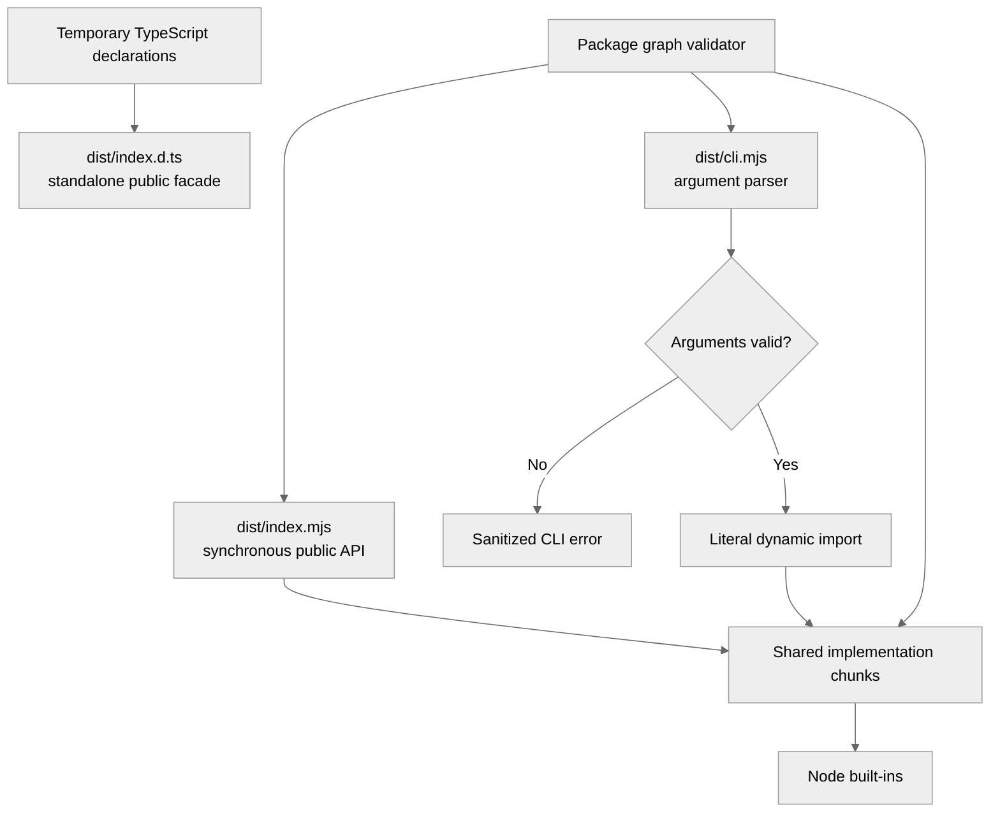

# Issue

**Title:** [MAR-2793] Share the API and CLI runtime graph

## Description

## Summary

Share the API and CLI runtime graph, load command implementations after CLI argument validation, and publish one public declaration facade. Combined JavaScript is 50.5% smaller than the audited build; matched help/version startup is 38.9%/36.9% faster with approximately 25% less peak RSS.

## Problem

The API and CLI duplicated almost the entire implementation, trivial commands evaluated the repository/cache runtime, and npm included 33 declaration files plus maintainer performance documents. Locale initialisation for the supersession count also consumed a material part of trivial-command startup.

## Design

- Bun still transpiles TypeScript; Rollup assembles one unminified ESM graph with stable public entries and contained hashed chunks. The existing cache/records cycle stays within one shared chunk. TypeScript 7 remains the compiler.
- The CLI parses and validates its own arguments before awaiting the selected existing implementation module. The existing error boundary catches both module-load failures and operation errors. The root API remains static and synchronous.
- Rollup's declaration plugin bundles TypeScript 7's temporary declaration output using its documented development-only TypeScript 6 API compatibility package. Only the supported root facade is published.
- Package verification follows actual static and lazy imports from the two entries, requires contained existing files or Node built-ins, rejects orphan outputs/private declarations, and retains the existing exact tarball byte/mode/metadata checks. Build output records source contributions without another persisted manifest.

## Scope

Build assembly, CLI loading and identical help formatting without locale initialisation; public declaration packaging; the npm file allowlist and README link; package graph/installed-bin checks; complementary loader and packaging regressions; the durable `build.shared-esm` architecture record.

## Deliberately excluded

Runtime algorithms, public API/CLI changes, persisted-data/schema changes, new public subpaths, CI restructuring (MAR-2794), the documentation reduction (MAR-2795), and release/version changes (MAR-2796).

## Compatibility

The package remains synchronous Node ESM with 11 root runtime exports, 19 public type exports, Node >=24.15.0, zero runtime dependencies, and the same CLI output/errors/limits. All private chunks remain directly in `dist`, preserving executing-package discovery. Published 0.2.0 and integrity-pinned actual 0.3.0 compatibility, immediate-main upgrade/downgrade parity, canonical/artifact byte preservation and packed CLI checks pass. The package checker also executes the installed npm bin/shim.

Bun 1.3.1's shared build emitted duplicate exports for mixed static/dynamic module reachability; the packed API gate rejected it. Rollup assembles the graph without changing the project's Bun or TypeScript compiler version.

## Performance

Base: `69711d9b25d71f83701b28a961a037f003f3244d`. Final head: `15072d9cdef457ed0cf85b09daff5c452990d235`.

Audited `1acd065b791523c1b438f44120b04af502f973a9` was independently built with the pinned tooling: 903,349 JavaScript bytes (444,299 API + 459,050 CLI). Candidate total: **447,080 bytes, -50.51%**, exceeding the 40% target. Against latest main: **864,217 -> 447,080 bytes, -48.27%**. Declarations: **26,316 -> 4,255 bytes; 33 files -> one**. The six emitted JavaScript files include each of 32 source implementations once.

Matched supplemental startup: same M5 Pro, Node 24.15.0, alternating base/candidate order, fresh processes, 20 measured samples and two discarded warmups per side/operation. Setup is excluded; no module tracing during measurement. Both sides use the same exit-only peak-RSS capture. Read-output parity normalises only its generated timestamp outside the timer.

| Operation | Median ms, base -> head | p95 ms, base -> head | Median peak RSS bytes, base -> head |
| --- | --- | --- | --- |
| Version | 33.712 -> 21.256 (-36.95%) | 42.500 -> 24.607 | 65,273,856 -> 48,873,472 |
| Help | 32.760 -> 20.026 (-38.87%) | 33.728 -> 20.554 | 65,216,512 -> 48,832,512 |
| Read | 40.129 -> 33.586 (-16.30%) | 41.347 -> 35.129 | 69,156,864 -> 60,588,032 |
| API import | 26.555 -> 26.936 (+1.43%) | 32.551 -> 31.080 | 57,622,528 -> 56,016,896 |

Both trivial-command startup and RSS targets pass. API import latency is effectively unchanged; its candidate maximum was 52.861 ms (base 33.484 ms), despite lower p95. Full raw distributions and 176 total supplemental samples are retained locally. The first candidate's 19.3% help improvement missed the target; removing measured locale initialisation cost produced the table above without weakening a threshold.

The unchanged common harness (SHA-256 `7143ad061631aba5380340cebdd622c3c1052dd2ea5a861180b94dbb530531a2`) passed **600 local raw reports / 53 comparisons** and **600 CI raw reports / 58 comparisons**, each with 20 measured samples plus two warmups, matching base/head and runner/Node within every pair. No regression budget changed or failed.

Local common comparison on Node 24.15.0/M5 Pro confirms help **34.252 -> 20.452 ms (-40.29%)**, version **33.750 -> 20.301 ms (-39.85%)**. Gather median **135.036 -> 135.496 ms (+0.34%)**, p95 **142.332 -> 140.327 ms**, peak RSS **136,069,120 -> 133,955,584 bytes**; preparation median **107.601 -> 107.712 ms**, query/projection **5.994 -> 6.014 ms**. Gather range **11.093 -> 9.894 ms**, variance **8.920 -> 5.187 ms²**. Strict validation median **128.988 -> 128.696 ms**, p95 **139.837 -> 143.519 ms**, peak RSS **133,709,824 -> 135,495,680 bytes (+1.34%)**. Cache size remains **4,689,920 bytes**. Local tarball **357,276 -> 262,283 bytes (-26.59%)**. All raw samples and preparation/query/spread data are retained.

Exact-head Linux arm64 CI operation pairs:

| Operation (1,000 records) | Median ms | p95 ms | Peak RSS MiB |
| --- | ---: | ---: | ---: |
| gather | 221.56 → 217.78 | 230.54 → 227.38 | 124.25 → 124.17 |
| maximumPayloadSearch | 226.41 → 229.29 | 237.88 → 239.59 | 132.79 → 133.18 |
| largePayloadSearch | 224.45 → 222.84 | 229.88 → 229.67 | 124.06 → 123.62 |
| coldHydrate | 291.40 → 291.98 | 302.01 → 302.22 | 129.35 → 129.28 |
| unchangedPrepare | 212.56 → 212.02 | 219.13 → 218.42 | 124.15 → 123.90 |
| stalePrepare | 392.47 → 389.72 | 407.91 → 404.51 | 146.87 → 147.02 |
| list | 215.97 → 214.72 | 224.86 → 221.03 | 123.75 → 124.17 |
| show | 216.11 → 216.82 | 220.37 → 224.89 | 124.04 → 124.01 |
| compactSearch | 210.99 → 214.47 | 220.06 → 222.30 | 122.07 → 123.57 |
| fullSearch | 206.90 → 206.07 | 212.46 → 212.31 | 123.98 → 124.03 |
| payloadOnlySearch | 222.57 → 218.86 | 226.46 → 226.82 | 131.60 → 133.04 |
| missingSearch | 213.00 → 214.59 | 220.71 → 220.64 | 123.93 → 124.04 |
| listMaximum | 224.10 → 224.54 | 227.29 → 229.10 | 123.52 → 125.29 |
| validateArtifacts | 128.67 → 127.73 | 134.38 → 132.46 | 119.79 → 119.37 |
| strictCacheValidation | 206.88 → 208.05 | 210.66 → 214.29 | 123.60 → 123.41 |

[CI run 34530997438](https://github.com/isaachinman/encephalon/actions/runs/34530997438), attempt one: **23/23 jobs passed in 5m07s**, longest job tooling **4m41s**; every job and the workflow were below ten minutes. Linux/macOS/Windows and minimum/current Node coverage passed, as did exact-candidate/release-equivalent checks. Greptile **5/5** on final head `15072d9cdef457ed0cf85b09daff5c452990d235`, review one, check `103051406905`, no unresolved findings.

## Verification

- Frozen install; lint; all four typechecks; complete runtime suite (817 passed, three skipped, 52.0 seconds) and tooling suite (91 passed, 160.8 seconds); build/generated/package/benchmark checks; 54 canonical records valid; diff hygiene. All passed before commit.
- Independent Pro review completed. Its declaration default-export bypass was reproduced with a failing mutation test, fixed, and followed by the full passing verification run.
- Two clean builds: all seven output paths, content hashes and modes identical. All 32 included source implementations occur in one chunk each.
- Actual packed help/version module traces load only the CLI, lightweight errors/budgets/version chunk and `node:util`. Source attribution excludes cache, SQLite, locking, init, baseline, instructions and mutation modules.
- One loader-guard regression covers trivial commands and invalid global/command options before filesystem/SQLite/crypto/child-process loading; it failed on the base and passes on the candidate. Two small graph/declaration tests cover missing, escaping and external imports, orphan exclusion and private declaration rejection.
- Existing packed API/CLI result-limit mutants still fail independently. Complete public declaration consumers check signatures, optional members and the error union. Orphan hashed chunks and private declarations are rejected by real package checks.
- Exact retained candidate: package validation, tarball-only publish dry run, published compatibility oracles, immediate-main parity, 32 packed CLI checks and canonical validation pass. No npm publication occurs.

Verification commands: `bun install --frozen-lockfile`, `bun run lint`, `bun run typecheck`, `bun run test`, `bun run test:tooling`, `bun run build`, `bun run check:generated`, `bun run check:package`, `bun run benchmark:check`, `node dist/cli.mjs validate --root .`, `git diff --check`; retained tarball `check:publish` and `check:compatibility`, plus actual 0.3/main parity and packed-CLI fixtures. All returned zero.

## Risk and rollback

The principal risk is module evaluation/order or packaging drift across supported operating systems; packed behavioural checks, source-attributed load traces and the existing OS/Node CI matrix cover those boundaries. Development-only build dependencies increase to support shared assembly and declarations; installed runtime dependencies remain zero. Reverting restores the prior package layout without changing stored data.

## Linear

https://linear.app/marcoappio/issue/MAR-2793

<!-- greptile_comment -->

<h3>Greptile Summary</h3>

The PR replaces duplicated API/CLI bundles with a shared Rollup-assembled ESM graph, defers CLI implementation loading until argument validation succeeds, and publishes one standalone declaration facade.

- Keeps the synchronous root API while lazily loading command-specific CLI implementations.
- Derives packaged runtime files from imports reachable from the API and CLI entries.
- Adds declaration and package-graph validation, installed-bin coverage, and loader regressions.
- Removes maintainer performance documents from the npm payload while retaining their repository documentation.

<h3>Confidence Score: 5/5</h3>

The PR appears safe to merge; no concrete correctness, security, packaging, or repository-rule issue remains.

The shared runtime graph remains reachable from both supported entries, CLI validation precedes lazy implementation loading, and the new package and declaration checks exercise containment, installed execution, and the complete public type facade.

<h3>Important Files Changed</h3>

| Filename | Overview |
|----------|----------|
| scripts/build.ts | Replaces independent Bun bundles with one Rollup ESM graph and bundles temporary declarations into a public facade. |
| src/cli.ts | Defers command implementation imports until after command-specific argument validation while preserving sanitized failures. |
| scripts/package-graph.ts | Traverses reachable runtime imports and verifies that the declaration facade contains exactly the root public exports. |
| scripts/package-preflight.ts | Derives the exact package allowlist from reachable runtime outputs and the standalone declaration facade. |
| scripts/package-graph.test.ts | Covers shared and lazy graph edges, containment failures, orphan exclusion, and invalid declaration facades. |
| test/cli.test.ts | Verifies help, version, malformed payloads, and invalid options avoid loading heavyweight runtime modules. |
| package.json | Adds development-only Rollup/declaration tooling and removes maintainer performance documents from npm packaging. |

<h3>Flowchart</h3>

Reviews (1): Last reviewed commit: ["\[MAR-2793\] Share the API and CLI runtime..."]() | [Re-trigger Greptile](https://app.greptile.com/api/retrigger?id=62803356)

<!-- /greptile_comment -->

## Task

Modify the repository so that the issue described above is resolved. The repository is checked out at base commit `69711d9b25d7`. Edit files in place; the verifier captures your changes via `git diff` and scores them against an oracle patch using SWE-RL-style diff-similarity reward.