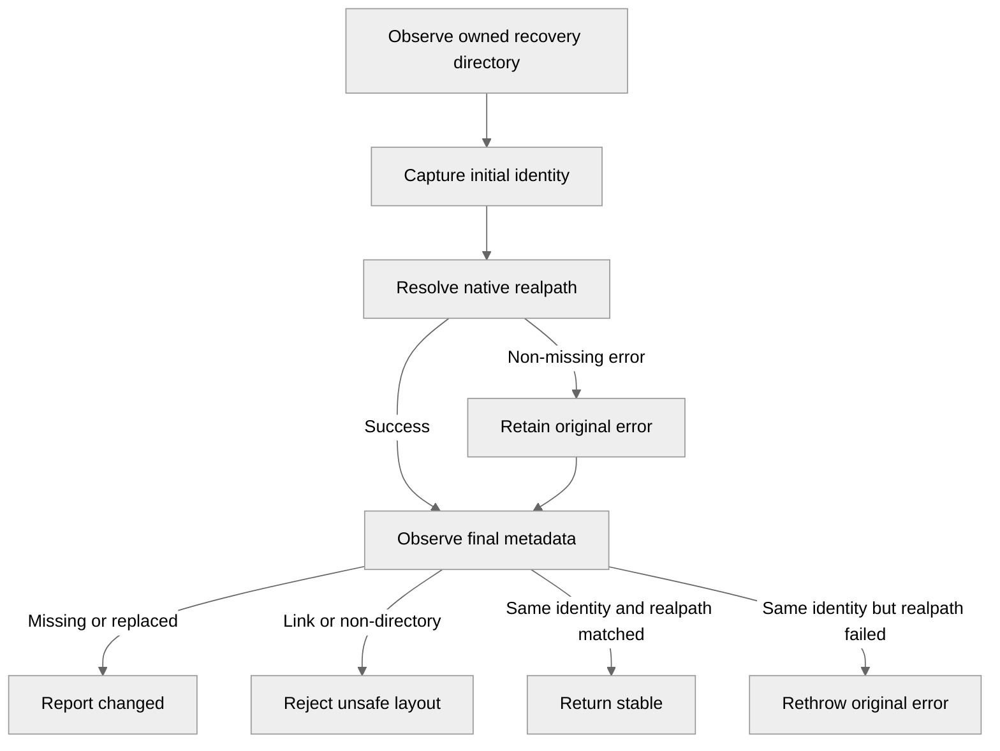

# Issue

**Title:** [MAR-2795] Reduce documentation to stable public contracts

## Description

## Summary

Replace the accumulated implementation narrative with a practical README and a concise normative public contract. Preserve the original documents and baseline byte-for-byte in Encephalon history, and execute the README walkthrough against the exact packed package. Correct the Windows recovery-observation race exposed by final CI, with a deterministic regression.

## Problem

Maintained documentation repeated private helpers, retired cache details and historical timings. Tests pinned that prose rather than the supported user workflow.

## Design

README owns installation and everyday commands; the contract owns public API/CLI, data formats, bounds, commit/recovery guarantees, privacy and compatibility. The performance guide owns contributor commands, unchanged regression policy and a freshly measured current baseline. Main-branch links are explicitly development documentation for the upcoming 0.4.0 release.

## Scope

| Document | Before | After | Reduction |
| --- | ---: | ---: | ---: |
| README | 35,495 bytes / 4,734 words | 9,915 bytes / 1,270 words | 72.1% bytes / 73.2% words |
| Public contract | 78,898 bytes / 10,358 words | 37,036 bytes / 4,853 words | 53.1% bytes / 53.1% words |

- Archive the original README, contract, implementation plan, performance guide and baseline under context record `3ae9fa5c-490d-4a55-b988-22609b49ba00`, with original paths, source commit and independently captured SHA-256 digests. Remove the active implementation plan.
- Preserve public diagnostic fields and distinct recovery actions, exact managed-block format, independent limits, strict cache equivalence and the supported filesystem boundary.
- Replace private-prose assertions with public sections/commands, explicit required documentation destinations and contributor-anchor checks and archive integrity checks. Reuse the package smoke consumer to run all 13 documented CLI commands and the literal API example; retain result-limit, Unicode, declaration and protocol coverage.
- Keep installed skill guidance operational: compact/fallback search, automatic preparation, committed-add recovery and shallow baseline enrichment.

## Deliberately excluded

No build, dependency, package whitelist, version, CI configuration or benchmark-harness changes. The sole runtime change is the CI-blocking recovery-observation correction described below, following the requirement to resolve flakiness before proceeding. No existing canonical record or artifact is rewritten. No real npm publication.

## Compatibility

Runtime JavaScript is 447,184 bytes and public declarations remain 4,255 bytes. The recovery fix changes runtime bytes; no dependency, public API, canonical format or ownership boundary changes. The selected candidate passed the actual pinned published 0.3.0 upgrade/downgrade and public-boundary checks. The development manifest remains 0.3.0 until MAR-2796; candidate identity is verified by digests and source commit, independently of its version.

## Performance

Base `a60fbf4028f999189820d948da5904e55ec16b5b` → final head `7ff026283455983a216f37300aad2c8036fe1253`. The unchanged harness `7143ad061631aba5380340cebdd622c3c1052dd2ea5a861180b94dbb530531a2` uses Node 24.15.0, 20 measured samples and two discarded warmups per operation/revision. Each campaign retains 600 raw reports. All 53 local and 58 CI comparisons pass; limits remain median 15%, p95 25%, peak RSS 20% and bytes 10%.

[Exact-head CI](https://github.com/isaachinman/encephalon/actions/runs/35005433694) passed all 25 jobs on its first attempt in **4m58s**; the longest job was Windows cache at **4m17s**. Every workflow and job remained below ten minutes. Representative CI results (milliseconds for latency, bytes for RSS):

| Operation | Metric | Base | Head | Change |
| --- | --- | ---: | ---: | ---: |
| gather | totalMs.median | 224.827 | 224.688 | -0.062% |
| gather | totalMs.p95 | 229.682 | 233.315 | 1.581% |
| gather | peakRssBytes.maximum | 130,162,688 | 129,773,568 | -0.299% |
| list | totalMs.median | 220.044 | 218.029 | -0.916% |
| list | totalMs.p95 | 227.041 | 226.22 | -0.362% |
| list | peakRssBytes.maximum | 129,298,432 | 130,347,008 | 0.811% |
| strictCacheValidation | totalMs.median | 208.68 | 209.134 | 0.217% |
| strictCacheValidation | totalMs.p95 | 215.482 | 214.092 | -0.645% |
| strictCacheValidation | peakRssBytes.maximum | 129,961,984 | 130,039,808 | 0.06% |

Local macOS arm64 confirmation completed in 279.968 seconds:

| Operation | Metric | Base | Head | Change |
| --- | --- | ---: | ---: | ---: |
| gather | totalMs.median | 142.883 | 143.117 | 0.164% |
| gather | totalMs.p95 | 150.346 | 151.138 | 0.527% |
| gather | peakRssBytes.maximum | 134,742,016 | 137,199,616 | 1.824% |
| list | totalMs.median | 138.654 | 136.129 | -1.82% |
| list | totalMs.p95 | 145.676 | 145.025 | -0.447% |
| list | peakRssBytes.maximum | 136,314,880 | 135,249,920 | -0.781% |
| strictCacheValidation | totalMs.median | 137.006 | 136.891 | -0.084% |
| strictCacheValidation | totalMs.p95 | 144.61 | 139.709 | -3.389% |
| strictCacheValidation | peakRssBytes.maximum | 135,168,000 | 133,791,744 | -1.018% |

The first local campaign failed only list p95: 221.688 → 304.563 ms (+37.383%). Its list median improved 4.522%; two isolated preparation/process-overhead spikes drove the tail. Those raw samples are preserved. One complete confirmation was run with no other task tests or builds running; all original samples were retained and no threshold, fixture, warmup count or harness changed. This result and CI's passing list p95 are consistent with local measurement noise; no runtime speed improvement is claimed.

README and contract shrink 72.1% and 53.1% by bytes. The actual candidate is 254,366 bytes versus the prior-main 263,323 bytes (-3.402%). Runtime JavaScript changes from 447,080 to 447,184 bytes (+0.023%); public declarations remain 4,255 bytes.

## Verification

- `bun run build`, `bun run lint`, `bun run typecheck`, `bun run test:all`, `bun run check:generated` and `node dist/cli.mjs validate` passed on Node 24.15.0. Full suite: 899 passed, three platform skips, 902 total in 149.5 seconds; canonical validation: 57 records, no errors.
- All five focused documentation checks passed. The five archived files equal their source-commit bytes and independently pinned digests; prior history remains unchanged.
- `node scripts/check-package.ts --retain-tarball package-artifacts`, metadata verification, repeated `--tarball` consumption, `node scripts/check-release-compatibility.ts package-artifacts/encephalon-0.3.0.tgz` and `node scripts/check-publish.ts package-artifacts/encephalon-0.3.0.tgz` passed. The actual pinned published 0.3.0 package is the compatibility oracle; publication was dry-run only.
- Local, CI producer and verified candidate tarballs are byte-identical: 254,366 bytes, SHA-256 `5a8fdc4d462135af12f0558f03a18c10011a8d36c8d48bf9bfa6b84ec3d8d66e`.
- `node scripts/benchmark-compare.ts a60fbf4028f999189820d948da5904e55ec16b5b 7ff026283455983a216f37300aad2c8036fe1253 <fresh-output-directory>` completed. Raw reports, statistics, thresholds and source/harness identities were independently recomputed for the passing local and CI campaigns.
- Primary-agent review and independent Pro review completed. Greptile review 3 explicitly gives **5/5 on 7ff026283455983a216f37300aad2c8036fe1253**, as shown in the current footer. Required exact-head CI is green.
- The unchanged Windows two-process contention test executed and passed in 1.492 seconds; the recovery-observation matrix executed and passed in 46.942 milliseconds. No retry, timeout increase or test skip was introduced.

## Risk and rollback

The main risk is documentation drift; packed examples execute the public workflow, and archived originals retain provenance. The recovery correction also changes error timing: an unchanged directory still throws the original native error, an independently changed identity invalidates the observation, and unsafe types remain rejected. Existing ownership checks protect later destructive actions. Roll back the code through a narrow revert if necessary; preserve append-only canonical history and its archive.

## Linear

Closes [MAR-2795](https://linear.app/marcoappio/issue/MAR-2795/documentation-reduce-maintained-documentation-to-stable-public). MAR-2796 begins only after this PR is merged, main CI and trusted promotion succeed, and Linear is reconciled.

## Review and CI corrections

The Markdown correction in `5777cdb` removes the handwritten link/slug parser and scopes the test to required public destinations. Greptile scored that head 5/5.

Final CI then exposed a Windows Node 24.15.0 `EBADF` in native realpath while two processes recovered the same malformed operation gate (run 34544376211, job 103093743835). The observer threw before its existing final directory-identity observation. Head `7ff026283455983a216f37300aad2c8036fe1253` defers a non-missing realpath exception until that observation: disappearance/replacement returns changed, while unchanged identity rethrows the original error. Final type/containment checks, destructive-operation ownership proofs and existing bounded retries remain in place. No timeout increase or test skip was added.

The existing regression now covers successful-but-mismatched paths, EBADF and EIO across moved, replaced, stable and non-directory successors. It failed before the fix and passes afterwards. An independent fault check also verified that a final lstat EIO remains the identical thrown error and preserves the directory. The original two-process exclusivity test passes locally and on Windows CI. Independent Pro review approved this approach; its suggested successor-type boundary is included.

Final-head CI passed and Greptile review 3 returned an explicit 5/5 on `7ff026283455983a216f37300aad2c8036fe1253`. Earlier scores are historical only.

<!-- greptile_comment -->

<h3>Greptile Summary</h3>

This PR replaces implementation-heavy documentation with a concise README and normative public contract, archives the original documents with provenance, strengthens package-walkthrough checks, and corrects recovery-directory observation after transient Windows realpath failures.
- Preserves the historical README, contract, implementation plan, performance guide, and baseline as immutable context artifacts.
- Keeps stable API, CLI, storage, recovery, privacy, compatibility, and operation-limit contracts in maintained documentation.
- Runs documented CLI and API examples against the packed candidate.
- Defers non-missing realpath failures until final directory identity is observed, preventing a removed or replaced recovery path from masking the race.

<h3>Confidence Score: 5/5</h3>

The PR appears safe to merge; no actionable defect remains in the recovery-observation correction or the documentation and package-verification changes.

The recovery helper still requires successful realpath verification before returning a stable owned directory, while disappearance and replacement are classified as changed and unsafe successor types are rejected. The previous Markdown-validation concern was manually resolved after the handwritten parser was removed, and the current scoped destination checks do not repeat that issue.

<h3>Important Files Changed</h3>

| Filename | Overview |
|----------|----------|
| src/cache-location.ts | Defers non-missing native-realpath exceptions until a final identity and type observation can distinguish a race from a stable operational failure. |
| test/cache.test.ts | Expands recovery observation coverage across path mismatches, EBADF/EIO failures, and moved, replaced, non-directory, and stable successors. |
| README.md | Replaces implementation narrative with installation, everyday workflow, recovery, API, privacy, compatibility, and contributor guidance. |
| docs/contract.md | Consolidates normative public API, CLI, data-format, limit, filesystem, recovery, and compatibility guarantees. |
| scripts/check-package.ts | Extends exact-packed-package verification for the documented public walkthrough. |
| test/package.test.ts | Verifies required documentation destinations and executes documented package-facing commands and API usage. |
| encephalon/context/3ae9fa5c-490d-4a55-b988-22609b49ba00.json | Records provenance and digests for the archived documentation snapshot. |

<h3>Flowchart</h3>

Reviews (3): Last reviewed commit: ["\[MAR-2795\] Recheck recovery identity aft..."]() | [Re-trigger Greptile](https://app.greptile.com/api/retrigger?id=62867232)

<h4>Context used (4)</h4>

- Knowledge Base — [Cache location and canonical layout](https://app.greptile.com/contract-lily/-/custom-context/knowledge-base/isaachinman/encephalon/-/docs/cache-layout-and-location.md)
- Knowledge Base — [Correctness, concurrency, and recovery](https://app.greptile.com/contract-lily/-/custom-context/knowledge-base/isaachinman/encephalon/-/docs/correctness-and-recovery.md)
- Knowledge Base — [Filesystem identity and bounded traversal](https://app.greptile.com/contract-lily/-/custom-context/knowledge-base/isaachinman/encephalon/-/docs/filesystem-identity-and-bounds.md)
- Knowledge Base — [Locking and durable recovery](https://app.greptile.com/contract-lily/-/custom-context/knowledge-base/isaachinman/encephalon/-/docs/locking-and-durable-recovery.md)

<!-- /greptile_comment -->

## Task

Modify the repository so that the issue described above is resolved. The repository is checked out at base commit `a60fbf4028f9`. Edit files in place; the verifier captures your changes via `git diff` and scores them against an oracle patch using SWE-RL-style diff-similarity reward.