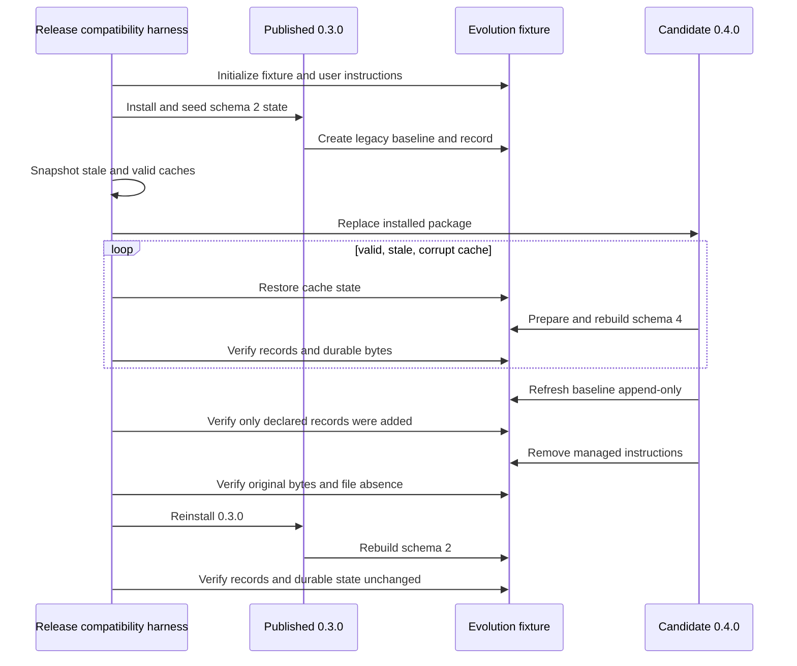

# Issue

**Title:** [MAR-2796] Prepare and verify the 0.4.0 release

## Description

## Summary

Prepare Encephalon 0.4.0 and verify the release against the immutable published 0.3.0 package. Package and generated versions move together; release notes describe the delivered runtime, snippet, baseline, cache, package and documentation changes. Historical changelog sections remain byte-identical.

## Problem

The existing immutable upgrade/downgrade roundtrip does not exercise an explicit baseline refresh or all three old-cache starting states. The release must prove these intentional changes preserve old canonical bytes and managed user instructions before publication.

## Design

Retain the existing API, CLI, declarations and independent-budget roundtrip unchanged. Add one evolution fixture using copies of the same three verified installations, without additional npm installs or another consumer matrix. Fresh subprocesses create real legacy language/file-count records, recover valid/stale/corrupt old caches, verify the exact payload-only snippet fallback, append a superseding baseline, restore managed instructions, and downgrade from cache schema 4 to 2. Cache snapshots are checkpointed after child exit and never replay process-owned locks. Durable snapshots allow only declared new baseline paths and the explicit instruction removal.

## Scope

- Bump package/generated versions to 0.4.0 and update the README/contract release descriptions.
- Add the published-oracle evolution probe and three complementary regressions for append-only changes, coherent SQLite snapshots and exact instruction restoration.
- Derive current candidate versions in existing package/preflight stand-ins while retaining the real 0.3.0 oracle and intentional mismatches.
- Prepare reproducible exact package bytes for the existing cross-platform release gates.

## Deliberately excluded

Runtime feature changes, dependency changes, new CI matrices, changed budgets and MAR-2574 are outside this diff. Real npm publication is reserved for the maintainer after merged-main verification; no GitHub Release is created. MAR-2796 remains open until post-publication registry verification.

## Compatibility

The actual published oracle is 361,046 bytes, SHA-1 `3dffeac3c66b60d398fb00eedd68243296c67b7b`, SHA-256 `4632b0becf232ddad26fde3329bc1b5fcdf90d4b03c9ae7e8f49b4574d296072`, integrity `sha512-wRDny+n6df42ZImjuqYNDOoi9PuoA5hRXPwaX7pXV4Nud3FqgSUEtK/CBQLtpLWpvqtrUn/cSlUIl/sX7OxGCA==`.

The synchronous ESM API, zero runtime dependencies, Node 24.15.0 floor and result limits 1–1000/default 20 remain intact. The selected candidate passes the full real-oracle API/CLI/declaration/budget roundtrip and schema 2 → 4 → 2. Existing canonical records and artifacts remain unchanged; explicit refresh appends 1 superseding baseline record. AGENTS.md retains its original CRLF bytes and missing final newline; an originally absent CLAUDE.md receives a managed-only block and is absent again after removal. Sequential downgrade is supported; concurrent mixed-version writers are not promised.

## Performance

Base `fb2f8146c1441d58bc6b2ebac1f39df6f220e22c`; head `1a5546f3f712ef380190498b27c7027727797075`. Frozen harness `7143ad061631aba5380340cebdd622c3c1052dd2ea5a861180b94dbb530531a2`, same machine and Node 24.15.0, 1,000 records, 15 operations, 20 measured samples and two warmups per side. All 600 raw reports and 53 local comparisons independently recomputed and passed. Thresholds remain median 15%, p95 25%, peak RSS 20%, bytes 10%; this release adds no runtime optimisation or new performance target.

| Operation | Median ms | p95 ms | Maximum RSS bytes |
| --- | --- | --- | --- |
| gather | 140.382 → 141.917 (1.09%) | 146.552 → 147.447 (0.61%) | 134709248.000 → 134397952.000 (-0.23%) |
| strictCacheValidation | 135.101 → 134.763 (-0.25%) | 145.550 → 142.225 (-2.28%) | 133251072.000 → 133693440.000 (0.33%) |
| compactSearch | 137.204 → 135.319 (-1.37%) | 145.184 → 143.868 (-0.91%) | 133595136.000 → 133447680.000 (-0.11%) |
| unchangedPrepare | 134.732 → 132.802 (-1.43%) | 140.554 → 138.651 (-1.35%) | 133529600.000 → 133136384.000 (-0.29%) |

- 1000:cache totalBytes: 4689920.000 → 4689920.000 (0.00%) bytes.
- package javascriptBytes: 447184.000 → 447184.000 (0.00%) bytes.
- package declarationBytes: 4255.000 → 4255.000 (0.00%) bytes.
- package tarballBytes: 254366.000 → 254348.000 (-0.01%) bytes.

## Verification

- `bun run lint`, `bun run typecheck`, `bun run test:all`: pass; 902 passed, 3 platform-specific skips, 0 failures in 144.7 seconds. The first full run exposed three stale 0.3.0 fixture filenames; those now derive the current generated version. No flaky rerun or weakened assertion.
- `bun run check:generated` and `node dist/cli.mjs validate`: pass; 57 canonical records valid.
- `node scripts/benchmark-compare.ts <base> <head> <output>`: all frozen local budgets pass; raw reports and independent audit retained outside the worktree.
- Generated-version check, `bun install --frozen-lockfile --ignore-scripts`, then two clean `bun run build` executions: identical complete dist manifests and literal tarball bytes before final selection.
- `node scripts/check-package.ts --retain-tarball package-artifacts`, then `--tarball package-artifacts/encephalon-0.4.0.tgz`: pass, including executable CLI, public declarations, Node-only consumers, README examples and limit boundaries.
- `node scripts/check-release-compatibility.ts package-artifacts/encephalon-0.4.0.tgz`: pass against the real published oracle, including all evolution states.
- `node scripts/check-publish.ts package-artifacts/encephalon-0.4.0.tgz`: exact-tarball dry run passed. Clean worktree before and after; selected bytes unchanged.
- Independent ChatGPT Pro design and final review: approved structure; no substantiated correctness defect. Its instruction-restoration coverage qualification is described explicitly above.
- Exact-head [CI 35012574867](https://github.com/isaachinman/encephalon/actions/runs/35012574867) passed all 25 jobs in 350 seconds; longest job 310 seconds. Node 24.15/current Node and Linux/macOS/Windows package consumers passed. All 600 raw CI benchmark reports and 58 comparisons were independently recomputed with unchanged thresholds. The CI producer is byte-identical to the locally selected candidate.
- Greptile review 1: explicit **5/5** on `1a5546f3f712ef380190498b27c7027727797075`, with no findings. Squash-merged as `306f95bc869b553a843cb5feb20e83d09b4b99ce` with the exact reviewed tree and expected latest-main parent. [Merged-main CI 35013292112](https://github.com/isaachinman/encephalon/actions/runs/35013292112) passed all 25 jobs on attempt 1 in 430 seconds (longest 384 seconds); all 600 raw reports / 58 CI comparisons passed independent recomputation. [Trusted promotion 35014011103](https://github.com/isaachinman/encephalon/actions/runs/35014011103) retained artifact 10414836134 only after successful main CI. Local, reviewed PR, main producer and trusted-promoted tarballs are byte-identical. The final exact-tarball publish dry run passed, and 0.4.0 was absent from npm at 2026-09-15T19:32:10.447Z. Manual publication and post-publication registry verification are the only remaining release steps; MAR-2796 stays open.

Selected tarball: 254348 bytes, SHA-256 `d3902d8f999a941e8ed829478d1a8ba4630c9c0406d991b23f639c47d44228e9`, npm integrity `sha512-WUyb55zSg1nVyHLpNKLUa77f/6c5EkuoLLcf1QWu+XtUPR/vRdv7fpc4hpya35lrx1lJss5zxWeCZAZhomGKoQ==`. Source commit `1a5546f3f712ef380190498b27c7027727797075`. All manifests, hashes and evidence are retained locally; the CI producer must match these exact bytes.

## Risk and rollback

Any compatibility, performance or byte-identity mismatch blocks publication. Before publication, correct defects through a new reviewed candidate. After publication, preserve immutable 0.4.0 registry bytes and use a later patch release for fixes. Cache rebuild/downgrade remains disposable; canonical history is not migrated or rewritten.

## Linear

https://linear.app/marcoappio/issue/MAR-2796/release-prepare-and-verify-encephalon-040-against-published-030

<!-- greptile_comment -->

<h3>Greptile Summary</h3>

This PR prepares the 0.4.0 release and expands compatibility verification against the immutable published 0.3.0 package.
- Synchronizes package and generated version metadata at 0.4.0.
- Adds an evolution probe covering schema 2 → 4 → 2, valid/stale/corrupt legacy caches, append-only baseline refresh, payload-only snippets, and exact instruction restoration.
- Updates release documentation and derives fixture versions from the generated package version.
- Adds focused regressions for durable baseline changes, coherent SQLite snapshots, and instruction-file byte preservation.

<h3>Confidence Score: 5/5</h3>

The PR appears safe to merge, with no concrete correctness, security, or repository-rule violations identified.

The release version updates are consistent, and the new compatibility harness coherently verifies cache recovery, append-only baseline evolution, instruction restoration, and sequential downgrade behavior.

<h3>Important Files Changed</h3>

| Filename | Overview |
|----------|----------|
| scripts/release-compatibility.ts | Integrates the published-oracle evolution lifecycle into the existing release compatibility harness. |
| scripts/release-evolution.ts | Defines cache snapshot helpers, append-only and instruction assertions, and the isolated evolution probe. |
| scripts/release-compatibility.test.ts | Adds focused regressions for baseline append-only behavior, SQLite snapshot restoration, and exact instruction restoration. |
| scripts/release-compatibility-process.test.ts | Updates candidate stand-ins and expectations to derive the current generated package version. |
| scripts/package-preflight.test.ts | Removes stale hard-coded package versions from preflight fixtures. |
| package.json | Advances the package version to 0.4.0. |
| src/generated/version.ts | Synchronizes the generated runtime version with package metadata. |
| CHANGELOG.md | Documents the runtime, cache, baseline, packaging, and compatibility changes delivered in 0.4.0. |

<h3>Sequence Diagram</h3>

Reviews (1): Last reviewed commit: ["\[MAR-2796\] Prepare and verify the 0.4.0 ..."]() | [Re-trigger Greptile](https://app.greptile.com/api/retrigger?id=64621730)

<!-- /greptile_comment -->

## Task

Modify the repository so that the issue described above is resolved. The repository is checked out at base commit `fb2f8146c144`. Edit files in place; the verifier captures your changes via `git diff` and scores them against an oracle patch using SWE-RL-style diff-similarity reward.