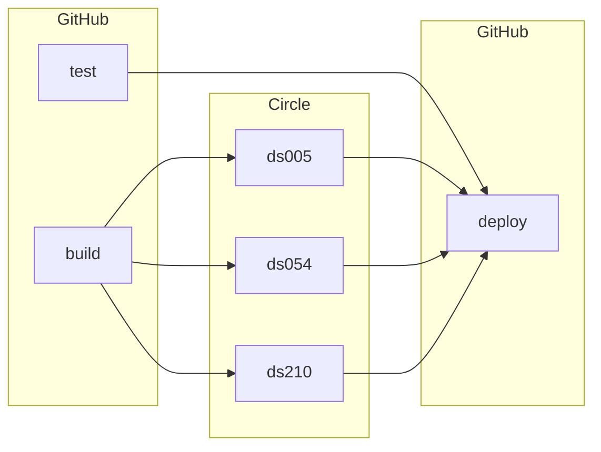

# Issue

**Title:** CI: Build docker images in GHA, store cache inline and push to GHCR

## Description

This PR is a potential model for nipreps using GHA to build Docker images. The latest build (from a previous commit's cache) took 2 minutes, including checkout, build and push. If the cache needs rebuilding, it's <10 minutes. This is a vast improvement from Circle all on its own.

I will make a separate PR to start triggering Circle builds from GHA after build. I would like to get to a model of:

Where Circle runs anything where we want inspectable artifacts and nothing else. For SDCflows, it would be tests again, but with artifact saving turned on.

## Task

Modify the repository so that the issue described above is resolved. The repository is checked out at base commit `52eee57be0d5`. Edit files in place; the verifier captures your changes via `git diff` and scores them against an oracle patch using SWE-RL-style diff-similarity reward.