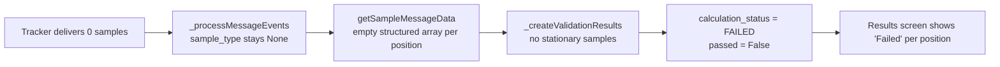

# Issue

**Title:** fix(iohub): Handle eye tracker validations that deliver no samples

## Description

`ValidationProcedure` no longer crashes with `IndexError` when the eye tracker delivers no samples during a validation, for example when the device is not plugged in or the tracker software is not running. The run now completes and every target position is marked `FAILED` with `passed = False`, the same result the procedure already gives for positions with too few good samples.

## Cause

`ValidationTargetRenderer._processMessageEvents` always read `self.saved_pos_samples[0][0].type`, which raises `IndexError` when the first position has no samples. With that line guarded, three more places in `psychopy/iohub/client/eyetracker/validation/procedure.py` failed on zero samples:

- `getSampleMessageData` gave empty positions an unstructured `float64` array, and `np.asanyarray(..., dtype=object)` stacked equal-length position arrays into a 2D object array. Either way `samplesforpos['targ_state']` raised `IndexError`. The stacking also happens in a normal run when all positions collect the same number of samples, or when there is only one position.
- Positions without stationary samples used `first_stime`, `last_stime`, `filter_stime` and `filter_etime` before assignment (`UnboundLocalError`).
- The `results_in_degrees` conversion accessed fields of empty arrays.

## Changes

- Take `sample_type`/`sample_msg_dtype` from the first position that has samples. If no samples arrive, print one line.
- Give empty positions an empty array with the structured sample dtype, and build the returned object array explicitly (`np.empty(n, dtype=object); arr[:] = ...`) so each position keeps its own dtype.
- Set the sample time-range fields to `None` for positions without stationary samples.
- Skip empty positions in the `results_in_degrees` conversion.

New tests in `psychopy/tests/test_iohub/test_validation_procedure.py` use canned per-position events and need no ioHub server or window. `testValidationNoEyeSamples` covers the zero-sample run and `testValidationEqualSampleCounts` covers the lost dtype. Both fail on the current code and pass with this change. I checked the object-array construction on numpy 1.23 and 2.5.

## Open choices

- This targets `release` because CONTRIBUTING.md says bug fixes go there. The reporter saw the bug on `dev`, and the commit applies cleanly to both.
- The no-samples message is a `print`, which matches how the procedure reports other user-facing messages. I can switch it to `logging` if you prefer.
- Not included: the issue also suggests aborting the experiment when `setRecordingState` fails. That changes device behaviour, so I left it for a separate decision.

## Task

Modify the repository so that the issue described above is resolved. The repository is checked out at base commit `9535622fbcaa`. Edit files in place; the verifier captures your changes via `git diff` and scores them against an oracle patch using SWE-RL-style diff-similarity reward.