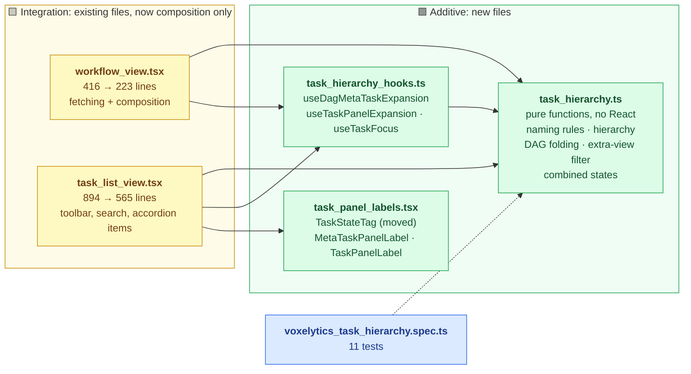

# Issue

**Title:** Refactor Voxelytics meta task handling into tested helpers and hooks

## Description

### Summary
Meta task handling in the Voxelytics workflow viewer was spread over `workflow_view.tsx` and `task_list_view.tsx`, with each place re-deriving the `a@b@c` hierarchy itself. This PR moves it into one module of pure, tested helpers, three focused hooks and the panel label components. The two view components are left to compose them.

Mostly a refactor. Two real bugs got fixed along the way, and one small behaviour changed (see *Does this change behaviour?* below).

 and #10179. Frontend only.

### The change at a glance



**What's moved and what's new.** Roughly 87 % of `task_panel_labels.tsx` and 53 % of `task_hierarchy.ts` are lines that already existed in the two old files. Most of what is new is in the hooks.

| Before | After | |
|---|---|---|
| `TaskStateTag`, panel header JSX | `task_panel_labels.tsx` | 📦 moved as-is |
| `aggregateTimes`, `aggregateTaskInfos` | `getMetaTaskInfo` + `getTaskInfo` (private) | 📦 moved as-is, split into the meta branch and the leaf branch |
| *(computed per panel on every render)* | `getTaskInfosWithHierarchy`, memoized | ✨ new: one bottom-up pass per report and run |
| `getTasksWithHierarchy` | same name | ✏️ rewritten: creates missing parent meta tasks, optional root for the extra view |
| `collapseReport` + `shouldCollapseId` + depth sort | `collapseMetaTasksInDag` | ✏️ rewritten: "fold into the outermost folded ancestor", no sort needed |
| `selectMetaTask` | `filterReportToMetaTask` | ✏️ rewritten, uses `isInMetaTask` |
| `expandedMetaTaskKeys` state + sync effect + toggle | `useDagMetaTaskExpansion` | ✏️ rewritten: the fold state is computed directly instead of synced in an effect |
| `expandedTasks` + collapse handlers | `useTaskPanelExpansion` | 📦 moved (from #10179) |
| location-state effect + scroll effect | `useTaskFocus` | 📦 moved (from #10178/#10179) |
| inline `select` in `useQuery` | `useCallback` | ✨ new (see *Is it faster or slower?* below) |

### Suggested review order
1. **`task_hierarchy.ts`** together with its spec: the rules, readable without any React.
2. **`task_hierarchy_hooks.ts`**: about 100 lines, the state.
3. **`workflow_view.tsx`** and **`task_list_view.tsx`**: mostly deletions plus wiring.
4. `task_panel_labels.tsx` can be skimmed. To see that it's moved code, run `git diff --color-moved=dimmed-zebra origin/master...HEAD`; GitHub's diff doesn't highlight moves.

### Questions you may have

<details>
<summary><b>Does this change behaviour?</b></summary>

Only in these ways; everything else is meant to be identical.

| | Before | After |
|---|---|---|
| 🐛 Fold `segment` in the DAG, or open `?metatask=segment` | tasks like `segmentation` were included, because the check was `startsWith("segment")` | only tasks inside `segment@…` |
| 🐛 A meta task containing only nested meta tasks (`a@b@c`, no `a@x`) | `a@b` was shown at the top level | nested under `a` |
| First render of a workflow with meta tasks | DAG briefly unfolded, then folded by an effect | folded from the first render |
| Leave the extra view ("Show entire workflow") | the opened meta task stayed unfolded in the DAG | it folds back. Meta tasks you unfolded yourself stay unfolded. |

**Checked against master:** I opened the same 4 pages on this branch and on master's frontend, against the same backend: two synthetic workflows (consolidated view and a single run) and one real `infer_with_neuron_model` workflow. Every task header (state, timing text) and every DAG node matched exactly. The nested extra view (`?metatask=segment@postprocess`) also matches master.

</details>

<details>
<summary><b>Why compute the DAG fold state instead of syncing it?</b></summary>

The old code kept a `Record<metaTaskKey, boolean>` and filled it in an effect after every report change. The DAG folding then depended on the record's key order, so it had to be re-sorted by nesting depth on every toggle. Now only the user's toggles are stored, and `isMetaTaskExpanded(key)` is computed from them and `?metatask=`. That removes the effect, the brief unfolded first render and the sort.

</details>

<details>
<summary><b>What was the "load-bearing quirk"?</b></summary>

While testing I found that the old hierarchy builder's habit of putting orphaned nested meta tasks at the top level was what made the extra view work for a nested meta task. The filtered report no longer contains the parent meta task, so the old builder happened to put the opened meta task at the top. The new builder gets an explicit `rootMetaTask` instead, and the DAG treats the opened meta task's parents as unfolded. That's covered by a test, and I checked it in the browser.

</details>

<details>
<summary><b>Is it faster or slower?</b></summary>

Faster, though it was never slow enough to notice.
- **Combined states:** `aggregateTaskInfos` used to run recursively for every accordion item on every render (search keystrokes, polling), so nested meta tasks were re-aggregated at every level. They're now computed once per report and run.
- **`select`:** `useQuery`'s `select` was an inline function, so React Query re-ran it (re-parsing the report and creating new objects) on every `WorkflowView` render. That invalidated every memo below it.

</details>

<details>
<summary><b>What's tested, and what isn't?</b></summary>

- **Unit tests (11):** the naming rules, the hierarchy (including the extra-view root), the DAG folding (outermost ancestor, no self-edges, the prefix bug), the extra-view filter and the combined states (nested meta tasks, single-run view).
- **Hooks:** not unit-tested. I tested them by hand in the browser with the data below:
  - follow a Runs link to a task inside a nested meta task
  - "Collapse All", then history back and forward: the task re-expands
  - toggle a top-level panel: nested panels stay open
  - "Expand in DAG" on both nesting levels
  - click a nested DAG node after "Collapse All"
  - extra view, including a Runs link inside it (keeps `?metatask=`) and "Show entire workflow"

</details>

<details>
<summary><b>What's deliberately out of scope?</b></summary>

`TaskView`, `DAGView`, the MiniSearch filtering and the toolbar are unchanged. The task filter input is uncontrolled, so it doesn't visibly clear when a task is focused. That behaviour already exists on master and isn't changed here.

</details>

### Steps to test:
- Create the test data (snippet below), then open `/workflows/synthmeta01`.
- Open `segment` → `segment@postprocess` → `segment@postprocess@mesh` → Runs, and click another run. On the target run, all three panels are open and scrolled into view.
- Click "Collapse All", then use browser back and forward: the task re-expands.
- Use "Expand in DAG" on `segment`, then on `segment@postprocess`. Each level unfolds separately in the DAG.
- Click "Open in extra View" on `segment@postprocess`. The DAG and list show only its two tasks, and "Show entire workflow" folds the DAG back.

<details>
<summary>SQL: workflow <code>synthmeta01</code> with nested meta tasks and 3 runs (for the default dev DB, <code>sample_organization</code>)</summary>

| Task | meta-initial | meta-rerun-failed | meta-rerun-fixed |
|---|---|---|---|
| download | completed | skipped | skipped |
| segment@predict | completed | skipped | skipped |
| segment@postprocess@agglomerate | completed | completed | skipped |
| segment@postprocess@mesh | completed | **failed** | completed |
| export | completed | skipped | completed |

Run with `psql -h localhost -U postgres webknossos -f synthmeta.sql`. It's a single transaction, and every row is tied to `workflow_hash = 'synthmeta01'`.

```sql
BEGIN;
INSERT INTO webknossos.voxelytics_workflows VALUES ('sample_organization', 'synthmeta01', 'synthetic_nested_meta_tasks');
INSERT INTO webknossos.voxelytics_runs (_id,_organization,_user,name,username,hostname,voxelyticsVersion,workflow_hash,workflow_yamlContent,workflow_config,beginTime,endTime,state) VALUES ('6ad20000000000005e7a0000','sample_organization',(SELECT _id FROM webknossos.users WHERE _organization = 'sample_organization' ORDER BY created LIMIT 1),'meta-initial','synthetic-user','synthetic-host','0.0.0-synthetic','synthmeta01','# synthetic workflow with nested meta tasks
','{"paths": [], "schema_version": 1, "global_parameters": {}}','2026-10-13T09:00:00+00:00','2026-10-13T11:31:00+00:00','COMPLETE');
INSERT INTO webknossos.voxelytics_tasks (_id,_run,name,task,config,beginTime,endTime,state) VALUES ('6ad20000000000005e7a0001','6ad20000000000005e7a0000','download','Download','{"config": {"name": "download"}, "inputs": {}, "description": "Synthetic `Download` task.", "distribution": {}, "output_paths": {}}','2026-10-13T09:05:00+00:00','2026-10-13T09:30:00+00:00','COMPLETE');
INSERT INTO webknossos.voxelytics_artifacts (_id,_task,name,path,fileSize,inodeCount,version,metadata) VALUES ('6ad20000000000005e7a0002','6ad20000000000005e7a0001','dataset','/synthetic/synthmeta01/download',1048576,3,'1','{"links": {}, "iframes": {}, "attributes": {}}');
INSERT INTO webknossos.voxelytics_tasks (_id,_run,name,task,config,beginTime,endTime,state) VALUES ('6ad20000000000005e7a0003','6ad20000000000005e7a0000','segment@predict','Predict','{"config": {"name": "predict"}, "inputs": {"data": "download:dataset"}, "description": "Synthetic `Predict` task.", "distribution": {}, "output_paths": {}}','2026-10-13T09:35:00+00:00','2026-10-13T10:00:00+00:00','COMPLETE');
INSERT INTO webknossos.voxelytics_artifacts (_id,_task,name,path,fileSize,inodeCount,version,metadata) VALUES ('6ad20000000000005e7a0004','6ad20000000000005e7a0003','probabilities','/synthetic/synthmeta01/segment@predict',1048576,3,'1','{"links": {}, "iframes": {}, "attributes": {}}');
INSERT INTO webknossos.voxelytics_tasks (_id,_run,name,task,config,beginTime,endTime,state) VALUES ('6ad20000000000005e7a0005','6ad20000000000005e7a0000','segment@postprocess@agglomerate','Agglomerate','{"config": {"name": "agglomerate"}, "inputs": {"probs": "segment@predict:probabilities"}, "description": "Synthetic `Agglomerate` task.", "distribution": {}, "output_paths": {}}','2026-10-13T10:05:00+00:00','2026-10-13T10:30:00+00:00','COMPLETE');
INSERT INTO webknossos.voxelytics_artifacts (_id,_task,name,path,fileSize,inodeCount,version,metadata) VALUES ('6ad20000000000005e7a0006','6ad20000000000005e7a0005','segmentation','/synthetic/synthmeta01/segment@postprocess@agglomerate',1048576,3,'1','{"links": {}, "iframes": {}, "attributes": {}}');
INSERT INTO webknossos.voxelytics_tasks (_id,_run,name,task,config,beginTime,endTime,state) VALUES ('6ad20000000000005e7a0007','6ad20000000000005e7a0000','segment@postprocess@mesh','Mesh','{"config": {"name": "mesh"}, "inputs": {"seg": "segment@postprocess@agglomerate:segmentation"}, "description": "Synthetic `Mesh` task.", "distribution": {}, "output_paths": {}}','2026-10-13T10:35:00+00:00','2026-10-13T11:00:00+00:00','COMPLETE');
INSERT INTO webknossos.voxelytics_artifacts (_id,_task,name,path,fileSize,inodeCount,version,metadata) VALUES ('6ad20000000000005e7a0008','6ad20000000000005e7a0007','meshes','/synthetic/synthmeta01/segment@postprocess@mesh',1048576,3,'1','{"links": {}, "iframes": {}, "attributes": {}}');
INSERT INTO webknossos.voxelytics_tasks (_id,_run,name,task,config,beginTime,endTime,state) VALUES ('6ad20000000000005e7a0009','6ad20000000000005e7a0000','export','Export','{"config": {"name": "export"}, "inputs": {"segmentation": "segment@postprocess@agglomerate:segmentation"}, "description": "Synthetic `Export` task.", "distribution": {}, "output_paths": {}}','2026-10-13T11:05:00+00:00','2026-10-13T11:30:00+00:00','COMPLETE');
INSERT INTO webknossos.voxelytics_artifacts (_id,_task,name,path,fileSize,inodeCount,version,metadata) VALUES ('6ad20000000000005e7a000a','6ad20000000000005e7a0009','export','/synthetic/synthmeta01/export',1048576,3,'1','{"links": {}, "iframes": {}, "attributes": {}}');
INSERT INTO webknossos.voxelytics_runs (_id,_organization,_user,name,username,hostname,voxelyticsVersion,workflow_hash,workflow_yamlContent,workflow_config,beginTime,endTime,state) VALUES ('6ad20000000000005e7a000b','sample_organization',(SELECT _id FROM webknossos.users WHERE _organization = 'sample_organization' ORDER BY created LIMIT 1),'meta-rerun-failed','synthetic-user','synthetic-host','0.0.0-synthetic','synthmeta01','# synthetic workflow with nested meta tasks
','{"paths": [], "schema_version": 1, "global_parameters": {}}','2026-10-14T09:00:00+00:00','2026-10-14T10:01:00+00:00','FAILED');
INSERT INTO webknossos.voxelytics_tasks (_id,_run,name,task,config,beginTime,endTime,state) VALUES ('6ad20000000000005e7a000c','6ad20000000000005e7a000b','download','Download','{"config": {"name": "download"}, "inputs": {}, "description": "Synthetic `Download` task.", "distribution": {}, "output_paths": {}}',NULL,NULL,'SKIPPED');
INSERT INTO webknossos.voxelytics_tasks (_id,_run,name,task,config,beginTime,endTime,state) VALUES ('6ad20000000000005e7a000d','6ad20000000000005e7a000b','segment@predict','Predict','{"config": {"name": "predict"}, "inputs": {"data": "download:dataset"}, "description": "Synthetic `Predict` task.", "distribution": {}, "output_paths": {}}',NULL,NULL,'SKIPPED');
INSERT INTO webknossos.voxelytics_tasks (_id,_run,name,task,config,beginTime,endTime,state) VALUES ('6ad20000000000005e7a000e','6ad20000000000005e7a000b','segment@postprocess@agglomerate','Agglomerate','{"config": {"name": "agglomerate"}, "inputs": {"probs": "segment@predict:probabilities"}, "description": "Synthetic `Agglomerate` task.", "distribution": {}, "output_paths": {}}','2026-10-14T09:05:00+00:00','2026-10-14T09:30:00+00:00','COMPLETE');
INSERT INTO webknossos.voxelytics_tasks (_id,_run,name,task,config,beginTime,endTime,state) VALUES ('6ad20000000000005e7a000f','6ad20000000000005e7a000b','segment@postprocess@mesh','Mesh','{"config": {"name": "mesh"}, "inputs": {"seg": "segment@postprocess@agglomerate:segmentation"}, "description": "Synthetic `Mesh` task.", "distribution": {}, "output_paths": {}}','2026-10-14T09:35:00+00:00','2026-10-14T10:00:00+00:00','FAILED');
INSERT INTO webknossos.voxelytics_tasks (_id,_run,name,task,config,beginTime,endTime,state) VALUES ('6ad20000000000005e7a0010','6ad20000000000005e7a000b','export','Export','{"config": {"name": "export"}, "inputs": {"segmentation": "segment@postprocess@agglomerate:segmentation"}, "description": "Synthetic `Export` task.", "distribution": {}, "output_paths": {}}',NULL,NULL,'SKIPPED');
INSERT INTO webknossos.voxelytics_runs (_id,_organization,_user,name,username,hostname,voxelyticsVersion,workflow_hash,workflow_yamlContent,workflow_config,beginTime,endTime,state) VALUES ('6ad20000000000005e7a0011','sample_organization',(SELECT _id FROM webknossos.users WHERE _organization = 'sample_organization' ORDER BY created LIMIT 1),'meta-rerun-fixed','synthetic-user','synthetic-host','0.0.0-synthetic','synthmeta01','# synthetic workflow with nested meta tasks
','{"paths": [], "schema_version": 1, "global_parameters": {}}','2026-10-15T09:00:00+00:00','2026-10-15T10:01:00+00:00','COMPLETE');
INSERT INTO webknossos.voxelytics_tasks (_id,_run,name,task,config,beginTime,endTime,state) VALUES ('6ad20000000000005e7a0012','6ad20000000000005e7a0011','download','Download','{"config": {"name": "download"}, "inputs": {}, "description": "Synthetic `Download` task.", "distribution": {}, "output_paths": {}}',NULL,NULL,'SKIPPED');
INSERT INTO webknossos.voxelytics_tasks (_id,_run,name,task,config,beginTime,endTime,state) VALUES ('6ad20000000000005e7a0013','6ad20000000000005e7a0011','segment@predict','Predict','{"config": {"name": "predict"}, "inputs": {"data": "download:dataset"}, "description": "Synthetic `Predict` task.", "distribution": {}, "output_paths": {}}',NULL,NULL,'SKIPPED');
INSERT INTO webknossos.voxelytics_tasks (_id,_run,name,task,config,beginTime,endTime,state) VALUES ('6ad20000000000005e7a0014','6ad20000000000005e7a0011','segment@postprocess@agglomerate','Agglomerate','{"config": {"name": "agglomerate"}, "inputs": {"probs": "segment@predict:probabilities"}, "description": "Synthetic `Agglomerate` task.", "distribution": {}, "output_paths": {}}',NULL,NULL,'SKIPPED');
INSERT INTO webknossos.voxelytics_tasks (_id,_run,name,task,config,beginTime,endTime,state) VALUES ('6ad20000000000005e7a0015','6ad20000000000005e7a0011','segment@postprocess@mesh','Mesh','{"config": {"name": "mesh"}, "inputs": {"seg": "segment@postprocess@agglomerate:segmentation"}, "description": "Synthetic `Mesh` task.", "distribution": {}, "output_paths": {}}','2026-10-15T09:05:00+00:00','2026-10-15T09:30:00+00:00','COMPLETE');
INSERT INTO webknossos.voxelytics_tasks (_id,_run,name,task,config,beginTime,endTime,state) VALUES ('6ad20000000000005e7a0016','6ad20000000000005e7a0011','export','Export','{"config": {"name": "export"}, "inputs": {"segmentation": "segment@postprocess@agglomerate:segmentation"}, "description": "Synthetic `Export` task.", "distribution": {}, "output_paths": {}}','2026-10-15T09:35:00+00:00','2026-10-15T10:00:00+00:00','COMPLETE');
COMMIT;
```
</details>

### Issues:
-

------
- [x] Added changelog entry (create a `$PR_NUMBER.md` file in `unreleased_changes` or use `./tools/create-changelog-entry.py`)
- [ ] Considered [common edge cases](../blob/master/.github/common_edge_cases.md)

## Task

Modify the repository so that the issue described above is resolved. The repository is checked out at base commit `6f71caf39192`. Edit files in place; the verifier captures your changes via `git diff` and scores them against an oracle patch using SWE-RL-style diff-similarity reward.