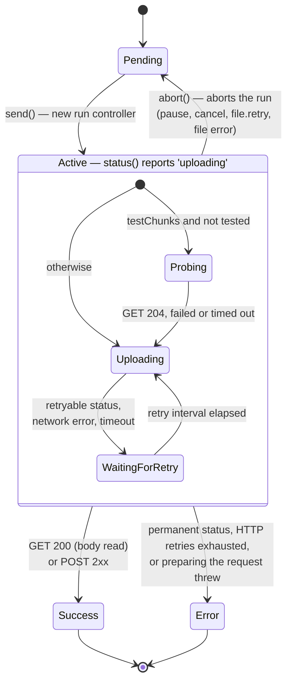
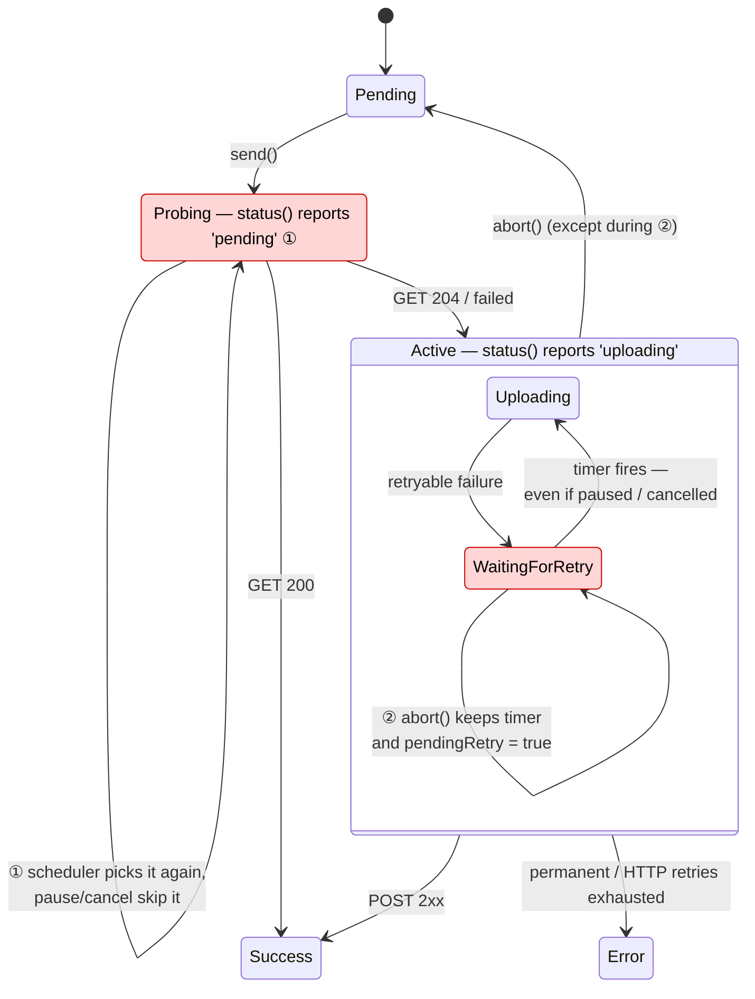
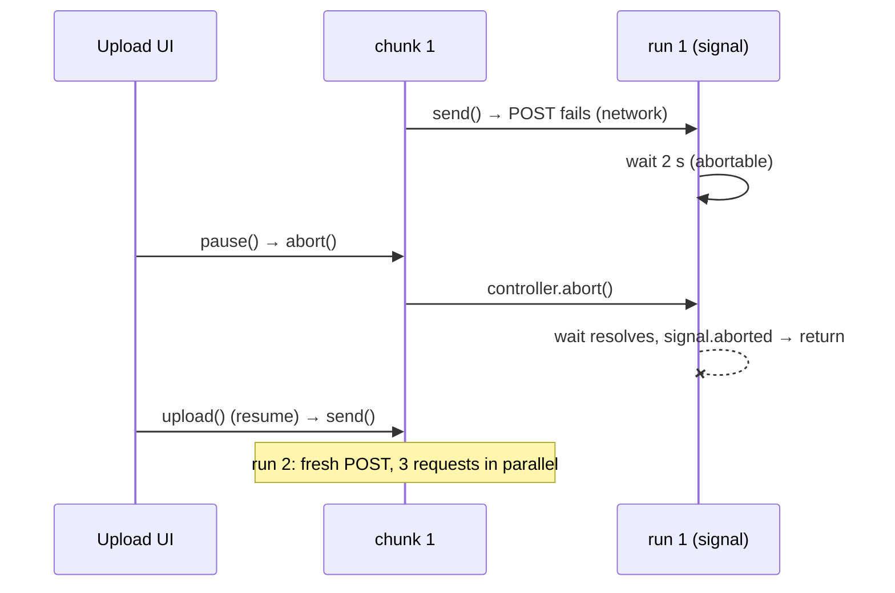

# Issue

**Title:** Fix upload chunk probes and retries ignoring pause/cancel

## Description

### Summary

Fixes lifecycle bugs in our resumable-upload library (`libs/resumable_upload`). All but #4 are reachable with the production dataset-upload config (`testChunks: true`, `simultaneousUploads: 3`, `chunkRetryInterval: 2000`):

1. **Probes ignored the scheduler and pause.** While a chunk's `GET` probe was in flight, the chunk reported `pending`. Upload start therefore probed chunk 1 three times (`GET 1, 1, 1`) and then uploaded it three times, and `pause()`/`cancel()` skipped running probes.
2. **Retry timers survived `abort()`.** A pending retry restarted the chunk while paused or cancelled, and `pendingRetry` stayed `true`, so resume was a no-op: the files stayed paused and the upload got stuck once the retried chunk had finished.
3. **Pausing while a probe's body was read** made the resumed run skip the probe and `POST` a chunk the server already had.
4. **A throwing `query`/`headers` option or a failed file read** left the chunk stuck in `uploading`, holding a slot forever. This is hardening: WK's `query` can't throw and the default `chunkFormat: "blob"` doesn't use a `FileReader`.
5. **`file.retry()` resumed a paused upload.** The token-refresh retry after a `403` restarted requests while the Cancel dialog was open.
6. **A throwing callback re-uploaded a finished chunk.** `finish()` ran inside the `try` that handles network errors, so an error thrown by the success callback or by `uploadNextChunk()` was retried like a failed request.

User-visible effect: in the dataset upload, **Cancel** pauses and opens a confirmation dialog. Requests kept going while it was open, and "No, keep it running" could leave the upload stuck.

#### The fix

Each `send()` starts a **run** with its own `AbortController`, and `abort()` aborts it. The probe, every upload attempt and the wait between retries all observe that one signal, so after `abort()` nothing from the old run can restart the chunk or change its state. The check after every `await` is simply `if (signal.aborted) return;`. Each request gets its own `AbortController` that follows the run signal and the `fetchTimeout`; its timer and listener are cleared once the request finishes. Response bodies of retried requests are cancelled so they don't hold a connection. If the run was already aborted before a request starts (e.g. by a synchronous progress listener), the request is aborted right away, and the wait between retries removes its abort listener when it ends. `finish()` is called after the request has been handled, and errors thrown after a chunk finished are logged instead of being dropped.

`file.retry()` now only resumes the uploader when the file isn't paused (`resumable_file.ts`, 1 line).

### Chunk state machine

`status()` is what the scheduler, `isUploading()`, `pause()` and `cancel()` rely on, so every active state must report `uploading`.

Before this PR, Probing reported `pending` (bug 1), and `abort()` didn't leave WaitingForRetry (bug 2):

How a run ends on pause during a retry wait:

### Notes for reviewers

- **Unchanged retry policy:** network errors and timeouts still retry indefinitely; only HTTP errors are checked against `maxChunkRetries`, as before. Network-error retries still increment the shared retry counter; that's tracked in #10286.
- **API:** `send()` returns `void` instead of `Promise<void>` (nobody awaited it), and `test()`/`upload()` are private. `status()`, events and options are unchanged.
- **Tests:** `resumable-upload-lifecycle.spec.ts` uses a `fetch` stub whose requests stay open until the test answers them, so in-flight probes and pending retries are observable. The "chunk test body-read gap" tests in `resumable-upload-use-cases.spec.ts` cover both re-entering `uploadNextChunk()` and pausing/resuming during the probe's body read.

### Steps to test:
Use a dataset upload of at least ~40 MB (more than 3 chunks of 10 MB). In DevTools → Network, filter for `upload/dataset` and throttle to "Slow 4G".

- **Distinct probes:** start the upload. The first three `GET`s have `resumableChunkNumber` 1, 2, 3 (before: 1, 1, 1), and at most 3 requests are in flight.
- **Pause:** click *Cancel* while requests are running. All in-flight requests are cancelled and none start while the dialog is open.
- **Keep running:** pick "No, keep it running". Three requests run in parallel again.
- **Retry wait:** go *Offline* until the upload shows "retrying", click *Cancel*, go back online and wait > 2 s. No request starts while the dialog is open.

### Issues:
- Found in an internal audit of the resumable-upload library.

------
- [x] Added changelog entry (create a `$PR_NUMBER.md` file in `unreleased_changes` or use `./tools/create-changelog-entry.py`)
- [x] Removed dev-only changes like prints and application.conf edits
- [x] Considered [common edge cases](../blob/master/.github/common_edge_cases.md)

## Task

Modify the repository so that the issue described above is resolved. The repository is checked out at base commit `764618907f01`. Edit files in place; the verifier captures your changes via `git diff` and scores them against an oracle patch using SWE-RL-style diff-similarity reward.