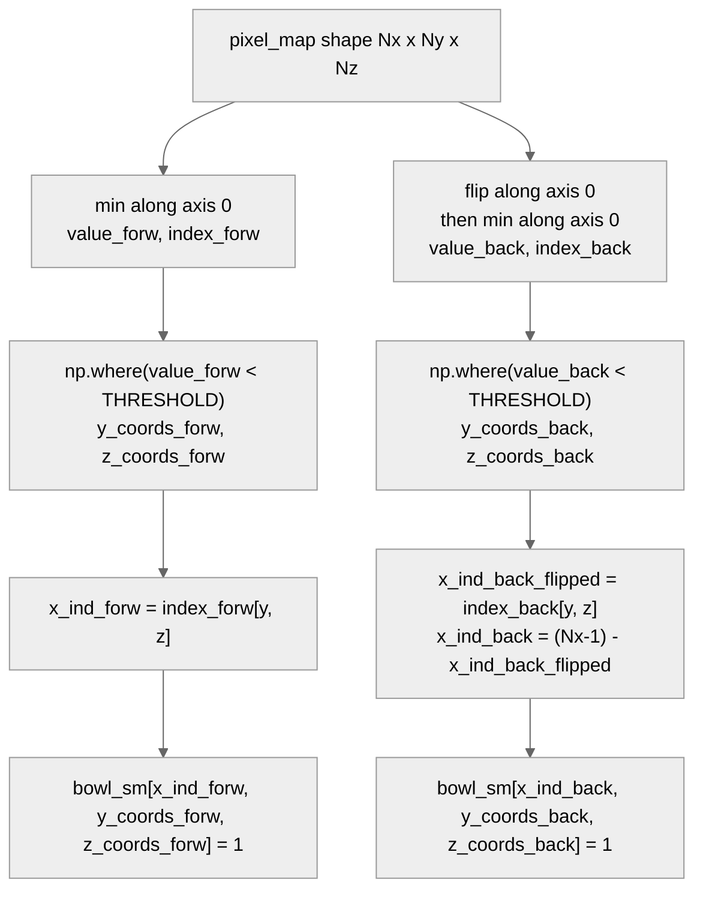

# Issue

**Title:** Replace matlab_find with numpy functions in mapgen

## Description

<TODO>

<!-- greptile_comment -->

<h3>Greptile Summary</h3>

This PR replaces MATLAB-compatibility shim calls (`matlab_find`, `ind2sub`, `sub2ind`, `matlab_assign`) with native NumPy equivalents in `make_line` and the DIMENSION 1 block of `make_bowl` in `mapgen.py`. The index-arithmetic equivalence is correct: `matlab_find(diff == min(diff))[0]` → `np.argmin(diff)` preserves first-occurrence tie-breaking, and the 1-based ↔ 0-based offset adjustments are properly removed.

- In `make_line`, six identical index-selection sites are simplified: `np.argmin(diff)` replaces the `matlab_find` round-trip, and the downstream `poss_x[index[0] - 1]` accesses become plain `poss_x[index]`.
- In `make_bowl`, the DIMENSION 1 forward/backward surface-extraction pipeline is rewritten using `np.where` + direct 3-D array assignment, correctly mapping the flipped backward index via `(Nx - 1) - index_back_flipped`. DIMENSION 2 and DIMENSION 3 are left unchanged, still relying on `matlab_find`.

<h3>Confidence Score: 4/5</h3>

The changed logic is a correct mechanical translation from MATLAB-style helpers to native NumPy — index equivalence holds in both make_line and the make_bowl DIMENSION 1 block. The only concern is that DIMENSION 2 and DIMENSION 3 of make_bowl were not migrated, leaving the function internally inconsistent.

The six make_line sites and the make_bowl DIMENSION 1 block all translate cleanly, and the 0-based/1-based offset adjustments are handled correctly throughout. The remaining make_bowl dimensions still use the old matlab_find path, which is not a correctness issue but does leave an incomplete job that will need a follow-up.

kwave/utils/mapgen.py — specifically the DIMENSION 2 (lines ~1745–1763) and DIMENSION 3 (lines ~1783–1801) blocks in make_bowl, which still use the old matlab_find pattern.

<h3>Important Files Changed</h3>

| Filename | Overview |
|----------|----------|
| kwave/utils/mapgen.py | Replaces `matlab_find`-based index arithmetic with `np.argmin` in `make_line` and with `np.where`/direct array indexing in the DIMENSION 1 block of `make_bowl`; DIMENSION 2 and DIMENSION 3 in `make_bowl` still use the old `matlab_find` pattern |

<h3>Flowchart</h3>

<!-- greptile_failed_comments -->

<h3>Comments Outside Diff (1)</h3>

1. `kwave/utils/mapgen.py`, line 1745-1763 ([link](https://github.com/waltsims/k-wave-python/blob/40b2c4b496f2c82df6ff8b554da42d741693767c/kwave/utils/mapgen.py#L1745-L1763))

    **Incomplete migration — DIMENSION 2 still uses `matlab_find`**

   The DIMENSION 1 block was fully migrated to native numpy operations, but DIMENSION 2 (lines 1745–1763) and DIMENSION 3 (lines 1783–1801) still use `matlab_find`, `ind2sub`, `sub2ind`, and `matlab_assign`. This leaves the refactoring half-done and makes the three dimension blocks inconsistent with each other.

<!-- /greptile_failed_comments -->

Reviews (1): Last reviewed commit:  | [Re-trigger Greptile](https://app.greptile.com/api/retrigger?id=32451242)

<!-- /greptile_comment -->

## Task

Modify the repository so that the issue described above is resolved. The repository is checked out at base commit `cf4ec8fdcb0a`. Edit files in place; the verifier captures your changes via `git diff` and scores them against an oracle patch using SWE-RL-style diff-similarity reward.