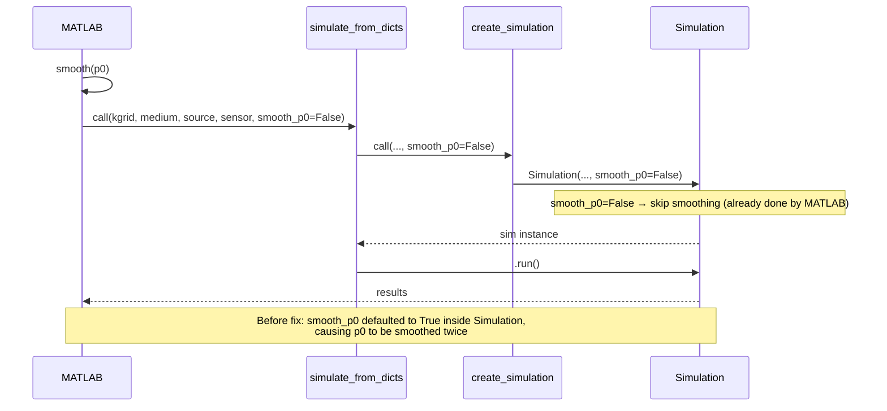

# Issue

**Title:** Achieve full 1D/2D/3D parity with MATLAB k-Wave (<1e-15)

## Description

Two bugs fixed:
1. simulate_from_dicts defaulted smooth_p0=True, causing double-smoothing when called from the MATLAB shim (which smooths before calling Python). Changed default to False since the MATLAB shim handles smoothing.
2. Added additive-no-correction source mode.
3. Added interop_sanity() for MATLAB column-major validation.

k-wave-cupy parity: 252/252 sub-tests PASS across 1D/2D/3D, all source types, all media types, at machine precision (~1e-15).

<!-- greptile_comment -->

<h3>Greptile Summary</h3>

This PR fixes a double-smoothing bug in the MATLAB interop layer: `create_simulation` and `simulate_from_dicts` previously relied on `Simulation`'s default of `smooth_p0=True`, causing p0 initial conditions to be smoothed a second time when called from the MATLAB shim (which already smooths before calling Python). The fix adds an explicit `smooth_p0=False` parameter default to both interop functions while leaving the `Simulation` class default unchanged for direct Python use.

- `create_simulation` and `simulate_from_dicts` now default to `smooth_p0=False`; callers can opt back in with `smooth_p0=True`
- The PR description also references `additive-no-correction` source mode and `interop_sanity()`, but both were already present on the base branch (`add-cupy-solver`) and are not new in this diff
- The existing `TestMatlabInterop.test_simulate_from_dicts` uses a 1D grid, so `smooth_p0` is never evaluated (guarded by `ndim >= 2`) — the test cannot detect a regression in this fix
- `interop_sanity()` is not exported from `kwave/solvers/__init__.py` and has no direct test coverage; it also silently assumes ≥2-D input

<h3>Confidence Score: 4/5</h3>

- The fix is correct and well-scoped; safe to merge once a 2D regression test for the smooth_p0 change is added.
- The change is minimal, the documented rationale is sound, and the behavioral change only affects the MATLAB interop path. The main gap is test coverage: the single existing interop test exercises 1D only, which cannot detect a regression in the smooth_p0 logic. No logic errors or safety issues were found in the production path.
- kwave/solvers/kspace_solver.py — specifically the `test_simulate_from_dicts` test (1D only) and the unvalidated `interop_sanity` function.

<h3>Important Files Changed</h3>

| Filename | Overview |
|----------|----------|
| kwave/solvers/kspace_solver.py | Added `smooth_p0=False` default to `create_simulation` and `simulate_from_dicts` to prevent double-smoothing in the MATLAB shim; the fix is correct but the only regression test exercises a 1D case where `smooth_p0` is a no-op, leaving the 2D/3D path untested. |

<h3>Sequence Diagram</h3>

<!-- greptile_failed_comments -->

<h3>Comments Outside Diff (1)</h3>

1. `kwave/solvers/kspace_solver.py`, line 694-698 ([link](https://github.com/waltsims/k-wave-python/blob/09b3126a7f4dc0a53fdf5cc939ed961df2e2c25a/kwave/solvers/kspace_solver.py#L694-L698))

    **`interop_sanity` silently requires a 2D array**

   `arr[0, 1] = 99` hard-codes a two-dimensional index. Passing a 1D array (or any array with `shape[1] < 2`) will raise an `IndexError` with no helpful message. Since this function is designed to be called from MATLAB, an explicit shape check (or at least a docstring note) would make the failure easier to diagnose.

<!-- /greptile_failed_comments -->

Reviews (1): Last reviewed commit:  | [Re-trigger Greptile](https://app.greptile.com/api/retrigger?id=25983067)

> Greptile also left **1 inline comment** on this PR.

<!-- /greptile_comment -->

## Task

Modify the repository so that the issue described above is resolved. The repository is checked out at base commit `d61a9e6870f7`. Edit files in place; the verifier captures your changes via `git diff` and scores them against an oracle patch using SWE-RL-style diff-similarity reward.