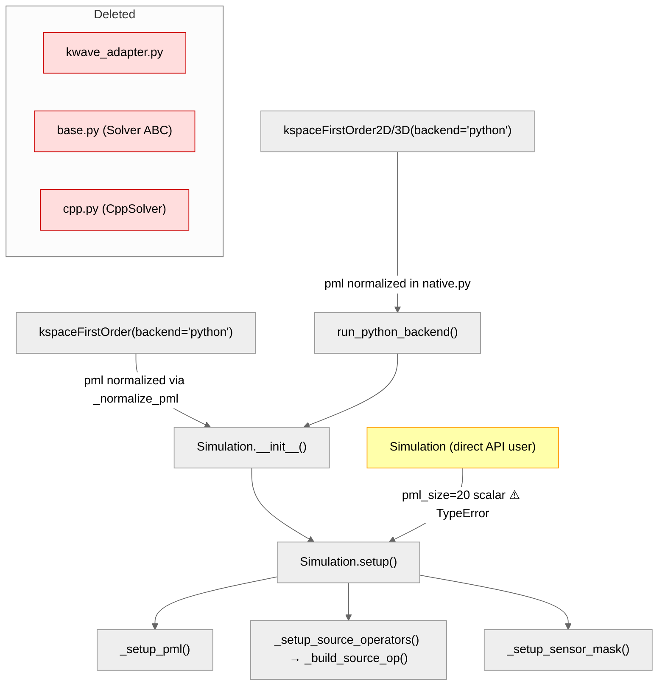

# Issue

**Title:** Simplify solver layers: delete adapter/ABC, flatten call chain

## Description

- Delete kwave_adapter.py: kspaceFirstOrder calls Simulation directly
- Delete base.py (Solver ABC) and cpp.py (CppSolver stub): unused abstractions
- Collapse native.py to minimal legacy bridge for kspaceFirstOrder2D/3D
- Rewrite __init__.py: export Backend enum + Simulation, drop get_solver
- Simulation.__init__: keyword-only params after sensor, remove "auto" backend
- Simplify _setup_pml: remove hasattr guards (overrides always tuples)
- Extract _build_source_op to module level for testability
- Rename N=self.ndim to n_rho_splits (avoid N-as-grid-count confusion)
- Fix acoustic_intensity break→continue (handle non-contiguous axes)
- Fix _normalize_pml error message (user-facing, not internal note)
- Fix _compute_staggered_density: return ndim values, not always 3
- Handle kwave objects directly (None attrs for record, p_mode, etc.)

Net: -162 lines, 3 files deleted, 0 indirection layers.

<!-- greptile_comment -->

<h3>Greptile Summary</h3>

This PR is a focused refactoring that deletes three indirection layers (`kwave_adapter.py`, `base.py`, `cpp.py`) and flattens the call chain so that `kspaceFirstOrder` constructs `Simulation` directly. It ships several genuine bug fixes alongside the cleanup: `acoustic_intensity` `break→continue` (non-contiguous axes), `_compute_staggered_density` returning `ndim` values instead of always 3, and cleaner `record`/`p_mode`/`u_mode` attribute access for native kwave objects. The net change is −162 lines which is a healthy reduction in complexity.

Two concrete issues were found that need attention before merging:

- **`_setup_pml` scalar guard removal** (`kspace_solver.py`): The `hasattr(..., "__len__")` guards were removed on the assumption that `_pml_size_override` and `_pml_alpha_override` are always tuples. This is true for calls routed through `kspaceFirstOrder` (which normalises via `_normalize_pml`) and `native.py` (which calls `tuple(pml_size)`), but `Simulation` is now a first-class public export. Any external caller using `Simulation(..., pml_size=20)` will get an opaque `TypeError: 'int' object is not subscriptable` at `setup()` time — a regression compared to the previous behaviour.
- **`validate_simulation` removed from `kspaceFirstOrder2D/3D` Python path** (`native.py`): The CFL stability warning, PML-vs-grid-size check, medium positivity checks, and source-mask presence checks were all performed by `validate_simulation` in the old code. They were removed when the validation block was stripped from `kspaceFirstOrder2D.py` / `kspaceFirstOrder3D.py`, and `run_python_backend` does not add them back. Users of the legacy 2D/3D entry points with `backend="python"` lose these early, actionable diagnostics.

<h3>Confidence Score: 3/5</h3>

- PR needs two targeted fixes before merge: restore scalar pml guard in _setup_pml and re-add validate_simulation to the legacy 2D/3D Python path.
- The architectural simplification is sound and the three bug fixes are correct. However, removing the subscript guard from `_setup_pml` is a real regression for any direct `Simulation` user passing a scalar `pml_size`/`pml_alpha`, and dropping `validate_simulation` from the kspaceFirstOrder2D/3D Python path removes CFL warnings and bounds-checking for users of those legacy entry points. Both are concrete, reproducible issues that are straightforward to fix.
- `kwave/solvers/kspace_solver.py` (lines 319–323, `_setup_pml` scalar guard) and `kwave/solvers/native.py` (missing `validate_simulation` call).

<h3>Important Files Changed</h3>

| Filename | Overview |
|----------|----------|
| kwave/solvers/kspace_solver.py | Core solver refactored: `_build_source_op` extracted to module level, `_setup_pml` hasattr guards removed (breaking direct Simulation API with scalar pml_size/pml_alpha), `acoustic_intensity` break→continue bug fixed, backend 'auto' removed from `__init__` (moved to `_resolve_backend`). The guard removal is the main concern. |
| kwave/solvers/native.py | Collapsed from PythonSolver class to a thin `run_python_backend` function — correct approach. However, `validate_simulation` was removed from this path without replacement, causing users of kspaceFirstOrder2D/3D to lose upfront validation (CFL, PML bounds, medium positivity, etc.). |
| kwave/kspaceFirstOrder.py | Adapter layer removed; kspaceFirstOrder now constructs Simulation directly. `_normalize_pml` error message updated (minor confusion for pml_alpha). Both pml_size and pml_alpha are correctly normalised to tuples before Simulation construction. |
| kwave/kspaceFirstOrder2D.py | Removed pml_size normalisation and validate_simulation from the Python backend branch; the normalisation moved to native.py but validation was dropped entirely. |
| kwave/kspaceFirstOrder3D.py | Same as kspaceFirstOrder2D.py: validation call removed, normalisation moved to native.py. |
| kwave/solvers/cpp_simulation.py | _compute_staggered_density now returns ndim values (list comprehension) instead of always 3, fixing a correctness issue for 1D/2D simulations with heterogeneous density. |
| kwave/solvers/__init__.py | Public API simplified: Backend enum now defined locally (not imported from deleted base.py), get_solver removed, PythonSolver removed. Clean and correct. |
| tests/test_native_solver.py | Tests updated to reflect new API (Backend enum, direct Simulation construction). Old get_solver/PythonSolver tests replaced with equivalent coverage. |

<h3>Flowchart</h3>

Reviews (1): Last reviewed commit:  | [Re-trigger Greptile](https://app.greptile.com/api/retrigger?id=25991740)

> Greptile also left **3 inline comments** on this PR.

<!-- /greptile_comment -->

## Task

Modify the repository so that the issue described above is resolved. The repository is checked out at base commit `fa76b0847601`. Edit files in place; the verifier captures your changes via `git diff` and scores them against an oracle patch using SWE-RL-style diff-similarity reward.