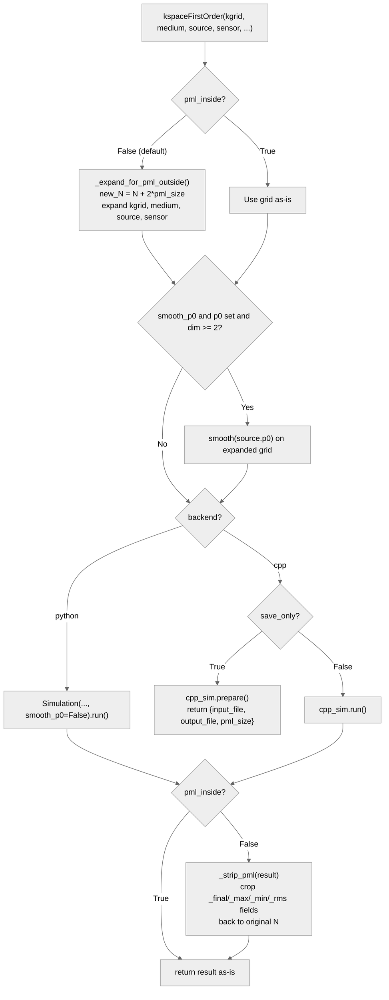

# Issue

**Title:** Add pml_inside parameter to kspaceFirstOrder()

## Description

Shared pre/post-processing for both Python and C++ backends:
- Grid expansion when pml_inside=False (default)
- p0 smoothing hoisted above backend dispatch
- PML stripping from full-grid output fields

The solver (Simulation) stays untouched — it just receives an already-expanded grid and computes.

<!-- greptile_comment -->

<h3>Greptile Summary</h3>

This PR introduces a `pml_inside` parameter to `kspaceFirstOrder()`, making PML-outside the default behaviour: the grid is transparently expanded before solver dispatch and full-grid output fields are cropped back to the user's original domain afterwards. The shared pre/post-processing (`_expand_for_pml_outside`, `_strip_pml`, `_expand_obj`) replaces the legacy `expand_grid_matrices.py` path, which is now marked deprecated. The approach is clean and the implementation covers the key medium fields (including the previously-missing `sound_speed_ref` and `alpha_filter`), with comments explaining intentional omissions (`s_mask`).

**Key issues:**

- **Tests not updated in `test_native_solver.py`**: ~8 tests in `TestNative2D` and `TestNativePhysics` use full-grid 64×64 sensor masks (`np.ones((64, 64), dtype=bool)`) and assert shapes like `result["p"].shape == (64 * 64, 10)`. Under the new default `pml_inside=False`, `_expand_for_pml_outside` expands those masks to 104×104 (default `pml_size=20`), so the sensor data will have 10 816 rows instead of 4 096. Only `test_sensor_none_records_everywhere` was updated with `pml_inside=True`; the rest need the same treatment (matching what the integration tests already do).
- **`sensor.directivity.angle` not expanded**: The legacy path (`expand_directivity_angle`) zero-padded this 2-D field; the new helper skips it. Callers who set a directivity sensor in 2-D and rely on `pml_inside=False` will get a shape mismatch at runtime.

<h3>Confidence Score: 3/5</h3>

- Not safe to merge until the un-updated unit tests in test_native_solver.py are fixed — they will fail in CI under the new default.
- The production logic in kspaceFirstOrder.py is well-structured and the medium/source/sensor expansion is largely correct. However, roughly 8 unit tests in TestNative2D and TestNativePhysics were not updated to add `pml_inside=True`, and will deterministically fail because the default pml_outside path expands the 64×64 sensor mask to 104×104, causing all shape assertions against `64*64` to break. This is a clear CI-blocking regression introduced by the PR itself, not a pre-existing issue.
- tests/test_native_solver.py — TestNative2D and TestNativePhysics test methods need pml_inside=True added (or expected shapes updated)

<h3>Important Files Changed</h3>

| Filename | Overview |
|----------|----------|
| kwave/kspaceFirstOrder.py | Core change: adds `pml_inside` parameter and three helpers (`_expand_for_pml_outside`, `_strip_pml`, `_expand_obj`). Logic is sound; medium fields (`sound_speed_ref`, `alpha_filter`) are now included and match legacy behaviour. Minor gap: `sensor.directivity.angle` is not expanded. |
| tests/test_native_solver.py | Only `test_sensor_none_records_everywhere` was updated to use `pml_inside=True`; ~8 other tests in `TestNative2D` and `TestNativePhysics` still use full-grid 64×64 sensor masks without the flag and will fail because `_expand_for_pml_outside` expands those masks to 104×104 under the new default. |
| kwave/kWaveSimulation_helper/expand_grid_matrices.py | Only a deprecation comment block was added; no functional changes. |
| tests/integration/test_ivp_1D.py | Correctly adds `pml_inside=True` to preserve comparison with MATLAB reference data generated on the original (unexpanded) grid. |
| tests/integration/test_ivp_2D.py | Correctly adds `pml_inside=True` to preserve MATLAB reference comparison. |
| tests/integration/test_photoacoustic.py | Correctly adds `pml_inside=True` to both 2D and 3D photoacoustic reference tests. |

<h3>Flowchart</h3>

<!-- greptile_failed_comments -->

<h3>Comments Outside Diff (2)</h3>

1. `tests/test_native_solver.py`, line 42-221 ([link](https://github.com/waltsims/k-wave-python/blob/c6236031d6bb290a93611bbcd29c05f5eece3f5d/tests/test_native_solver.py#L42-L221))

    **Many tests silently run on expanded grids after the new `pml_inside=False` default**

   The majority of tests in `TestNative2D`, `TestNative1D`, `TestNativePhysics`, and `TestCppSaveOnly` (lines 42–221) do not pass `pml_inside=True`. With the new default `pml_inside=False`, they now silently run the solver on a 104×104 expanded grid instead of the intended 64×64. The test assertions happen to still pass because:
   - Sensor-recorded shapes (e.g. `(64*64, 10)`) are unaffected — the sensor mask is expanded with zeros, preserving the 4096 active points.
   - Full-grid fields are stripped back by `_strip_pml`.

   However, the **simulation behavior has changed**: the source, medium, and sensor are all operating on a different grid from what the test author intended. This makes the tests less reliable as regression checks for specific grid-size behavior and makes each 2D test about 2.6× more expensive to run.

   For tests that are deliberately validating numerical output (rather than just checking shapes), please add `pml_inside=True` to preserve the original grid size and physics, matching the intent of the already-updated integration tests (`test_ivp_1D.py`, `test_ivp_2D.py`, `test_photoacoustic.py`).

2. `tests/test_native_solver.py`, line 43-88 ([link](https://github.com/waltsims/k-wave-python/blob/dfe2f7f94fe96f64e995a7f510dc3b653b634df4/tests/test_native_solver.py#L43-L88))

    **Full-grid sensor tests will fail under the new `pml_inside=False` default**

   The new default `pml_inside=False` causes `_expand_for_pml_outside` to expand the sensor mask from `(64, 64)` → `(104, 104)` (with default `pml_size=20`). Because the binary mask covers the entire 104×104 expanded grid, the solver returns `result["p"]` with shape `(10816, 10)` — not `(4096, 10)`. `_strip_pml` only trims `ndim`-dimensional arrays with `_final`/`_max`/`_min`/`_rms` suffixes; it leaves time-series sensor data untouched.

   Every test in this file that:
   1. uses a full-grid sensor mask (`np.ones((64, 64), dtype=bool)`), and
   2. asserts a shape based on `64 * 64`,

   will now fail. The affected assertions are:

   - `TestNative2D.test_p0_source` (line 46): `result["p"].shape == (64 * 64, 10)` → will be `(10816, 10)`
   - `TestNative2D.test_heterogeneous_medium` (line 59): `result["p"].shape[0] == 64 * 64` → will be `10816`
   - `TestNative2D.test_absorption` (line 69): same as `test_p0_source`
   - `TestNative2D.test_record_aggregates` (line 87): `result["p_max"].shape == (64 * 64,)` → will be `(10816,)` (`_strip_pml` skips 1-D arrays in a 2-D simulation)
   - `TestNativePhysics.test_nonlinearity_bona` (line 122): same shape assertion
   - `TestNativePhysics.test_stokes_absorption` (line 131): same
   - `TestNativePhysics.test_velocity_recording` (lines 149–150): `result["ux"].shape == (64*64, 10)` and `result["ux_max"].shape == (64*64,)` — both fail
   - `TestNativePhysics.test_intensity_recording` (lines 157–158): `result["Ix"].shape == (64*64, 10)` and `result["Ix_avg"].shape == (64*64,)` — both fail

   The fix is to add `pml_inside=True` to each of these calls (matching what `test_ivp_2D.py` and the three integration tests already do), or alternatively update the expected shapes to reflect the expanded-then-cropped-back-to-64×64 sensor data (which would require sensor mask logic changes to keep 64×64 results when using `pml_inside=False`).

<!-- /greptile_failed_comments -->

Reviews (4): Last reviewed commit:  | [Re-trigger Greptile](https://app.greptile.com/api/retrigger?id=26004712)

> Greptile also left **1 inline comment** on this PR.

<!-- /greptile_comment -->

## Task

Modify the repository so that the issue described above is resolved. The repository is checked out at base commit `37dbc21a64c2`. Edit files in place; the verifier captures your changes via `git diff` and scores them against an oracle patch using SWE-RL-style diff-similarity reward.