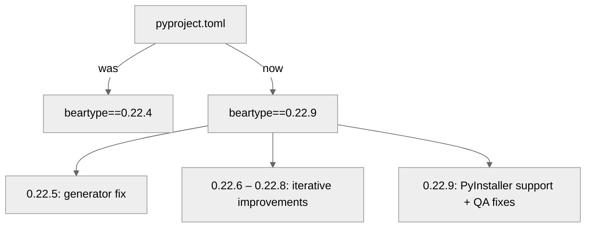

# Issue

**Title:** Bump beartype from 0.22.4 to 0.22.9

## Description

Bumps [beartype](https://github.com/beartype/beartype) from 0.22.4 to 0.22.9.

Release notes

<em>Sourced from <a href="https://github.com/beartype/beartype/releases">beartype's releases</a>.</em>

<blockquote>
<h2>Beartype 0.22.9: Party in Da QA House</h2>

<a href="https://github.com/beartype"><code>@​beartype</code></a> <code>0.22.9</code> celebrates <a href="https://github.com/beartype/beartype/discussions/597"><strong><code>one million @​beartype downloads a day</code></strong></a>! We wanted to rent out a loft warehouse space, flip a dry ice machine off Ebay for pennies, shadow-drop <a href="https://www.youtube.com/watch?v=LAQZfeETFbg&amp;list=RDLAQZfeETFbg&amp;start_radio=1">DJ Lorien Testard</a>, invite all our GitHub homies, and get down and funky with this QA quinceañera. It didn't happen. I released instead. The memories we might have made are only another patch release in the <code>0.22.X</code> dev cycle. Bear friends, it's your time to shine tonight:

<pre lang="bash"><code># Via &quot;pip&quot;, the once-great venerable master packager now fallen on hard times:
$ pip install --upgrade beartype      # &lt;-- you go, pipe-smoking pip
<h1>Via &quot;uv&quot;, the plucky upstart spiky-haired kid wielding a sword larger than its body:</h1>

$ uv pip install --upgrade beartype   # &lt;-- when you no longer have the strength to care about lock files

<h1>Via &quot;conda&quot;, the corporate scientist in casual lab attire who wants to be your buddy, pal:</h1>

$ conda config --add channels conda-forge  # &lt;-- where did python packaging go wrong?
$ conda install conda-forge::beartype      # &lt;-- it all seemed so simple, once.
</code></pre>

<a href="https://github.com/beartype"><code>@​beartype</code></a> <code>0.22.9</code>: &quot;Wave your keyboards in the air like those bugs don't care.&quot;

<!-- raw HTML omitted --><em>one million downloads a day says you can't stop this party</em><!-- raw HTML omitted -->

<a href="https://github.com/beartype"><code>@​beartype</code></a> <code>0.22.9</code> is helping <a href="https://github.com/leycec"><code>@​leycec</code></a> and his beautiful science wife to eat food. Thanks entirely to...

<h2>GitHub Sponsors: Befriend the Bear and Get a Bear for Life</h2>

This release comes courtesy these proud <a href="https://github.com/sponsors/leycec">GitHub Sponsors</a>, without whom everyone in the <a href="https://github.com/leycec"><code>@​leycec</code></a> family would currently be eating grasshoppers in the abandoned back lot again:

<ul>
<li><a href="https://github.com/sesco-llc"><code>@​sesco-llc</code></a> (SESCO Enterprises), &quot;The Power of Innovation in Trading&quot;: <!-- raw HTML omitted --><em>this inspires me to get out of the house and do something</em><!-- raw HTML omitted -->
<a href="https://sescollc.com">https://sescollc.com</a></li>
<li><a href="https://github.com/DylanModesitt"><code>@​DylanModesitt</code></a> (Dylan Modesitt), quantitative strategies energy trading associate: <!-- raw HTML omitted --><em>...wikipedia, don't fail me now!</em><!-- raw HTML omitted -->
<a href="https://dylanmodesitt.com">https://dylanmodesitt.com</a></li>
<li><strong>[Tidelift][]</strong>, graciously paying out recurring income to security-sensitive open-source projects like <a href="https://github.com/beartype"><code>@​beartype</code></a>: <!-- raw HTML omitted --><em>so much hype</em><!-- raw HTML omitted -->
<a href="https://www.sonarsource.com/products/sonarqube/advanced-security">https://www.sonarsource.com/products/sonarqube/advanced-security</a></li>
</ul>

If you represent a security-conscious corporate, government, or non-profit, the <em>best</em> way bar none for you to support <a href="https://github.com/beartype"><code>@​beartype</code></a> and secure your own workflow is by subscribing to <strong>[Tidelift][]</strong> through <strong>[SonarQube Advanced Security][].</strong> Security giant [Sonar][] recently acquired [Tidelift][], guaranteeing the economic viability of the Tidelift model for billions of future open-source projects that have yet to be born. Join the jargon-laden conversation and pay someone else to think about unreadable acronyms like SAST, SCA, and SBOM for once.

Thanks so much, masters of fintech and lifted tides.

<!-- raw HTML omitted -->The Masters of Fintech and Lifted Tides. <em>That's who.</em><!-- raw HTML omitted -->

<h2>PyInstaller: Bundling Your Type-Checked Apps Since Now</h2>

<a href="https://github.com/beartype"><code>@​beartype</code></a> <code>0.22.9</code> brings official support for... <em>wait</em>. <strong>[PyInstaller][]</strong>? Hasn't <a href="https://github.com/beartype"><code>@​beartype</code></a> supported [PyInstaller][] since the beginning? Yeah. We thought so too. Then Meta was all like: <a href=""><code>&quot;Oh no you don't, @​beartype.&quot;</code></a> :joy:

<a href="https://github.com/beartype"><code>@​beartype</code></a> has officially supported competing products like <a href="https://nuitka.net">Nuitka</a> for years. Now PyInstaller joins the ranks. But it's not <em>just</em> PyInstaller. <a href="https://github.com/beartype"><code>@​beartype</code></a> <code>0.22.9</code> should also resolve any similar pending issues with other app bundling frameworks like... uhh, <a href="https://briefcase.beeware.org">Briefcase</a>? No idea, honestly. That's untested wishful thinking. The very best kind.

<a href="https://github.com/beartype"><code>@​beartype</code></a> <code>0.22.9</code>: <em>When you realize a small part of you still cares about desktop apps.</em>

<!-- raw HTML omitted -->Your bundled app moments after being packaged with <a href="https://github.com/beartype"><code>@​beartype</code></a>. It's... not good.<!-- raw HTML omitted -->

<!-- raw HTML omitted -->
</blockquote>

... (truncated)

Commits

<ul>
<li><a href=""><code>9430c65</code></a> Beartype 0.22.9: Party in Da QA House</li>
<li><a href=""><code>9a3c642</code></a> PyInstaller x 3.</li>
<li><a href=""><code>e29b2d5</code></a> Superficial <code>ty</code> compatibility.</li>
<li><a href=""><code>8cd5e99</code></a> PyInstaller x 2.</li>
<li><a href=""><code>0302808</code></a> PyInstaller x 1.</li>
<li><a href=""><code>cf3f9d7</code></a> Pytest subprocess sanitization x 1.</li>
<li><a href=""><code>ae62686</code></a> Mypy integration test improved.</li>
<li><a href=""><code>fbfddc4</code></a> Synchronous generator code optimized.</li>
<li><a href=""><code>eca38eb</code></a> <strong>Beartype 0.23.0</strong> restarted. <em>sigh</em></li>
<li><a href=""><code>8a046e0</code></a> Beartype 0.22.8: The Return of the Generator Return</li>
<li>Additional commits viewable in <a href="https://github.com/beartype/beartype/compare/v0.22.4...v0.22.9">compare view</a></li>
</ul>

 

Dependabot will resolve any conflicts with this PR as long as you don't alter it yourself. You can also trigger a rebase manually by commenting `@dependabot rebase`.

[//]: # (dependabot-automerge-start)
[//]: # (dependabot-automerge-end)

---

Dependabot commands and options

 

You can trigger Dependabot actions by commenting on this PR:
- `@dependabot rebase` will rebase this PR
- `@dependabot recreate` will recreate this PR, overwriting any edits that have been made to it
- `@dependabot show <dependency name> ignore conditions` will show all of the ignore conditions of the specified dependency
- `@dependabot ignore this major version` will close this PR and stop Dependabot creating any more for this major version (unless you reopen the PR or upgrade to it yourself)
- `@dependabot ignore this minor version` will close this PR and stop Dependabot creating any more for this minor version (unless you reopen the PR or upgrade to it yourself)
- `@dependabot ignore this dependency` will close this PR and stop Dependabot creating any more for this dependency (unless you reopen the PR or upgrade to it yourself)

<!-- greptile_comment -->

<h3>Greptile Summary</h3>

This PR bumps the `beartype` runtime type-checking library from `0.22.4` to `0.22.9`, a five-patch incremental update. The change is isolated to a single version string in `pyproject.toml` and carries no risk of breaking changes given beartype's patch-level versioning policy.

Key points:
- The version range spans five patch releases (`0.22.5` through `0.22.9`), all in the `0.22.x` development cycle, so no breaking API changes are expected.
- Notable upstream improvements include: official PyInstaller bundling support, synchronous generator code optimization, and improved mypy integration testing.
- The `beartype==` exact-pin strategy is consistent with the rest of the project's pinning approach for this dependency.
- No source code, tests, or other configuration files are touched.

<h3>Confidence Score: 5/5</h3>

- This PR is safe to merge; it is a routine patch-level dependency bump with no breaking changes.
- The change is a single-line version bump of a patch-release series (0.22.4 → 0.22.9) for a type-checking utility. No source code, tests, or other configuration is modified, and the upstream release notes confirm only additive improvements and bug fixes. Risk is negligible.
- No files require special attention.

<h3>Important Files Changed</h3>

| Filename | Overview |
|----------|----------|
| pyproject.toml | Single-line dependency version bump of beartype from 0.22.4 to 0.22.9; no issues found. |

<h3>Flowchart</h3>

Reviews (1): Last reviewed commit:  | [Re-trigger Greptile](https://app.greptile.com/api/retrigger?id=26099568)

<!-- /greptile_comment -->

## Task

Modify the repository so that the issue described above is resolved. The repository is checked out at base commit `502565a5c7a0`. Edit files in place; the verifier captures your changes via `git diff` and scores them against an oracle patch using SWE-RL-style diff-similarity reward.