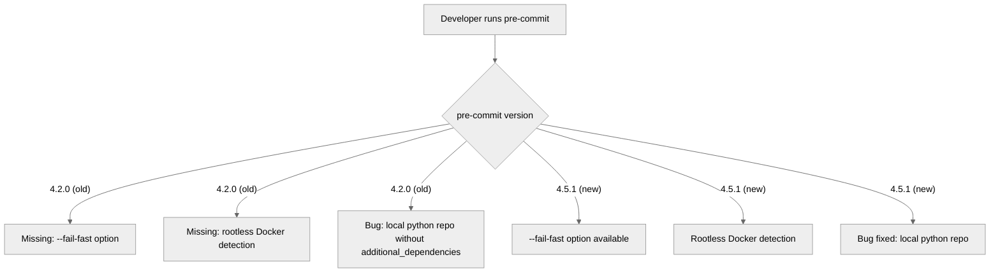

# Issue

**Title:** Bump pre-commit from 4.2.0 to 4.5.1

## Description

Bumps [pre-commit](https://github.com/pre-commit/pre-commit) from 4.2.0 to 4.5.1.

Release notes

<em>Sourced from <a href="https://github.com/pre-commit/pre-commit/releases">pre-commit's releases</a>.</em>

<blockquote>
<h2>pre-commit v4.5.1</h2>
<h3>Fixes</h3>
<ul>
<li>Fix <code>language: python</code> with <code>repo: local</code> without <code>additional_dependencies</code>.
<ul>
<li><a href="">#3597</a> PR by <a href="https://github.com/asottile"><code>@​asottile</code></a>.</li>
</ul>
</li>
</ul>
<h2>pre-commit v4.5.0</h2>
<h3>Features</h3>
<ul>
<li>Add <code>pre-commit hazmat</code>.
<ul>
<li><a href="">#3585</a> PR by <a href="https://github.com/asottile"><code>@​asottile</code></a>.</li>
</ul>
</li>
</ul>
<h2>pre-commit v4.4.0</h2>
<h3>Features</h3>
<ul>
<li>Add <code>--fail-fast</code> option to <code>pre-commit run</code>.
<ul>
<li><a href="">#3528</a> PR by <a href="https://github.com/JulianMaurin"><code>@​JulianMaurin</code></a>.</li>
</ul>
</li>
<li>Upgrade <code>ruby-build</code> / <code>rbenv</code>.
<ul>
<li><a href="">#3566</a> PR by <a href="https://github.com/asottile"><code>@​asottile</code></a>.</li>
<li><a href="">#3565</a> issue by <a href="https://github.com/MRigal"><code>@​MRigal</code></a>.</li>
</ul>
</li>
<li>Add <code>language: unsupported</code> / <code>language: unsupported_script</code> as aliases for <code>language: system</code> / <code>language: script</code> (which will eventually be deprecated).
<ul>
<li><a href="">#3577</a> PR by <a href="https://github.com/asottile"><code>@​asottile</code></a>.</li>
</ul>
</li>
<li>Add support docker-in-docker detection for cgroups v2.
<ul>
<li><a href="">#3535</a> PR by <a href="https://github.com/br-rhrbacek"><code>@​br-rhrbacek</code></a>.</li>
<li><a href="">#3360</a> issue by <a href="https://github.com/JasonAlt"><code>@​JasonAlt</code></a>.</li>
</ul>
</li>
</ul>
<h3>Fixes</h3>
<ul>
<li>Handle when docker gives <code>SecurityOptions: null</code>.
<ul>
<li><a href="">#3537</a> PR by <a href="https://github.com/asottile"><code>@​asottile</code></a>.</li>
<li><a href="">#3514</a> issue by <a href="https://github.com/jenstroeger"><code>@​jenstroeger</code></a>.</li>
</ul>
</li>
<li>Fix error context for invalid <code>stages</code> in <code>.pre-commit-config.yaml</code>.
<ul>
<li><a href="">#3576</a> PR by <a href="https://github.com/asottile"><code>@​asottile</code></a>.</li>
</ul>
</li>
</ul>
<h2>pre-commit v4.3.0</h2>
<h3>Features</h3>
<ul>
<li><code>language: docker</code> / <code>language: docker_image</code>: detect rootless docker.
<ul>
<li><a href="">#3446</a> PR by <a href="https://github.com/matthewhughes934"><code>@​matthewhughes934</code></a>.</li>
<li><a href="">#1243</a> issue by <a href="https://github.com/dkolepp"><code>@​dkolepp</code></a>.</li>
</ul>
</li>
<li><code>language: julia</code>: avoid <code>startup.jl</code> when executing hooks.
<ul>
<li><a href="">#3496</a> PR by <a href="https://github.com/ericphanson"><code>@​ericphanson</code></a>.</li>
</ul>
</li>
<li><code>language: dart</code>: support latest dart versions which require a higher sdk
lower bound.
<ul>
<li><a href="">#3507</a> PR by <a href="https://github.com/bc-lee"><code>@​bc-lee</code></a>.</li>
</ul>
</li>
</ul>
</blockquote>

Changelog

<em>Sourced from <a href="https://github.com/pre-commit/pre-commit/blob/main/CHANGELOG.md">pre-commit's changelog</a>.</em>

<blockquote>
<h1>4.5.1 - 2025-12-16</h1>
<h3>Fixes</h3>
<ul>
<li>Fix <code>language: python</code> with <code>repo: local</code> without <code>additional_dependencies</code>.
<ul>
<li><a href="">#3597</a> PR by <a href="https://github.com/asottile"><code>@​asottile</code></a>.</li>
</ul>
</li>
</ul>
<h1>4.5.0 - 2025-11-22</h1>
<h3>Features</h3>
<ul>
<li>Add <code>pre-commit hazmat</code>.
<ul>
<li><a href="">#3585</a> PR by <a href="https://github.com/asottile"><code>@​asottile</code></a>.</li>
</ul>
</li>
</ul>
<h1>4.4.0 - 2025-11-08</h1>
<h3>Features</h3>
<ul>
<li>Add <code>--fail-fast</code> option to <code>pre-commit run</code>.
<ul>
<li><a href="">#3528</a> PR by <a href="https://github.com/JulianMaurin"><code>@​JulianMaurin</code></a>.</li>
</ul>
</li>
<li>Upgrade <code>ruby-build</code> / <code>rbenv</code>.
<ul>
<li><a href="">#3566</a> PR by <a href="https://github.com/asottile"><code>@​asottile</code></a>.</li>
<li><a href="">#3565</a> issue by <a href="https://github.com/MRigal"><code>@​MRigal</code></a>.</li>
</ul>
</li>
<li>Add <code>language: unsupported</code> / <code>language: unsupported_script</code> as aliases
for <code>language: system</code> / <code>language: script</code> (which will eventually be
deprecated).
<ul>
<li><a href="">#3577</a> PR by <a href="https://github.com/asottile"><code>@​asottile</code></a>.</li>
</ul>
</li>
<li>Add support docker-in-docker detection for cgroups v2.
<ul>
<li><a href="">#3535</a> PR by <a href="https://github.com/br-rhrbacek"><code>@​br-rhrbacek</code></a>.</li>
<li><a href="">#3360</a> issue by <a href="https://github.com/JasonAlt"><code>@​JasonAlt</code></a>.</li>
</ul>
</li>
</ul>
<h3>Fixes</h3>
<ul>
<li>Handle when docker gives <code>SecurityOptions: null</code>.
<ul>
<li><a href="">#3537</a> PR by <a href="https://github.com/asottile"><code>@​asottile</code></a>.</li>
<li><a href="">#3514</a> issue by <a href="https://github.com/jenstroeger"><code>@​jenstroeger</code></a>.</li>
</ul>
</li>
<li>Fix error context for invalid <code>stages</code> in <code>.pre-commit-config.yaml</code>.
<ul>
<li><a href="">#3576</a> PR by <a href="https://github.com/asottile"><code>@​asottile</code></a>.</li>
</ul>
</li>
</ul>
<h1>4.3.0 - 2025-08-09</h1>
<h3>Features</h3>
<ul>
<li><code>language: docker</code> / <code>language: docker_image</code>: detect rootless docker.
<ul>
<li><a href="">#3446</a> PR by <a href="https://github.com/matthewhughes934"><code>@​matthewhughes934</code></a>.</li>
<li><a href="">#1243</a> issue by <a href="https://github.com/dkolepp"><code>@​dkolepp</code></a>.</li>
</ul>
</li>
<li><code>language: julia</code>: avoid <code>startup.jl</code> when executing hooks.
<ul>
<li><a href="">#3496</a> PR by <a href="https://github.com/ericphanson"><code>@​ericphanson</code></a>.</li>
</ul>
</li>
<li><code>language: dart</code>: support latest dart versions which require a higher sdk
lower bound.
<ul>
<li><a href="">#3507</a> PR by <a href="https://github.com/bc-lee"><code>@​bc-lee</code></a>.</li>
</ul>
</li>
</ul>
</blockquote>

Commits

<ul>
<li><a href=""><code>8a0630c</code></a> v4.5.1</li>
<li><a href=""><code>fcbc745</code></a> Merge pull request <a href="">#3597</a> from pre-commit/empty-setup-py</li>
<li><a href=""><code>51592ee</code></a> fix python local template when artifact dirs are present</li>
<li><a href=""><code>67e8faf</code></a> Merge pull request <a href="">#3596</a> from pre-commit/pre-commit-ci-update-config</li>
<li><a href=""><code>c251e6b</code></a> [pre-commit.ci] pre-commit autoupdate</li>
<li><a href=""><code>98ccafa</code></a> Merge pull request <a href="">#3593</a> from pre-commit/pre-commit-ci-update-config</li>
<li><a href=""><code>4895355</code></a> [pre-commit.ci] pre-commit autoupdate</li>
<li><a href=""><code>2cedd58</code></a> Merge pull request <a href="">#3588</a> from pre-commit/pre-commit-ci-update-config</li>
<li><a href=""><code>465192d</code></a> [pre-commit.ci] pre-commit autoupdate</li>
<li><a href=""><code>fd42f96</code></a> Merge pull request <a href="">#3586</a> from pre-commit/zipapp-sha256-file-not-needed</li>
<li>Additional commits viewable in <a href="https://github.com/pre-commit/pre-commit/compare/v4.2.0...v4.5.1">compare view</a></li>
</ul>

 

Dependabot will resolve any conflicts with this PR as long as you don't alter it yourself. You can also trigger a rebase manually by commenting `@dependabot rebase`.

[//]: # (dependabot-automerge-start)
[//]: # (dependabot-automerge-end)

---

Dependabot commands and options

 

You can trigger Dependabot actions by commenting on this PR:
- `@dependabot rebase` will rebase this PR
- `@dependabot recreate` will recreate this PR, overwriting any edits that have been made to it
- `@dependabot show <dependency name> ignore conditions` will show all of the ignore conditions of the specified dependency
- `@dependabot ignore this major version` will close this PR and stop Dependabot creating any more for this major version (unless you reopen the PR or upgrade to it yourself)
- `@dependabot ignore this minor version` will close this PR and stop Dependabot creating any more for this minor version (unless you reopen the PR or upgrade to it yourself)
- `@dependabot ignore this dependency` will close this PR and stop Dependabot creating any more for this dependency (unless you reopen the PR or upgrade to it yourself)

<!-- greptile_comment -->

<h3>Greptile Summary</h3>

This is a routine Dependabot dependency bump for the `pre-commit` dev tool from `4.2.0` to `4.5.1` in `pyproject.toml`. The change only affects the developer tooling environment and has no impact on runtime behavior of the k-wave-python library itself.

- Bumps `pre-commit` from `4.2.0` → `4.5.1` (3 minor releases: 4.3.0, 4.4.0, 4.5.0, 4.5.1)
- Notable improvements included: rootless Docker detection, `--fail-fast` option, docker-in-docker support for cgroups v2, and a bugfix for `language: python` with `repo: local` without `additional_dependencies`
- Dependabot compatibility score is provided and this is a low-risk dev-only update
- No changes to production code, tests, or documentation

<h3>Confidence Score: 5/5</h3>

- This PR is safe to merge — it is a dev-only dependency bump with no runtime impact.
- The change is a single-line update to a dev dependency (`pre-commit`) with no effect on the library's runtime code, tests, or documentation. The new version includes only features and bug fixes; no breaking changes are noted in the changelog. Dependabot reports a high compatibility score.
- No files require special attention.

<h3>Important Files Changed</h3>

| Filename | Overview |
|----------|----------|
| pyproject.toml | Bumps the `pre-commit` dev dependency from `4.2.0` to `4.5.1`; single line change with no functional impact on runtime code. |

<h3>Flowchart</h3>

Reviews (1): Last reviewed commit:  | [Re-trigger Greptile](https://app.greptile.com/api/retrigger?id=26099579)

<!-- /greptile_comment -->

## Task

Modify the repository so that the issue described above is resolved. The repository is checked out at base commit `502565a5c7a0`. Edit files in place; the verifier captures your changes via `git diff` and scores them against an oracle patch using SWE-RL-style diff-similarity reward.