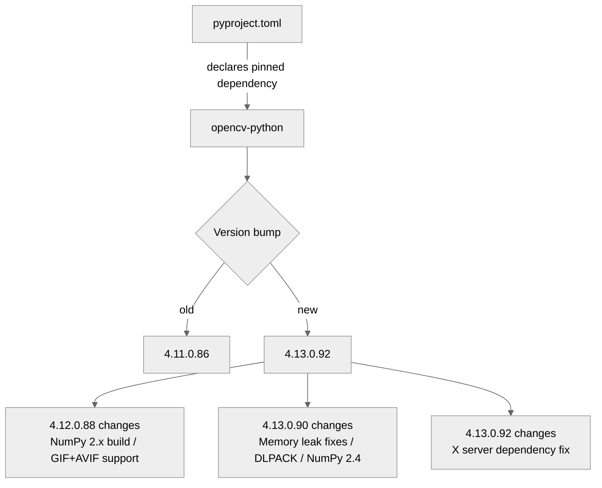

# Issue

**Title:** Bump opencv-python from 4.11.0.86 to 4.13.0.92

## Description

Bumps [opencv-python](https://github.com/opencv/opencv-python) from 4.11.0.86 to 4.13.0.92.

Release notes

<em>Sourced from <a href="https://github.com/opencv/opencv-python/releases">opencv-python's releases</a>.</em>

<blockquote>
<h2>4.13.0.92</h2>

Follow up release for 4.13.0 with X server dependency fix. See <a href="">#28438</a> for details.

<h2>4.13.0.90</h2>

Complete OpenCV 4.13.0 changelog: <a href="https://github.com/opencv/opencv/wiki/OpenCV-Change-Logs#version4130">https://github.com/opencv/opencv/wiki/OpenCV-Change-Logs#version4130</a>

Python specific:

<ul>
<li>Manylinux 2_28 support, Numpy 2.4 support, Python 3.14 support</li>
<li>Tuned Python bindings for logging <a href="">#27812</a></li>
<li>Marked Feature2D.detectAndCompute mask as optional in Python type stubs <a href="">#27544</a></li>
<li>Marked distCoeffs/R/D as optional in calib3d functions <a href="">#27564</a></li>
<li>Added DLPACK support <a href="">#27581</a>, <a href="">#27861</a></li>
<li>Fixed memory leaks in pybindings <a href="">#27738</a></li>
<li>Add PathLike type hints for args annotated with CV_WRAP_FILE_PATH <a href="">#27767</a></li>
<li>Fixed memory leak in pyopencv_to for path-like objects <a href="">#28047</a></li>
<li>Tunned Python bindings: use export_name as resolved typename for AliasTypeNode <a href="">#27997</a></li>
<li>python: fix pytest-cov false warnings by using compile() with full file path in exec_file_wrapper <a href="">#28093</a></li>
<li>Fixed python scalar typing issues <a href="">#27620</a></li>
<li>Fixed bug in ifdef state machine in header parser for bindings <a href="">#27393</a></li>
<li>Wrap GridType field in cv::findCirclesGrid parameters structure <a href="">#27689</a></li>
</ul>
<h2>4.12.0.88</h2>

Complete OpenCV 4.12.0 changelog: <a href="https://github.com/opencv/opencv/wiki/OpenCV-Change-Logs#version4120">https://github.com/opencv/opencv/wiki/OpenCV-Change-Logs#version4120</a>

Python:

<ul>
<li>Added libavif to the package and corresponding image format support on Linux and Mac OS. Windows is in progress.</li>
<li>Enabled GIF support by default.</li>
<li>Updated Numpy dependency rules. Packages for Python 3.9+ are built with Numpy 2.x. Packages for older Python version are built with Numpy 1.x.</li>
<li>Improved libjpeg-turbo performance in Windows builds (added NASM and assembly branches).</li>
<li>Made DNN, FLANN, G-API modules optional during the package build (bindings generation and typing).</li>
</ul>
</blockquote>

Commits

<ul>
<li>See full diff in <a href="https://github.com/opencv/opencv-python/commits">compare view</a></li>
</ul>

 

Dependabot will resolve any conflicts with this PR as long as you don't alter it yourself. You can also trigger a rebase manually by commenting `@dependabot rebase`.

[//]: # (dependabot-automerge-start)
[//]: # (dependabot-automerge-end)

---

Dependabot commands and options

 

You can trigger Dependabot actions by commenting on this PR:
- `@dependabot rebase` will rebase this PR
- `@dependabot recreate` will recreate this PR, overwriting any edits that have been made to it
- `@dependabot show <dependency name> ignore conditions` will show all of the ignore conditions of the specified dependency
- `@dependabot ignore this major version` will close this PR and stop Dependabot creating any more for this major version (unless you reopen the PR or upgrade to it yourself)
- `@dependabot ignore this minor version` will close this PR and stop Dependabot creating any more for this minor version (unless you reopen the PR or upgrade to it yourself)
- `@dependabot ignore this dependency` will close this PR and stop Dependabot creating any more for this dependency (unless you reopen the PR or upgrade to it yourself)

<!-- greptile_comment -->

<h3>Greptile Summary</h3>

This PR bumps `opencv-python` from `4.11.0.86` to `4.13.0.92`, skipping two intermediate releases (4.12.0.88 and 4.13.0.90). The change is a single-line version pin update in `pyproject.toml`, consistent with the project's existing convention of exact-version pinning for all dependencies.

Key highlights from the skipped releases:
- **4.12.0.88**: Enabled GIF and AVIF image format support, updated NumPy dependency rules (packages for Python 3.9+ are now built with NumPy 2.x).
- **4.13.0.90**: Fixed memory leaks in Python bindings, added DLPACK support, NumPy 2.4 compatibility, and Python 3.14 support.
- **4.13.0.92**: X server dependency fix (relevant for headless/CI environments).

One consideration worth tracking: starting with 4.12.0.88, the OpenCV Python wheels for Python 3.9+ are built against the NumPy 2.x C API. The current project pins `numpy>=1.22.2,<2.3.0`. While NumPy 2.x generally preserves ABI compatibility for packages using standard compatibility macros, it may be worth confirming that runtime behavior is unaffected with the existing NumPy range, and whether the upper bound should be relaxed to `<2.5.0` (or similar) to allow NumPy 2.4+ as now supported by OpenCV 4.13.

<h3>Confidence Score: 5/5</h3>

- This PR is safe to merge — it is a routine automated dependency bump with no logic changes.
- The change is a single exact-version pin update for a well-maintained library. The new version includes memory-leak fixes and a headless-environment compatibility fix with no breaking API changes reported. The project's existing NumPy constraint remains compatible with the new OpenCV release.
- No files require special attention.

<h3>Important Files Changed</h3>

| Filename | Overview |
|----------|----------|
| pyproject.toml | Single-line version bump of opencv-python from 4.11.0.86 to 4.13.0.92, consistent with the project's exact-version-pin convention for dependencies. |

<h3>Flowchart</h3>

Reviews (1): Last reviewed commit:  | [Re-trigger Greptile](https://app.greptile.com/api/retrigger?id=26099621)

<!-- /greptile_comment -->

## Task

Modify the repository so that the issue described above is resolved. The repository is checked out at base commit `502565a5c7a0`. Edit files in place; the verifier captures your changes via `git diff` and scores them against an oracle patch using SWE-RL-style diff-similarity reward.