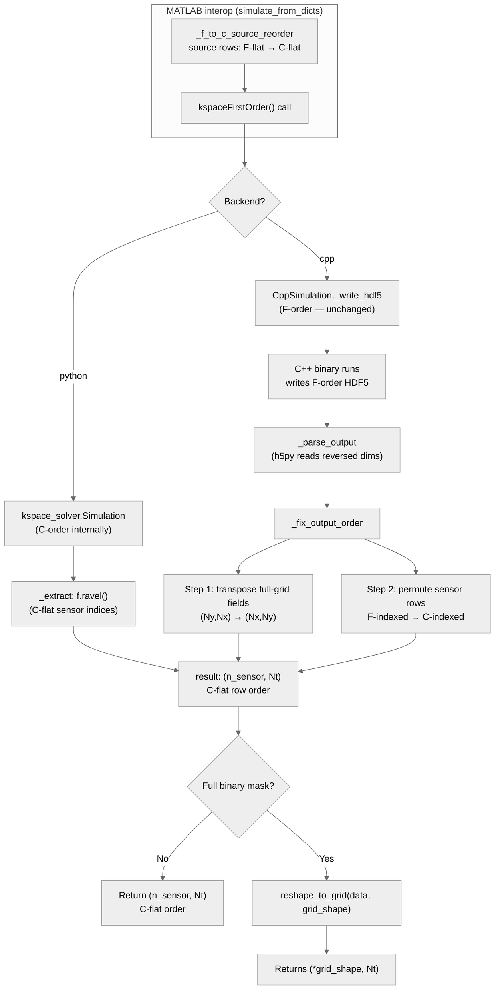

# Issue

**Title:** Migrate solver internals from F-order to C-order

## Description

The new kspaceFirstOrder() API now returns C-ordered sensor data:
- Full binary mask: (Nt, *grid_shape) — time-first, grid-shaped
- Partial binary mask: (n_sensor, Nt) in C-flattened order
- Cartesian mask: (n_points, Nt) ordered by input coordinates

Core changes:
- kspace_solver.py: all flatten/reshape switched from order="F" to C-order
- cpp_simulation.py: F-to-C permutation on sensor output, HDF5 stays F-order
- kspaceFirstOrder.py: auto-reshape for full masks, KWAVE_BACKEND/DEVICE env vars
- kwave_array.py, conversion.py: order parameter (default "F" + FutureWarning)
- Tests updated for new output shapes

<!-- greptile_comment -->

<h3>Greptile Summary</h3>

This PR performs a comprehensive migration of all solver internals from Fortran (column-major) to C (row-major) array ordering. The native Python solver (`kspace_solver.py`) now uses plain `ravel()`/`reshape()` throughout; the C++ backend path gains a new `_fix_output_order` post-processing step that transposes full-grid HDF5 fields and permutes sensor rows from F-indexed to C-indexed order. Two deprecation-guarded API changes (`cart2grid` and `kWaveArray` methods) provide a migration path for callers that relied on F-order outputs. A new `reshape_to_grid` convenience helper and extensive unit tests round out the change.\n\nKey points:\n- The bilinear interpolation strides are correctly recomputed for C-order via `np.cumprod([1] + list(self.grid_shape[:0:-1]))[::-1]`.\n- The F→C permutation logic (searchsorted on F-flat nonzero indices) is consistent across `_fix_output_order` (output) and `_f_to_c_source_reorder` (MATLAB input).\n- `plans/release-strategy.md` documents the new helper with the wrong name (`_reshape_sensor_to_grid` instead of `reshape_to_grid`) and wrong dimension order (`(Nt, *grid_shape)` instead of `(*grid_shape, Nt)`).\n- `simulate_from_dicts` builds `grid_shape` without the `int()` cast that `create_simulation` applies, which may break MATLAB interop callers using raw `scipy.io.loadmat` output.

<h3>Confidence Score: 5/5</h3>

Safe to merge — all remaining findings are P2 documentation/style issues that do not affect correctness for the primary Python solver path.

The core F→C migration logic is well-tested, the strides computation is mathematically correct, and the permutation approach is consistent between input (MATLAB interop source reorder) and output (_fix_output_order). The two open findings are: a stale/incorrect description in an internal planning document, and a missing int() cast in the MATLAB interop path that only matters for legacy callers using raw loadmat output.

kwave/solvers/kspace_solver.py (simulate_from_dicts int cast), plans/release-strategy.md (wrong function name/shape)

<details><summary><h3>Important Files Changed</h3></summary>

| Filename | Overview |
|----------|----------|
| kwave/kspaceFirstOrder.py | Adds `reshape_to_grid` helper, updates `_FULL_GRID_SUFFIXES`, switches source.p0 reshape and cart2grid to C-order. Logic is correct; docstring clearly states (n_sensor, Nt) → (*grid_shape, Nt) shape contract. |
| kwave/solvers/cpp_simulation.py | New `_fix_output_order` method transposes full-grid fields and reorders sensor rows from F-indexed to C-indexed using a searchsorted permutation. Shape-based disambiguation for n_sensor==Nt ambiguity is still present (flagged in previous review thread). |
| kwave/solvers/kspace_solver.py | Thorough F→C migration across flatten/reshape/ravel calls; bilinear interpolation strides correctly recomputed for C-order. `simulate_from_dicts` builds grid_shape without explicit int() conversion, unlike create_simulation which uses int(N) explicitly. |
| kwave/utils/conversion.py | Adds keyword-only `order` parameter with a FutureWarning sentinel, defaulting to "F" for backward compat. reorder_index extraction now uses the passed order parameter correctly. |
| kwave/utils/kwave_array.py | Replaces matlab_find/matlab_mask with np.where/direct indexing, adds FutureWarning sentinel for order parameter in get_distributed_source_signal and combine_sensor_data. Indexing logic is consistent (all 0-based now). |
| tests/test_c_order.py | New comprehensive test suite covering _fix_output_order, reshape_to_grid, _f_to_c_source_reorder, and FutureWarning triggers. Good coverage of edge cases (1D, 3D, full mask, partial mask). |
| plans/release-strategy.md | Plans entry for v0.6.1 describes `_reshape_sensor_to_grid()` with `(Nt, *grid_shape)` output, but the implemented function is `reshape_to_grid()` returning `(*grid_shape, Nt)`—both the name and dimension order are wrong. |
| tests/integration/conftest.py | Adds _c_to_f_reorder helper for MATLAB comparison and grid_shape parameter to assert_fields_close. Permutation logic correctly builds the C→F inverse mapping. |
| tests/integration/test_ivp_2D.py | Passes grid_shape=(128, 128) to assert_fields_close to trigger the new C→F reorder for MATLAB comparison. Minimal, correct change. |
| tests/test_native_solver.py | Shape assertions updated to explicitly check both dimensions (64*64, 10) instead of just shape[0]. Correct and more precise. |

</details>

</details>

<h3>Flowchart</h3>



<!-- greptile_failed_comments -->
<details><summary><h3>Comments Outside Diff (3)</h3></summary>

1. `tests/test_cross_backend.py`, line 1024 ([link](https://github.com/waltsims/k-wave-python/blob/fdc57d8699df294ae03d572df20d955bbd9d569e/tests/test_cross_backend.py#L1024))

   <a href="#"></a> **Source signal row ordering mismatched with new C-order solver**

   `get_distributed_source_signal` is called without `order='C'`, so it defaults to `order='F'` and emits a `FutureWarning`. More critically, the distributed source rows are indexed by **F-flattened** mask positions, but the new Python solver's `_build_source_op` assigns row `i` to the **i-th C-flattened** active mask position. For a 3D disc element with spatially-varying BLI weights, this assigns the wrong weight to each source grid point.

   The test only checks that backends agree with each other (`_assert_p_close`), not against a reference, so it will pass even though the simulated physics are wrong.

2. `tests/test_cross_backend.py`, line 854 ([link](https://github.com/waltsims/k-wave-python/blob/fdc57d8699df294ae03d572df20d955bbd9d569e/tests/test_cross_backend.py#L854))

   <a href="#"></a> **`("python", "gpu")` entry in `COMBOS` has no corresponding skip guard in `_collect`**

   `_collect` skips the CPP backend when `kgrid.dim < 2`, but there is no equivalent guard for `("python", "gpu")` when CuPy is unavailable. `_available` returns `False` in that case, so the pair is silently dropped — which is fine. However, if only one backend is available, `_assert_p_close` raises:

   ```
   AssertionError: Only 1 combo(s) available — need ≥2 to compare
   ```

   This makes CI results non-deterministic depending on which extras are installed. Consider adding a `pytest.skip` call inside `test_all_combos_agree` when fewer than two combos are actually runnable.

3. `kwave/solvers/kspace_solver.py`, line 782-792 ([link](https://github.com/waltsims/k-wave-python/blob/f5522e1c2ca8dd6e89e6d262b65f237c82963d6d/kwave/solvers/kspace_solver.py#L782-L792))

   <a href="#"></a> **`simulate_from_dicts` silently produces wrong results for multi-source MATLAB calls**

   The new docstring correctly identifies that MATLAB sends source signal rows in F-flattened order, but the function still just delegates to `create_simulation(...).run()` without any reordering. Any existing MATLAB caller that provides a multi-row source signal (i.e., multiple source points, each with its own time series) will now silently receive incorrectly scrambled simulation output — the source values will be injected at the wrong spatial locations.

   Since `simulate_from_dicts` is explicitly the MATLAB interop entry point, callers cannot be expected to perform shim-layer reordering themselves without a breaking API change or at least a loud error. Options:

   1. Add an explicit `ValueError` / `NotImplementedError` guard for `n_src > 1` until the shim is updated.
   2. Accept a `matlab_compat=False` flag and do the F→C row reordering here.
   3. At minimum, raise a runtime warning so callers are not silently producing wrong physics.

   Leaving it as a silent correctness break for all multi-point MATLAB source users is a regression that is hard to diagnose.
</details>

<!-- /greptile_failed_comments -->

<sub>Reviews (5): Last reviewed commit:  | [Re-trigger Greptile](https://app.greptile.com/api/retrigger?id=26504393)</sub>

<!-- /greptile_comment -->

## Task

Modify the repository so that the issue described above is resolved. The repository is checked out at base commit `8ab682236ea5`. Edit files in place; the verifier captures your changes via `git diff` and scores them against an oracle patch using SWE-RL-style diff-similarity reward.