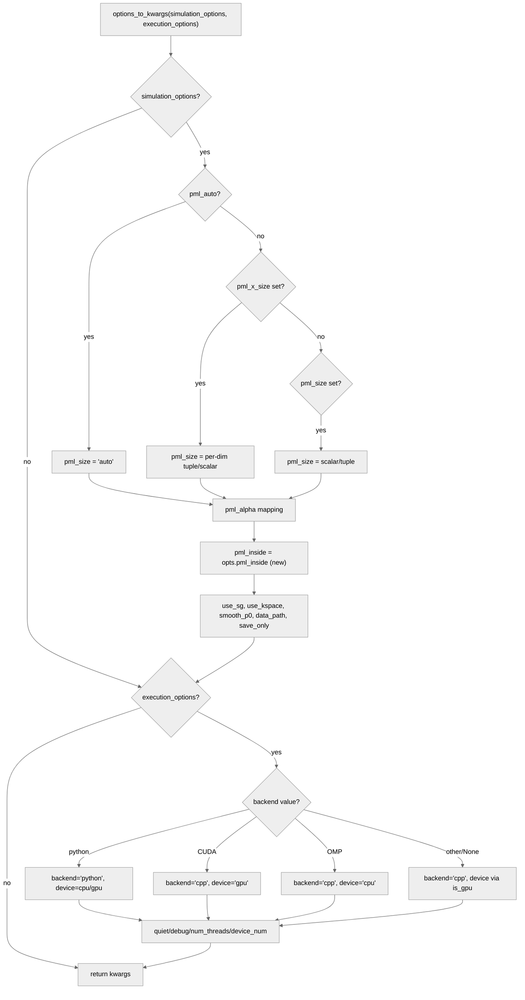

# Issue

**Title:** Add unified API docs and bump version to 0.6.0

## Description

- Add new_api.rst guide covering kspaceFirstOrder() usage, backend/device selection, PML options, save-only mode, migration from legacy API
- Update first_simulation.rst to use kspaceFirstOrder() instead of legacy
- Add kspaceFirstOrder to docs index and API toctree
- Update README with What's New in v0.6.0 section
- Bump version from 0.5.0rc1 to 0.6.0

<!-- greptile_comment -->

<h3>Greptile Summary</h3>

This PR introduces the v0.6.0 unified API documentation and bumps the version from `0.5.0rc1` to `0.6.0`. It adds a comprehensive `new_api.rst` guide, updates `first_simulation.rst` to use the new `kspaceFirstOrder()` entry point, wires everything into the docs index and API toctree, and makes one functional fix in `kwave/compat.py`.\n\n**Key changes:**\n- **New `docs/get_started/new_api.rst`** — covers quick start, backend/device selection, PML options, save-only cluster mode, a full parameter reference via `autofunction`, and a migration guide from the legacy options classes.\n- **`kwave/compat.py` functional fix** — `options_to_kwargs()` now unconditionally maps `pml_inside` from `SimulationOptions` to the kwargs dict, resolving the previously-flagged silent divergence between the legacy default (`True`) and the new API default (`False`) during migration.\n- **Environment-variables section removed** — the previously-flagged undocumented `KWAVE_BACKEND`/`KWAVE_DEVICE` section is absent from `new_api.rst`, correctly deferring that feature until it is actually implemented.\n- **Version bump** — `__version__` updated to `\"0.6.0\"` in `kwave/__init__.py`.

<h3>Confidence Score: 5/5</h3>

Safe to merge — both previously-flagged concerns are resolved and no new issues are introduced.

Both prior review concerns are addressed: `pml_inside` is now correctly forwarded by `options_to_kwargs()`, and the unimplemented environment-variables section was removed rather than shipped. The remaining changes are documentation and a version bump with no observable runtime risk.

No files require special attention.

<h3>Important Files Changed</h3>

| Filename | Overview |
|----------|----------|
| kwave/compat.py | Adds `pml_inside` to the unconditional kwargs mapping in `options_to_kwargs()`, fixing the previously-flagged silent data loss when migrating code that relied on a non-default `pml_inside` value. |
| kwave/__init__.py | Straightforward version bump from `0.5.0rc1` to `0.6.0`. |
| docs/get_started/new_api.rst | New Unified API guide covering quick start, backend/device selection, PML options, save-only mode, and migration from the legacy API; environment-variables section previously flagged is absent, and the migration example now works correctly following the compat.py fix. |
| docs/get_started/first_simulation.rst | Step 5 updated to use `kspaceFirstOrder()` instead of `kspaceFirstOrder2D`; a note is added explaining the unified API and pointing to the new guide. |
| docs/index.rst | Adds `get_started/new_api` to the toctree and `kwave.kspaceFirstOrder` to the API reference section. |
| docs/README.md | Adds a "What's New in v0.6.0" section advertising the unified API, Python solver, and a link to the new guide. |

<h3>Flowchart</h3>

Reviews (2): Last reviewed commit:  | [Re-trigger Greptile](https://app.greptile.com/api/retrigger?id=26510627)

<!-- /greptile_comment -->

## Task

Modify the repository so that the issue described above is resolved. The repository is checked out at base commit `a98aadd0c9c9`. Edit files in place; the verifier captures your changes via `git diff` and scores them against an oracle patch using SWE-RL-style diff-similarity reward.