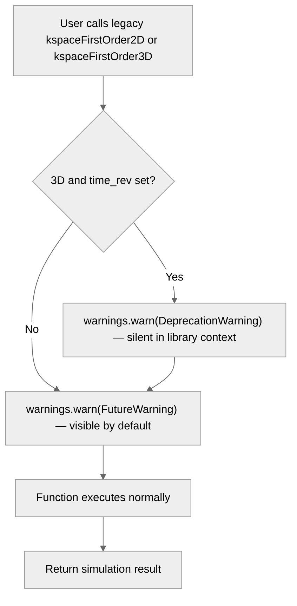

# Issue

**Title:** Fix docs furo toc

## Description

This pull request updates the way deprecation warnings are handled and documented for the legacy `kspaceFirstOrder2D` and `kspaceFirstOrder3D` functions. The main change is to replace `DeprecationWarning` with `FutureWarning` both in the Python code and in the documentation, to better reflect the intended warning to users.

Warning updates:

* Changed the warning type emitted by the legacy `kspaceFirstOrder2D` and `kspaceFirstOrder3D` functions from `DeprecationWarning` to `FutureWarning` in their respective Python files (`kwave/kspaceFirstOrder2D.py`, `kwave/kspaceFirstOrder3D.py`). [[1]](diffhunk://#diff-7b93017162f0108ac56942c409776347638d0cbe6f9074005898438ea496b4e7L208-R208) [[2]](diffhunk://#diff-6d2c31842a10c56ca65e151f711eeb8273ba1cc2003759b9225ca4c8316f2f6fL201-R201)
* Updated documentation to state that the legacy functions now emit `FutureWarning` instead of `DeprecationWarning` (`docs/get_started/new_api.rst`).

Documentation improvements:

* Clarified in the documentation that the legacy functions "emit warnings" instead of specifically "deprecation warnings" (`docs/get_started/first_simulation.rst`).
* Removed the table of contents from the new API documentation for conciseness (`docs/get_started/new_api.rst`).

<!-- greptile_comment -->

<h3>Greptile Summary</h3>

This PR replaces `DeprecationWarning` with `FutureWarning` in the legacy `kspaceFirstOrder2D` and `kspaceFirstOrder3D` functions, and aligns the documentation accordingly. It also removes a redundant table of contents from `new_api.rst` (the "Fix docs furo toc" title change).\n\nThe motivation is sound: `DeprecationWarning` is silenced by default in non-`__main__` contexts (e.g. when k-wave-python is used as a library), meaning most end users never saw the migration nudge. `FutureWarning` is shown by default, so this change ensures users are actually informed to migrate to `kspaceFirstOrder()`.\n\nKey changes:\n- `kwave/kspaceFirstOrder2D.py` and `kwave/kspaceFirstOrder3D.py`: `DeprecationWarning` → `FutureWarning` in the main function-level `warnings.warn()` calls.\n- `docs/get_started/new_api.rst`: Updated warning type reference and removed local TOC.\n- `docs/get_started/first_simulation.rst`: Loosened wording to "emit warnings" (appropriate since `FutureWarning` is not a deprecation warning subclass).\n- One minor inconsistency remains: `kspaceFirstOrder3D` still uses `DeprecationWarning` for its `time_rev` parameter deprecation, while the function-level warning now uses `FutureWarning`.

<h3>Confidence Score: 5/5</h3>

Safe to merge — changes are minimal, well-scoped, and correct; the only note is a non-blocking style inconsistency in kspaceFirstOrder3D.py.

All four changed files make clean, intentional updates. The FutureWarning change is semantically appropriate for end-user-facing library code. The single P2 comment (inconsistent DeprecationWarning on time_rev) is pre-existing and does not affect correctness or the primary migration path being improved here.

kwave/kspaceFirstOrder3D.py — minor inconsistency between warning types for time_rev (line 196) vs. the function-level warning.

<h3>Important Files Changed</h3>

| Filename | Overview |
|----------|----------|
| kwave/kspaceFirstOrder2D.py | Changed DeprecationWarning to FutureWarning for the function-level deprecation notice — correct and intentional to make the warning visible to end users by default. |
| kwave/kspaceFirstOrder3D.py | Changed DeprecationWarning to FutureWarning for the function-level warning, but the time_rev parameter deprecation on line 196 still uses DeprecationWarning, creating an inconsistency within the same function. |
| docs/get_started/new_api.rst | Removed local table of contents directive and updated warning type reference from DeprecationWarning to FutureWarning — clean documentation change. |
| docs/get_started/first_simulation.rst | Replaced 'emit deprecation warnings' with 'emit warnings' — appropriately loosened wording now that FutureWarning is used instead of DeprecationWarning. |

<h3>Flowchart</h3>

<!-- greptile_failed_comments -->

<h3>Comments Outside Diff (1)</h3>

1. `kwave/kspaceFirstOrder3D.py`, line 196 ([link](https://github.com/waltsims/k-wave-python/blob/61e52eee406ba144bfd167678391bf8c9c2c6077/kwave/kspaceFirstOrder3D.py#L196))

    **Inconsistent warning type for `time_rev` deprecation**

   Line 196 still emits `DeprecationWarning` for the `time_rev` parameter, while the main function-level deprecation below it was changed to `FutureWarning`. Since `FutureWarning` is visible to end users by default (while `DeprecationWarning` is silenced in non-`__main__` contexts), the `time_rev` warning will remain hidden to most users while the function-level warning is visible. Consider making this consistent:

<!-- /greptile_failed_comments -->

Reviews (1): Last reviewed commit:  | [Re-trigger Greptile](https://app.greptile.com/api/retrigger?id=26513010)

<!-- /greptile_comment -->

## Task

Modify the repository so that the issue described above is resolved. The repository is checked out at base commit `18dfd0166b91`. Edit files in place; the verifier captures your changes via `git diff` and scores them against an oracle patch using SWE-RL-style diff-similarity reward.