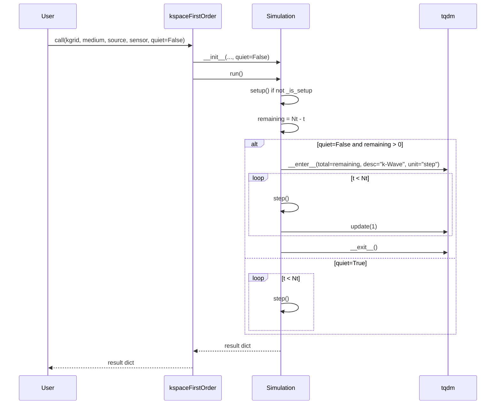

# Issue

**Title:** Add tqdm progress bar to Python solver

## Description

Shows a progress bar during simulation when quiet=False (default). Suppressed with quiet=True. Uses tqdm with step count and rate.

<!-- greptile_comment -->

<h3>Greptile Summary</h3>

This PR adds a `tqdm` progress bar to the Python solver's `run()` loop, giving users real-time feedback (step count, rate, and ETA) during simulations. The bar is shown by default (`quiet=False`) and suppressed with `quiet=True`, which was already an accepted parameter in `kspaceFirstOrder` and is now correctly threaded through to the `Simulation` class.

Key changes:
- `tqdm` promoted to a module-level import in `kspace_solver.py` and declared as a runtime dependency (`>=4.60`).
- `Simulation.__init__` gains a `quiet` keyword argument (default `False`), stored as `self.quiet`.
- `run()` wraps the step loop in a `tqdm` context manager when `not self.quiet` and `remaining > 0`; the `total` is set to `remaining = self.Nt - self.t`, so the bar is accurate even if some steps were already executed manually before `run()` was called.
- Both the Python and C++ backends consistently honour the `quiet` flag (C++ path already forwarded it to `cpp_sim.run()`).
- Two new smoke tests verify that the bar neither breaks a normal run nor suppresses results when `quiet=True`.

<h3>Confidence Score: 5/5</h3>

Safe to merge — the change is additive, correctly scoped to the Python backend's run loop, and covered by new smoke tests.

No P0 or P1 issues found. The `tqdm` integration is minimal and correct: `total` tracks remaining steps accurately, both backends honour `quiet`, the import is at module level, and the dependency version floor is sensible. All existing behaviour is preserved when `quiet=True`.

No files require special attention.

<h3>Important Files Changed</h3>

| Filename | Overview |
|----------|----------|
| kwave/solvers/kspace_solver.py | Adds `quiet` parameter to `Simulation.__init__` and wraps the run loop with a `tqdm` progress bar when `quiet=False`; `tqdm` is now a module-level import. |
| kwave/kspaceFirstOrder.py | Threads the existing `quiet` parameter through to `Simulation`; the C++ backend already forwarded `quiet` to `cpp_sim.run()`, so both backends are consistent. |
| pyproject.toml | Adds `tqdm>=4.60` as a runtime dependency; the minimum version is reasonable given the stable context-manager API used. |
| tests/test_native_solver.py | Adds `TestProgressBar` with two smoke tests covering `quiet=False` (bar shown) and `quiet=True` (bar suppressed); both assert on result shape. |
| uv.lock | Lock file updated to include `tqdm` in the dependency graph; no concerns. |

<h3>Sequence Diagram</h3>

<!-- greptile_failed_comments -->

<h3>Comments Outside Diff (1)</h3>

1. `uv.lock`, line 763-773 ([link](https://github.com/waltsims/k-wave-python/blob/ce79fdc07f33aaf324e42bf123f9d8984b227dae/uv.lock#L763-L773))

    **Lock file not regenerated after adding `tqdm` dependency**

   `tqdm>=4.60` was added to `pyproject.toml` but the `uv.lock` was not properly regenerated. The `k-wave-python` package entry in the lock file is missing `tqdm` in two places:

   1. The **`dependencies`** section (lines 763–773) lists `beartype`, `deepdiff`, `deprecated`, `h5py`, `jaxtyping`, `matplotlib`, `numpy`, `opencv-python`, and `scipy` — but not `tqdm`.
   2. The **`[package.metadata] requires-dist`** section (lines 804–827) also does not include `{ name = "tqdm", specifier = ">=4.60" }`.

   Because `tqdm` currently appears in the lock file only as a transitive dependency of `gdown` (an optional `example` extra) and `ssfp` (a transitive dep of the `test` extra), a plain `pip install k-wave-python` or `uv sync` without those extras would **not** install `tqdm`, causing an `ImportError` at runtime when `quiet=False` (the default).

   Additionally, running `uv lock --check` will fail because the lock file does not match `pyproject.toml`, which will break CI pipelines that verify lock-file integrity.

   **Fix:** Run `uv lock` to regenerate the lock file so `tqdm` is recorded as a direct runtime dependency of `k-wave-python`.

<!-- /greptile_failed_comments -->

Reviews (2): Last reviewed commit:  | [Re-trigger Greptile](https://app.greptile.com/api/retrigger?id=26569594)

<!-- /greptile_comment -->

## Task

Modify the repository so that the issue described above is resolved. The repository is checked out at base commit `785c0bdbbfd0`. Edit files in place; the verifier captures your changes via `git diff` and scores them against an oracle patch using SWE-RL-style diff-similarity reward.