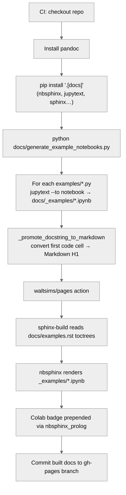

# Issue

**Title:** Remove unrelated test_example_parity.py change

## Description

<!-- greptile_comment -->

<h3>Greptile Summary</h3>

This PR introduces an example notebook gallery for the k-wave-python documentation: it adds a `generate_example_notebooks.py` script that converts `examples/*.py` files (jupytext percent format) to `.ipynb` notebooks in `docs/_examples/`, hooks that generation into both the `docs/Makefile` and the CI workflow, and a new `examples.rst` toctree page that exposes all 29 example notebooks via nbsphinx.

**Key changes:**
- `docs/generate_example_notebooks.py` — new script that shells out to `jupytext`, then promotes standalone module docstrings into rendered Markdown H1 cells.
- `.github/workflows/test_pages.yml` — adds pandoc install, manual `pip install '.[docs]'`, and notebook generation *before* the `waltsims/pages` action runs (fixing the previous double-installation issue by removing `pyproject_toml_deps` from the action's `with:` block).
- `docs/conf.py` — enables the `nbsphinx` extension with `nbsphinx_execute = "never"` (pre-rendered) and a Colab badge prolog; the badge URL still points to a `notebooks/` path that does not exist in the repository (noted in a prior review).
- `docs/_examples/` is gitignored, so notebooks are regenerated on every CI run rather than committed.
- `pyproject.toml` adds `nbsphinx==0.9.7` and `jupytext==1.16.6` to the `docs` dependency group.

<h3>Confidence Score: 5/5</h3>

Safe to merge — all remaining findings are minor style/edge-case suggestions that do not affect runtime behaviour.

No new P0 or P1 issues were found. The two P2 comments (.PHONY declaration and empty-docstring edge case) are non-blocking. The previously flagged Colab badge URL problem and double-installation concern are pre-existing and already in discussion; this PR does not worsen them and in fact fixes the double-installation by removing pyproject_toml_deps from the action.

docs/conf.py for the unresolved Colab badge path (tracked in a prior review thread).

<h3>Important Files Changed</h3>

| Filename | Overview |
|----------|----------|
| .github/workflows/test_pages.yml | Adds pandoc install, explicit dep install, and notebook generation before the pages action; removes the `pyproject_toml_deps` parameter from the action — intentional to avoid double-installation. |
| docs/generate_example_notebooks.py | New script converting `examples/*.py` (jupytext percent format) to `.ipynb` files in `docs/_examples/`; docstring-to-markdown promotion logic is mostly correct but has a minor empty-docstring edge case. |
| docs/conf.py | Adds `nbsphinx` extension and Colab badge prolog; Colab URL still references `master/notebooks/` which doesn't exist in the repo (flagged in prior review). |
| docs/Makefile | Adds a `notebooks` target for jupytext conversion and overrides `html` to depend on it; `html` should be declared `.PHONY`. |
| docs/examples.rst | New file listing all 29 example notebooks in a toctree gallery; all referenced filenames match the actual `examples/*.py` files. |
| .gitignore | Adds `docs/_examples/` to .gitignore so generated notebooks aren't committed; intentional since they're regenerated in CI. |
| pyproject.toml | Adds `nbsphinx==0.9.7` and `jupytext==1.16.6` to the `docs` optional-dependency group. |
| docs/index.rst | Adds `examples` to the toctree so the new gallery page is linked from the main navigation. |

<h3>Flowchart</h3>

Reviews (2): Last reviewed commit:  | [Re-trigger Greptile](https://app.greptile.com/api/retrigger?id=26697931)

<!-- /greptile_comment -->

## Task

Modify the repository so that the issue described above is resolved. The repository is checked out at base commit `8e75600f21e7`. Edit files in place; the verifier captures your changes via `git diff` and scores them against an oracle patch using SWE-RL-style diff-similarity reward.