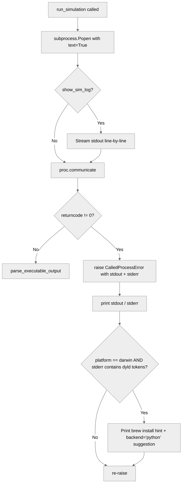

# Issue

**Title:** Clean up README and add macOS hint to C++ backend

## Description

- Remove macOS brew note from README (only needed for C++ backend, not the new NumPy/Python backend)
- Update contact email to walter.a.simson@gmail.com
- Add macOS dependency hint in executor.py when C++ binary fails: suggests brew install or switching to backend='python'

<!-- greptile_comment -->

<h3>Greptile Summary</h3>

This PR cleans up user-facing documentation and adds a targeted macOS dependency hint in the C++ executor error path.

- **`kwave/executor.py`**: Adds a `brew install` hint to stderr when a `CalledProcessError` occurs on macOS *and* the error output contains known dynamic-linker tokens (`\"Library not loaded\"`, `\"image not found\"`, or `\"dyld\"`). This directly addresses the prior review concern about the hint firing for unrelated failures.
- **`docs/README.md`**: Removes the macOS brew note (now correctly deferred to the C++ backend error path), updates the contact email, and condenses the introduction.
- **`docs/examples_guide.rst`** / **`docs/get_started/first_simulation.rst`**: Replaces verbose list-table blocks with lightweight bullet lists; all referenced `.py` example files were confirmed to exist in the repository.
- **`docs/development/development_environment.rst`**: Simplifies setup instructions to a `uv sync` / `uv run` workflow while preserving the MATLAB reference-download note.
- **`pyproject.toml`**: Updates Walter Simson's email in `authors` and `maintainers` to match the new contact address.

<h3>Confidence Score: 5/5</h3>

Safe to merge — all changes are documentation cleanup and a well-scoped error-path hint with no functional risk

The only code change in executor.py is a narrowly guarded print statement inside an already-failing exception handler; it cannot affect the happy path or introduce new exceptions. The prior review concern about over-broad hinting was addressed by scoping the check to dyld-specific stderr tokens. All referenced documentation file paths were verified to exist in the repository.

No files require special attention

<h3>Important Files Changed</h3>

| Filename | Overview |
|----------|----------|
| kwave/executor.py | Adds a macOS-scoped hint when C++ binary fails with dynamic linker errors; properly guarded behind platform and stderr content checks |
| docs/README.md | Removes macOS brew note (C++ backend-only concern), updates contact email, and condenses introduction text |
| docs/development/development_environment.rst | Condensed setup guide; preserves MATLAB reference download note; switches to uv sync/uv run idioms |
| docs/examples_guide.rst | Replaces verbose list-tables with lightweight bullet lists; all referenced example .py files verified to exist; uses ghfile extlink role with explicit titles (supported by Sphinx 5+) |
| docs/get_started/first_simulation.rst | Simplifies Next Steps section to a single cross-reference instead of a categorised example list |
| pyproject.toml | Updates Walter Simson's email in authors and maintainers to gmail address, consistent with README and other docs changes |

<h3>Flowchart</h3>

Reviews (3): Last reviewed commit:  | [Re-trigger Greptile](https://app.greptile.com/api/retrigger?id=26700888)

<!-- /greptile_comment -->

## Task

Modify the repository so that the issue described above is resolved. The repository is checked out at base commit `5d5074891059`. Edit files in place; the verifier captures your changes via `git diff` and scores them against an oracle patch using SWE-RL-style diff-similarity reward.