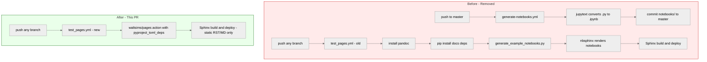

# Issue

**Title:** Remove dead notebook/gallery infrastructure from master

## Description

- Delete: generate-notebooks.yml, docs/examples.rst, docs/generate_example_notebooks.py, jupytext.toml, run_examples.py, docs/Makefile
- Remove nbsphinx extension and Colab prolog from docs/conf.py
- Remove nbsphinx and jupytext from docs dependencies
- Remove examples gallery from docs index toctree
- Revert test_pages.yml to simple Sphinx build (no pandoc/notebooks)
- Remove docs/_examples/ from .gitignore

The notebook gallery approach was closed — proper documentation with static images will replace it. Legacy example notebooks untouched.

<!-- greptile_comment -->

<h3>Greptile Summary</h3>

This PR removes all the notebook/gallery infrastructure that was introduced to generate interactive Jupyter notebook documentation from the `examples/*.py` files. The approach has been abandoned in favour of static-image documentation, so all associated files, CI workflows, Sphinx extensions, and dependencies are cleanly deleted.

- **Deleted files**: `generate-notebooks.yml`, `run_examples.py`, `docs/generate_example_notebooks.py`, `docs/examples.rst`, `docs/Makefile`, `Makefile`, `jupytext.toml`
- **`docs/conf.py`**: `nbsphinx` extension and Colab-badge prolog removed
- **`pyproject.toml`**: `nbsphinx==0.9.7` and `jupytext==1.16.6` dropped from the `[docs]` extra
- **`test_pages.yml`**: Simplified — pandoc install and notebook-generation steps removed; dependency installation delegated to the `waltsims/pages` action via the new `pyproject_toml_deps` input
- **`docs/index.rst`**: `examples` toctree entry removed alongside the now-deleted `examples.rst`
- **`.gitignore`**: `docs/_examples/` rule removed (directory is no longer generated)

No remaining references to the removed infrastructure exist in any build-critical file; the only mentions are in `plans/release-strategy.md`, a planning document where the historical context is appropriate to retain.

<h3>Confidence Score: 5/5</h3>

Safe to merge — purely a deletion of dead infrastructure with no impact on library functionality or existing tests.

All changes are deletions or straightforward removals of references. Every deleted file, extension, and dependency has been consistently removed across the workflow, Sphinx config, pyproject.toml, .gitignore, and index. No broken cross-references remain in build-critical files. No remaining findings rise above P2.

.github/workflows/test_pages.yml — uses a branch ref (waltsims/pages@pyproject.toml-support) rather than a pinned commit SHA, which is a pre-existing pattern not introduced by this PR.

<details><summary><h3>Important Files Changed</h3></summary>

| Filename | Overview |
|----------|----------|
| .github/workflows/generate-notebooks.yml | Deleted: CI workflow that auto-converted examples/*.py to notebooks and committed them back to master. |
| .github/workflows/test_pages.yml | Simplified: removed pandoc install + notebook generation steps; now delegates full dependency installation to the waltsims/pages action via the new pyproject_toml_deps input. |
| docs/conf.py | Removed nbsphinx extension, nbsphinx_execute setting, and the Colab-badge prolog template; rest of config unchanged. |
| pyproject.toml | Removed nbsphinx==0.9.7 and jupytext==1.16.6 from [docs] optional dependency group. |
| docs/index.rst | Removed examples toctree entry; the now-deleted examples.rst is no longer referenced. |
| docs/generate_example_notebooks.py | Deleted: script that converted examples/*.py (percent-format) to docs/_examples/*.ipynb for nbsphinx rendering. |

</details>

</details>

<h3>Flowchart</h3>



<!-- greptile_failed_comments -->
<details><summary><h3>Comments Outside Diff (3)</h3></summary>

1. `run_examples.py`

   <a href="#"></a> **Stale references to deleted `run_examples.py`**

   `run_examples.py` is deleted by this PR, but two places still reference it and will break:

   1. **Root `Makefile` line 20** — the `run-examples` target (and by extension the default `all` target) calls `python run_examples.py` directly. Anyone running `make run-examples` or `make all` will get a file-not-found error immediately after this merges.

   2. **`docs/development/development_environment.rst` lines 98 & 104** — the development docs show users how to run examples with two explicit invocations of `run_examples.py`:
      ```
      MPLBACKEND=Agg python run_examples.py
      MPLBACKEND=Agg KWAVE_FORCE_CPU=1 python run_examples.py
      ```

   Both references should be removed or updated to reflect whatever the new recommended way to run examples is (e.g., pointing users at the `examples/` directory directly).

2. `Makefile`, line 20 ([link](https://github.com/waltsims/k-wave-python/blob/414d700ed5790609c0210c20d38083ce44aea131/Makefile#L20))

   **`make run-examples` now broken — `run_examples.py` was deleted**

   `run_examples.py` is deleted in this PR, but the root `Makefile`'s `run-examples` target (and the `all` target which depends on it) still calls `python run_examples.py`. Any developer running `make run-examples` or `make all` will hit a `No such file or directory` error immediately.

   This Makefile target should either be removed or updated to invoke the examples via a different mechanism.

3. `docs/development/development_environment.rst`, line 96-104 ([link](https://github.com/waltsims/k-wave-python/blob/414d700ed5790609c0210c20d38083ce44aea131/docs/development/development_environment.rst#L96-L104))

   **Docs reference deleted `run_examples.py`**

   The "Running Examples" section shows two commands that both rely on `run_examples.py`, which is deleted in this PR:

   ```
   make run-examples
   # or
   MPLBACKEND=Agg python run_examples.py
   ```
   and
   ```
   MPLBACKEND=Agg KWAVE_FORCE_CPU=1 python run_examples.py
   ```

   Both will fail with `No such file or directory`. This section of the developer documentation should be updated or removed to reflect the new approach for running examples.
</details>

<!-- /greptile_failed_comments -->

<sub>Reviews (3): Last reviewed commit:  | [Re-trigger Greptile](https://app.greptile.com/api/retrigger?id=26701358)</sub>

<!-- /greptile_comment -->

## Task

Modify the repository so that the issue described above is resolved. The repository is checked out at base commit `3a7ae8f397a7`. Edit files in place; the verifier captures your changes via `git diff` and scores them against an oracle patch using SWE-RL-style diff-similarity reward.