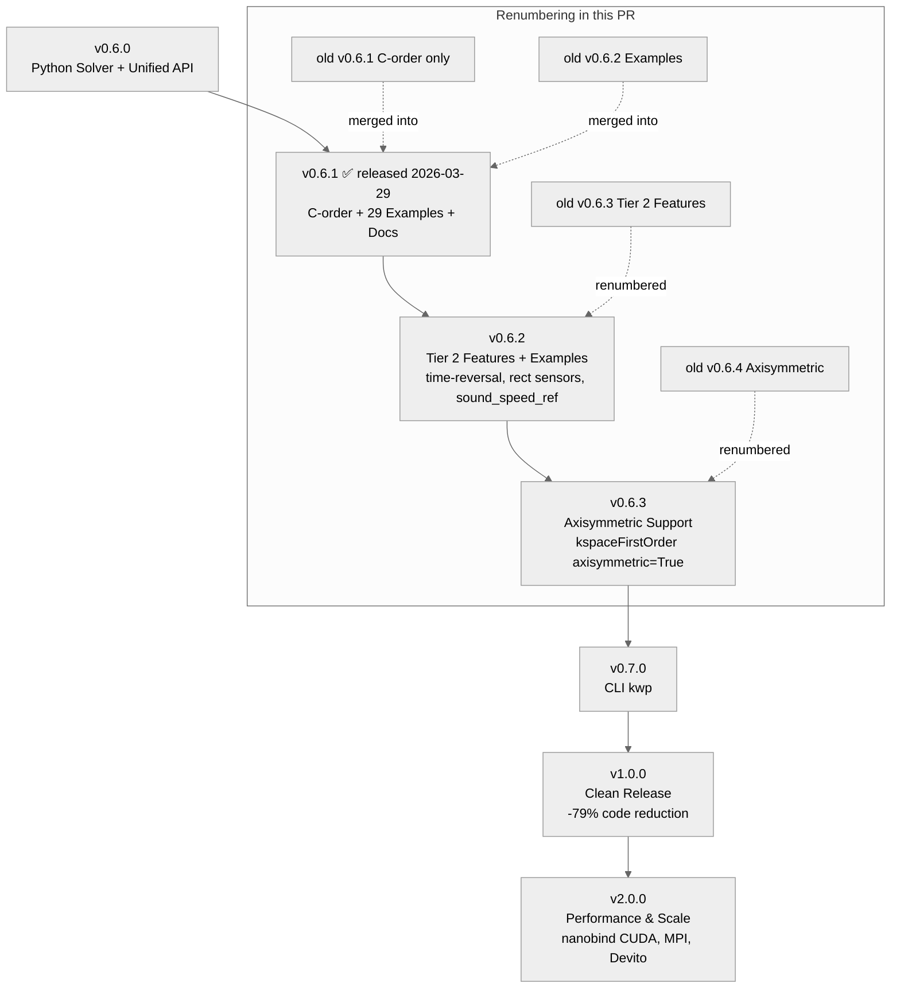

# Issue

**Title:** Bump version to 0.6.1, update release plan

## Description

v0.6.1 combines: C-order migration, 29 ported examples, 47 parity tests, 3D PML fix, docs cleanup, infra removal.

Renumber: old v0.6.2 (examples) merged into v0.6.1, old v0.6.3 (features) becomes v0.6.2, old v0.6.4 (axisymmetric) becomes v0.6.3.

<!-- greptile_comment -->

<h3>Greptile Summary</h3>

This PR bumps the package version to `0.6.1` and updates the release strategy document to reflect the consolidated scope of v0.6.1 (C-order migration + 29 ported examples + 47 parity tests + docs cleanup) and the downstream renumbering (old v0.6.3 → new v0.6.2 Tier 2 Features; old v0.6.4 → new v0.6.3 Axisymmetric).

- **`kwave/__init__.py`** — clean single-line bump; `pyproject.toml` uses `dynamic = [\"version\"]` with `path = \"kwave/__init__.py\"`, so the build system will pick up the new version correctly without any additional changes.
- **`plans/release-strategy.md`** — the version roadmap table and the new \"Phase 2.x: v0.6.x Point Releases\" summary section are correctly updated. However, the older detailed subsections (`## Phase 2.1`, `## Phase 2.2`, `## Phase 2.3`) and the **Testing Strategy** / **Implementation Order** blocks further down the document still carry the old version labels and old scope descriptions, creating internal inconsistency in the planning document.

<h3>Confidence Score: 5/5</h3>

Safe to merge — only a version bump and planning document update with no production code risk.

The only code change is a one-line version string bump that is correctly sourced by the build system. The sole finding is a P2 documentation inconsistency in a planning file (stale Phase 2.1/2.2/2.3 sections not reconciled after renumbering), which does not affect runtime behavior or release correctness.

plans/release-strategy.md — stale Phase 2.1/2.2/2.3 sections, Testing Strategy version labels, and Implementation Order list should be cleaned up to match the new numbering.

<h3>Important Files Changed</h3>

| Filename | Overview |
|----------|----------|
| kwave/__init__.py | Single-line version bump from 0.6.0 to 0.6.1; pyproject.toml dynamically sources version from this file via hatchling, so no other version files need updating. |
| plans/release-strategy.md | Version roadmap table and Phase 2.x summary block updated to reflect merged v0.6.1 scope and renumbered v0.6.2/v0.6.3; however Phase 2.1/2.2/2.3 detailed sections, Testing Strategy version labels, and Implementation Order list were not updated, leaving stale content inconsistent with the new numbering. |

<h3>Flowchart</h3>

<!-- greptile_failed_comments -->

<h3>Comments Outside Diff (1)</h3>

1. `plans/release-strategy.md`, line 127-218 ([link](https://github.com/waltsims/k-wave-python/blob/addf7dd06398127f4bff4c1952c4e83fae269717/plans/release-strategy.md#L127-L218))

    **Stale Phase 2.1/2.2/2.3 sections not updated to match renumbering**

   The PR correctly updated both the version roadmap table (lines 9–18) and the "Phase 2.x: v0.6.x Point Releases" summary block (lines 221–274). However, the three detailed phase sections further up in the document were not reconciled with the renumbering:

   - **Line 127** — `## Phase 2.1: v0.6.1 - C-order Migration (Helpers)` still describes v0.6.1 as *only* the C-order helpers migration (the old scope). The combined scope (C-order + examples + docs) shipped in this release is only reflected in the new "Phase 2.x" block below.
   - **Line 159** — `## Phase 2.2: v0.6.2 - Example Migration` describes work that was folded into v0.6.1 in this PR. It no longer corresponds to any future release.
   - **Line 192** — `## Phase 2.3: v0.6.3 - Axisymmetric Support` still uses the old v0.6.3 label; the roadmap now calls this v0.6.3 (previously v0.6.4), so the section title is accidentally correct — but its content duplicates/diverges from the updated "Phase 2.x" block.

   Additionally, the **Testing Strategy** (`v0.6.1 (C-order migration):`, `v0.6.2 (example migration):`, `v0.6.3 (axisymmetric):`) and the **Implementation Order** list at the bottom both still reference the old version numbers, making those sections inconsistent with the updated roadmap.

   Consider either removing the now-redundant Phase 2.1/2.2/2.3 sections (since "Phase 2.x" covers the same ground in updated form) or updating them in place to match the new numbering. Similarly, update the version labels in the Testing Strategy and Implementation Order sections to reflect the merged release.

<!-- /greptile_failed_comments -->

Reviews (1): Last reviewed commit:  | [Re-trigger Greptile](https://app.greptile.com/api/retrigger?id=26721156)

<!-- /greptile_comment -->

## Task

Modify the repository so that the issue described above is resolved. The repository is checked out at base commit `22c4c8e4ab01`. Edit files in place; the verifier captures your changes via `git diff` and scores them against an oracle patch using SWE-RL-style diff-similarity reward.