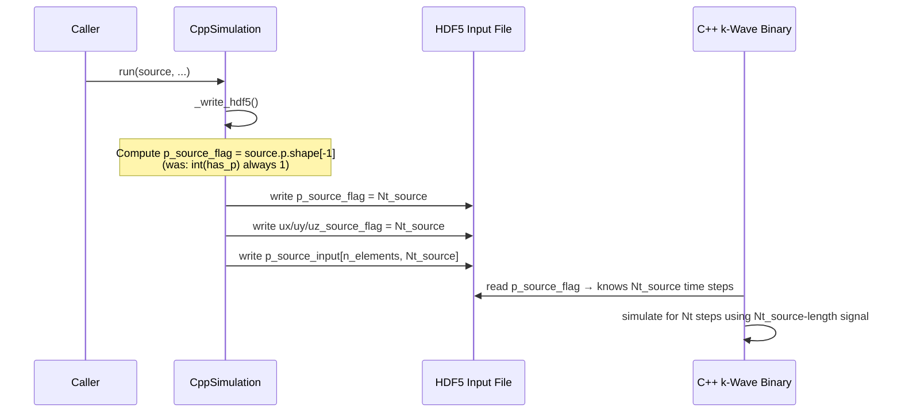

# Issue

**Title:** Fix cpp source flags in new API

## Description

.

<!-- greptile_comment -->

<h3>Greptile Summary</h3>

This PR fixes a bug in `CppSimulation._write_hdf5` where `p_source_flag`, `ux_source_flag`, `uy_source_flag`, and `uz_source_flag` were written as plain booleans (`0` or `1`) instead of the number of time steps the C++ binary actually expects. Without the fix, the C++ solver would always see a count of `1` regardless of the source signal length, causing incorrect simulations for any source with more than one time step.

- **Root cause fixed**: Replaces `int(has_p)` / `int(has_ux)` etc. with `np.asarray(source.*).shape[-1]`, correctly encoding the time-step count.
- **Safer indexing**: The new `shape[-1]` idiom works for both 1-D `(Nt,)` and 2-D `(n_elements, Nt)` source arrays, avoiding the `TypeError` that `len(source.p[0])` would raise on a 1-D input.
- **Clarity**: An inline comment is added explaining the non-obvious semantics of the `*_source_flag` fields, which will help future contributors.
- No new tests are introduced, but the change is straightforward and the fix is clearly correct given the C++ binary's documented contract.

<h3>Confidence Score: 5/5</h3>

Safe to merge — the fix is a targeted correctness patch with no regressions introduced.

The single changed file contains a clearly correct bug fix: source flags now carry the actual time-step count the C++ binary requires. The safer shape[-1] indexing resolves the previously flagged 1-D array edge case. No new code paths, no API changes, and no test regressions are present.

No files require special attention.

<h3>Important Files Changed</h3>

| Filename | Overview |
|----------|----------|
| kwave/solvers/cpp_simulation.py | Fixes source flags to encode the number of time steps instead of a boolean; uses safe shape[-1] indexing and adds an explanatory comment. |

<h3>Sequence Diagram</h3>

Reviews (2): Last reviewed commit:  | [Re-trigger Greptile](https://app.greptile.com/api/retrigger?id=26789346)

<!-- /greptile_comment -->

## Task

Modify the repository so that the issue described above is resolved. The repository is checked out at base commit `2ea27db08edc`. Edit files in place; the verifier captures your changes via `git diff` and scores them against an oracle patch using SWE-RL-style diff-similarity reward.