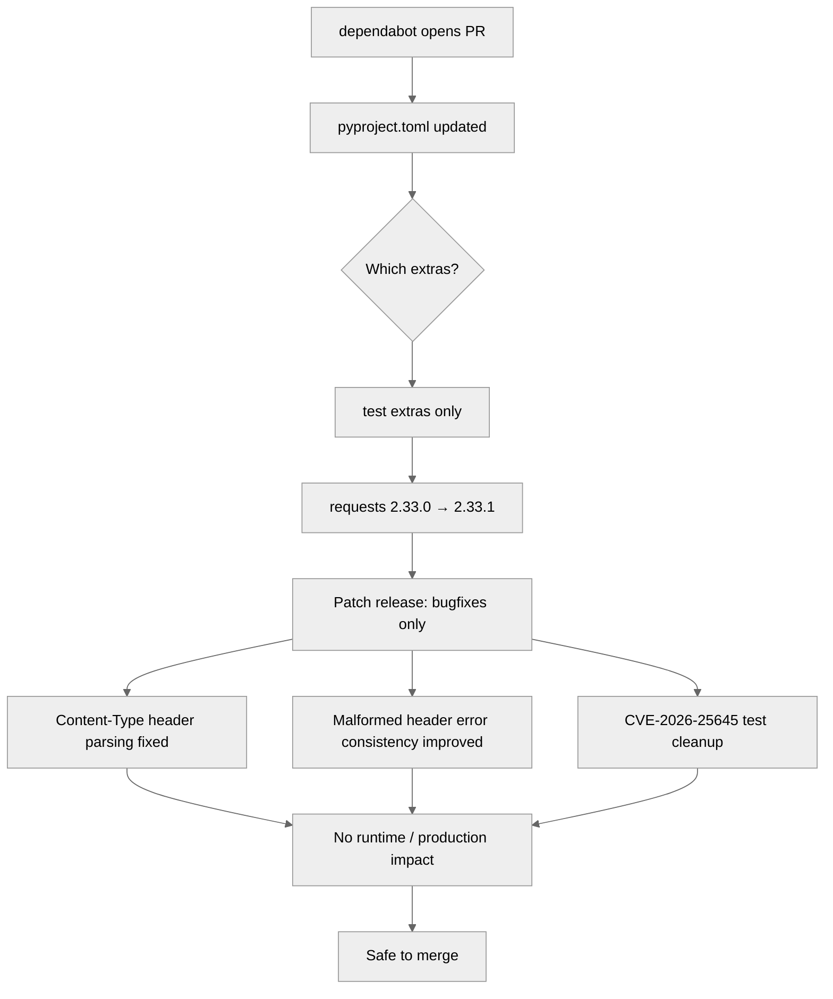

# Issue

**Title:** Bump requests from 2.33.0 to 2.33.1

## Description

Bumps [requests](https://github.com/psf/requests) from 2.33.0 to 2.33.1.

Release notes

<em>Sourced from <a href="https://github.com/psf/requests/releases">requests's releases</a>.</em>

<blockquote>
<h2>v2.33.1</h2>
<h2>2.33.1 (2026-03-30)</h2>

<strong>Bugfixes</strong>

<ul>
<li>Fixed test cleanup for CVE-2026-25645 to avoid leaving unnecessary
files in the tmp directory. (<a href="">#7305</a>)</li>
<li>Fixed Content-Type header parsing for malformed values. (<a href="">#7309</a>)</li>
<li>Improved error consistency for malformed header values. (<a href="">#7308</a>)</li>
</ul>
<h2>New Contributors</h2>
<ul>
<li><a href="https://github.com/ferdnyc"><code>@​ferdnyc</code></a> made their first contribution in <a href="">psf/requests#7277</a></li>
</ul>

<strong>Full Changelog</strong>: <a href="https://github.com/psf/requests/blob/main/HISTORY.md#2331-2026-03-30">https://github.com/psf/requests/blob/main/HISTORY.md#2331-2026-03-30</a>

</blockquote>

Changelog

<em>Sourced from <a href="https://github.com/psf/requests/blob/main/HISTORY.md">requests's changelog</a>.</em>

<blockquote>
<h2>2.33.1 (2026-03-30)</h2>

<strong>Bugfixes</strong>

<ul>
<li>Fixed test cleanup for CVE-2026-25645 to avoid leaving unnecessary
files in the tmp directory. (<a href="">#7305</a>)</li>
<li>Fixed Content-Type header parsing for malformed values. (<a href="">#7309</a>)</li>
<li>Improved error consistency for malformed header values. (<a href="">#7308</a>)</li>
</ul>
</blockquote>

Commits

<ul>
<li><a href=""><code>111d2b7</code></a> v2.33.1</li>
<li><a href=""><code>f0198e6</code></a> Fix malformed value parsing for Content-Type (<a href="">#7309</a>)</li>
<li><a href=""><code>bc7dd0f</code></a> Fix cosmetic header validity parsing regex (<a href="">#7308</a>)</li>
<li><a href=""><code>4443b1a</code></a> Fix unintended test extra (<a href="">#7306</a>)</li>
<li><a href=""><code>389eea5</code></a> Cleanup extracted file after extract_zipped_path test (<a href="">#7305</a>)</li>
<li><a href=""><code>7407309</code></a> Packaging: DRY out extras definition (<a href="">#7277</a>)</li>
<li>See full diff in <a href="https://github.com/psf/requests/compare/v2.33.0...v2.33.1">compare view</a></li>
</ul>

 

Dependabot will resolve any conflicts with this PR as long as you don't alter it yourself. You can also trigger a rebase manually by commenting `@dependabot rebase`.

[//]: # (dependabot-automerge-start)
[//]: # (dependabot-automerge-end)

---

Dependabot commands and options

 

You can trigger Dependabot actions by commenting on this PR:
- `@dependabot rebase` will rebase this PR
- `@dependabot recreate` will recreate this PR, overwriting any edits that have been made to it
- `@dependabot show <dependency name> ignore conditions` will show all of the ignore conditions of the specified dependency
- `@dependabot ignore this major version` will close this PR and stop Dependabot creating any more for this major version (unless you reopen the PR or upgrade to it yourself)
- `@dependabot ignore this minor version` will close this PR and stop Dependabot creating any more for this minor version (unless you reopen the PR or upgrade to it yourself)
- `@dependabot ignore this dependency` will close this PR and stop Dependabot creating any more for this dependency (unless you reopen the PR or upgrade to it yourself)

<!-- greptile_comment -->

<h3>Greptile Summary</h3>

This PR is a routine dependency bump of the `requests` library from `2.33.0` to `2.33.1`, applied only to the test extras in `pyproject.toml`. The change is minimal and low-risk.

- Upgrades `requests` (test dependency) from `2.33.0` → `2.33.1` in `pyproject.toml`
- The `2.33.1` release is a patch-level bugfix that fixes Content-Type header parsing for malformed values, improves error consistency for malformed header values, and includes test cleanup related to CVE-2026-25645
- `requests` is only listed under the `[test]` extras, so this has no impact on the core library or production runtime behavior
- The Dependabot compatibility score indicates high confidence in the upgrade being non-breaking

<h3>Confidence Score: 5/5</h3>

- This PR is safe to merge — it is a single-line patch-level dependency bump with no breaking changes and no production impact.
- The change is a minimal patch bump of a test-only dependency. No logic, APIs, or runtime code are affected. The upstream release notes confirm only bugfixes with no breaking changes, and the Dependabot compatibility score is high.
- No files require special attention.

<h3>Important Files Changed</h3>

| Filename | Overview |
|----------|----------|
| pyproject.toml | Bumps the `requests` test dependency from 2.33.0 to 2.33.1 — a patch-level bugfix release with no breaking changes. |

<h3>Flowchart</h3>

Reviews (1): Last reviewed commit:  | [Re-trigger Greptile](https://app.greptile.com/api/retrigger?id=26834136)

<!-- /greptile_comment -->

## Task

Modify the repository so that the issue described above is resolved. The repository is checked out at base commit `4fa9e7a73e3d`. Edit files in place; the verifier captures your changes via `git diff` and scores them against an oracle patch using SWE-RL-style diff-similarity reward.