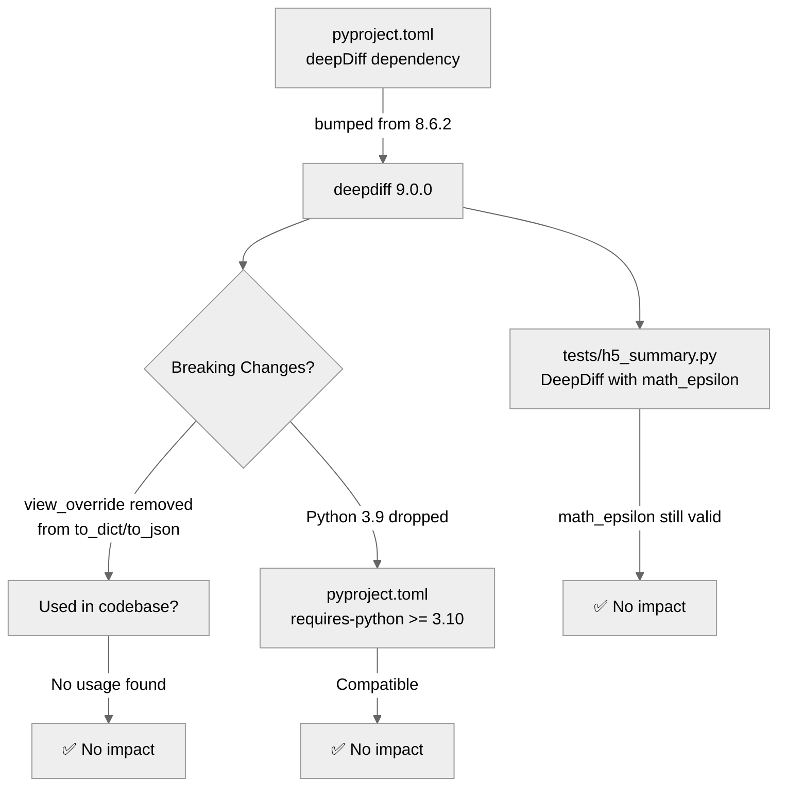

# Issue

**Title:** Bump deepdiff from 8.6.2 to 9.0.0

## Description

Bumps [deepdiff](https://github.com/qlustered/deepdiff) from 8.6.2 to 9.0.0.

Release notes

<em>Sourced from <a href="https://github.com/qlustered/deepdiff/releases">deepdiff's releases</a>.</em>

<blockquote>
<h2>9.0.0</h2>
<ul>
<li>migration note:
<ul>
<li><code>to_dict()</code> and <code>to_json()</code> now accept a <code>verbose_level</code> parameter and always return a usable text-view dict. When the original view is <code>'tree'</code>, they default to <code>verbose_level=2</code> for full detail. The old <code>view_override</code> parameter is removed. To get the previous results, you will need to pass the explicit verbose_level to <code>to_json</code> and <code>to_dict</code> if you are using the tree view.</li>
</ul>
</li>
<li>Dropping support for Python 3.9</li>
<li>Support for python 3.14</li>
<li>Added support for callable <code>group_by</code> thanks to <a href="https://github.com/echan5">echan5</a></li>
<li>Added <code>FlatDeltaDict</code> TypedDict for <code>to_flat_dicts</code> return type</li>
<li>Fixed colored view display when all list items are removed thanks to <a href="https://github.com/yannrouillard">yannrouillard</a></li>
<li>Fixed <code>hasattr()</code> swallowing <code>AttributeError</code> in <code>__slots__</code> handling for objects with <code>__getattr__</code> thanks to <a href="https://github.com/tpvasconcelos">tpvasconcelos</a></li>
<li>Fixed <code>ignore_order=True</code> missing int-vs-float type changes</li>
<li>Always use t1 path for reporting thanks to <a href="https://github.com/devin13cox">devin13cox</a></li>
<li>Fixed <code>_convert_oversized_ints</code> failing on NamedTuples</li>
<li>Fixed orjson <code>TypeError</code> for integers exceeding 64-bit range</li>
<li>Fixed parameter bug in <code>to_flat_dicts</code> where <code>include_action_in_path</code> and <code>report_type_changes</code> were not being passed through</li>
<li>Fixed <code>ignore_keys</code> issue in <code>detailed__dict__</code> thanks to <a href="https://github.com/vitalis89">vitalis89</a></li>
<li>Fixed logarithmic similarity type hint thanks to <a href="https://github.com/ljames8">ljames8</a></li>
</ul>
</blockquote>

Commits

<ul>
<li><a href=""><code>41c7265</code></a> fixing docs</li>
<li><a href=""><code>563c51e</code></a> Merge branch 'master' of github.com:seperman/deepdiff</li>
<li><a href=""><code>172dc5c</code></a> updating docs</li>
<li><a href=""><code>81c4c9e</code></a> updating docs</li>
<li><a href=""><code>2155042</code></a> Merge pull request <a href="">#579</a> from qlustered/dev</li>
<li><a href=""><code>dc70684</code></a> 9.0.0 version</li>
<li><a href=""><code>8ff51de</code></a> 9.0.0 version bump</li>
<li><a href=""><code>123a4af</code></a> no more auto commit on version bump</li>
<li><a href=""><code>9138418</code></a> including docs in wheel</li>
<li><a href=""><code>eac9365</code></a> updating changelog</li>
<li>Additional commits viewable in <a href="https://github.com/qlustered/deepdiff/compare/8.6.2...9.0.0">compare view</a></li>
</ul>

 

Dependabot will resolve any conflicts with this PR as long as you don't alter it yourself. You can also trigger a rebase manually by commenting `@dependabot rebase`.

[//]: # (dependabot-automerge-start)
[//]: # (dependabot-automerge-end)

---

Dependabot commands and options

 

You can trigger Dependabot actions by commenting on this PR:
- `@dependabot rebase` will rebase this PR
- `@dependabot recreate` will recreate this PR, overwriting any edits that have been made to it
- `@dependabot show <dependency name> ignore conditions` will show all of the ignore conditions of the specified dependency
- `@dependabot ignore this major version` will close this PR and stop Dependabot creating any more for this major version (unless you reopen the PR or upgrade to it yourself)
- `@dependabot ignore this minor version` will close this PR and stop Dependabot creating any more for this minor version (unless you reopen the PR or upgrade to it yourself)
- `@dependabot ignore this dependency` will close this PR and stop Dependabot creating any more for this dependency (unless you reopen the PR or upgrade to it yourself)

<!-- greptile_comment -->

<h3>Greptile Summary</h3>

This PR is a Dependabot-generated major version bump of `deepdiff` from `8.6.2` to `9.0.0` in `pyproject.toml`.

The only usage of `deepdiff` in the repository is in `tests/h5_summary.py`, where `DeepDiff` is called with `exclude_paths` and `math_epsilon` parameters. These parameters are unaffected by the breaking changes introduced in `9.0.0`:

- The sole breaking API change in `9.0.0` is the removal of the `view_override` parameter from `to_dict()` and `to_json()` (replaced by `verbose_level`). Neither method — nor the `view_override` parameter — is used anywhere in the codebase.
- Python 3.9 support was dropped, but `pyproject.toml` already requires `>=3.10`, so there is no compatibility issue.
- All other `9.0.0` changes are bug fixes and new features that pose no risk to existing usage.

<h3>Confidence Score: 5/5</h3>

- Safe to merge — the single breaking change in deepdiff 9.0.0 does not affect any code in this repository.
- The only breaking change (removal of `view_override` from `to_dict`/`to_json`) is not used anywhere in the codebase. The one DeepDiff call in `tests/h5_summary.py` uses only `exclude_paths` and `math_epsilon`, which remain unchanged. Python version requirements are also compatible.
- No files require special attention.

<h3>Important Files Changed</h3>

| Filename | Overview |
|----------|----------|
| pyproject.toml | Bumps deepdiff from 8.6.2 to 9.0.0 (major version); the sole breaking change (removal of `view_override` in `to_dict`/`to_json`) is not used in this codebase, and the one usage of DeepDiff in `tests/h5_summary.py` remains compatible. |

<h3>Flowchart</h3>

Reviews (1): Last reviewed commit:  | [Re-trigger Greptile](https://app.greptile.com/api/retrigger?id=26834173)

<!-- /greptile_comment -->

## Task

Modify the repository so that the issue described above is resolved. The repository is checked out at base commit `4fa9e7a73e3d`. Edit files in place; the verifier captures your changes via `git diff` and scores them against an oracle patch using SWE-RL-style diff-similarity reward.