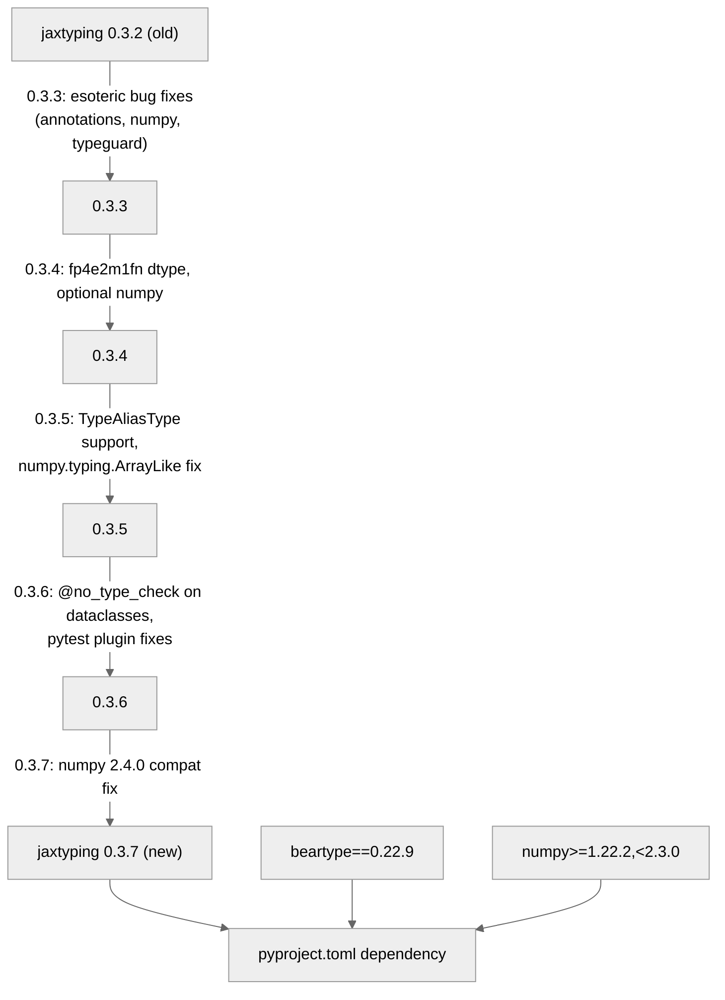

# Issue

**Title:** Bump jaxtyping from 0.3.2 to 0.3.7

## Description

Bumps [jaxtyping](https://github.com/patrick-kidger/jaxtyping) from 0.3.2 to 0.3.7.

Release notes

<em>Sourced from <a href="https://github.com/patrick-kidger/jaxtyping/releases">jaxtyping's releases</a>.</em>

<blockquote>
<h2>jaxtyping v0.3.7</h2>

Bugfix: <code>SomeDtype[Union[numpy.typing.ArrayLike, ...], ...]</code> will no longer crash in numpy 2.4.0. (<a href="">#374</a>)

<strong>Full Changelog</strong>: <a href="https://github.com/patrick-kidger/jaxtyping/compare/v0.3.6...v0.3.7">https://github.com/patrick-kidger/jaxtyping/compare/v0.3.6...v0.3.7</a>

<h2>jaxtyping v0.3.6</h2>
<ul>
<li>Bugfix: <code>@typing.no_type_check</code> is now respected on dataclasses. (Thanks <a href="https://github.com/jeertmans"><code>@​jeertmans</code></a>! <a href="">patrick-kidger/jaxtyping#370</a>)</li>
<li>Bugfix: the pytest plugin is now exected before pytest <code>conftest.py</code> is ran, making it usable even if the package under test is imported inside <code>conftest.py</code>. (Thanks <a href="https://github.com/jeertmans"><code>@​jeertmans</code></a>! <a href="">patrick-kidger/jaxtyping#371</a>)</li>
<li>Bugfix: the pytest plugin supports typecheckers that call multi-argument constructors. (Thanks <a href="https://github.com/jeertmans"><code>@​jeertmans</code></a>! <a href="">patrick-kidger/jaxtyping#369</a>)</li>
</ul>

<strong>Full Changelog</strong>: <a href="https://github.com/patrick-kidger/jaxtyping/compare/v0.3.5...v0.3.6">https://github.com/patrick-kidger/jaxtyping/compare/v0.3.5...v0.3.6</a>

<h2>jaxtyping v0.3.5</h2>
<ul>
<li>

Feature: support <code>TypeAliasType</code>s as array types. For example:

<pre lang="python"><code>type Foo = np.ndarray | int
Float[Foo, &quot;&quot;]
</code></pre>

In particular, this re-enables support for <code>numpy.typing.ArrayLike</code>, which recently switched from being a union to a type alias.

</li>
<li>

Docs: big update to emphasize the way in which we are framework-agnostic.

</li>
</ul>

<strong>Full Changelog</strong>: <a href="https://github.com/patrick-kidger/jaxtyping/compare/v0.3.4...v0.3.5">https://github.com/patrick-kidger/jaxtyping/compare/v0.3.4...v0.3.5</a>

<h2>jaxtyping v0.3.4</h2>
<ul>
<li>Add fp4e2m1fn type (Thanks <a href="https://github.com/vincentlo-a"><code>@​vincentlo-a</code></a>! <a href="">patrick-kidger/jaxtyping#353</a>)</li>
<li>No longer crashing if <code>numpy</code> not available. (Thanks <a href="https://github.com/charlesbmi"><code>@​charlesbmi</code></a>! <a href="">patrick-kidger/jaxtyping#361</a>)</li>
<li>No longer crashing when building documentation using either either <code>pytkdoc_tweaks</code> or <code>hippogriffe</code> (=my internal doc libraries that probably no-one else uses 😁) and JAX is not available (<a href="">#362</a>)</li>
</ul>
<h2>New Contributors</h2>
<ul>
<li><a href="https://github.com/vincentlo-a"><code>@​vincentlo-a</code></a> made their first contribution in <a href="">patrick-kidger/jaxtyping#353</a></li>
<li><a href="https://github.com/charlesbmi"><code>@​charlesbmi</code></a> made their first contribution in <a href="">patrick-kidger/jaxtyping#361</a></li>
</ul>

<strong>Full Changelog</strong>: <a href="https://github.com/patrick-kidger/jaxtyping/compare/v0.3.3...v0.3.4">https://github.com/patrick-kidger/jaxtyping/compare/v0.3.3...v0.3.4</a>

<h2>jaxtyping v0.3.3</h2>

A collection of esoteric fixes, mostly due to versions of other libraries:

<ul>
<li>Fix for partially-stringified annotations resulting in spurious errors. (If we can't resolve them at decoration time then they just become an <code>Any</code> instead.)</li>
<li>Fix for <code>Dtype[numpy.typing.ArrayLike, ...]</code> not accepting <code>bool</code>/<code>int</code>/<code>float</code> in NumPy 2.3.3-ish.</li>
<li>Fix for <code>Foo | Bar</code> annotations with <code>typeguard==2.13.3</code> producing false negatives. (Fixes <a href="">#349</a>.)</li>
<li>Fix for <code>jaxtyping.ArrayLike</code> not including <code>jax._src.literals.LiteralArray</code> under <code>jax==0.7.2</code>.</li>
</ul>
<h2>New Contributors</h2>
<ul>
<li><a href="https://github.com/nstarman"><code>@​nstarman</code></a> made their first contribution in <a href="">patrick-kidger/jaxtyping#345</a></li>
</ul>

<strong>Full Changelog</strong>: <a href="https://github.com/patrick-kidger/jaxtyping/compare/v0.3.2...v0.3.3">https://github.com/patrick-kidger/jaxtyping/compare/v0.3.2...v0.3.3</a>

</blockquote>

Commits

<ul>
<li><a href=""><code>b3ad46f</code></a> Numpy 2.4.0 compat: fix union of arraylike.</li>
<li><a href=""><code>103e004</code></a> 0.3.6</li>
<li><a href=""><code>4bb34ef</code></a> fix(lib): respect <code>@no_type_check</code> decorator on class (<a href="">#370</a>)</li>
<li><a href=""><code>9be8523</code></a> fix(pytest): execute import hook before <code>conftest.py</code> files are read</li>
<li><a href=""><code>aec7db5</code></a> fix(pytest_plugin): avoid splitting typechecker constructor with commas</li>
<li><a href=""><code>bf49ed2</code></a> Big doc update to de-emphasize JAX, make us more framework-agnostic</li>
<li><a href=""><code>299f0af</code></a> fix numpy arraylike, add support for typealiastype</li>
<li><a href=""><code>289f504</code></a> version bump to 0.3.4</li>
<li><a href=""><code>a906b19</code></a> Dropped failing tests for very old jaxtyping. No idea what's going on but not...</li>
<li><a href=""><code>3bf6882</code></a> Dropped erroneous JAX dependency when building docs</li>
<li>Additional commits viewable in <a href="https://github.com/patrick-kidger/jaxtyping/compare/v0.3.2...v0.3.7">compare view</a></li>
</ul>

 

Dependabot will resolve any conflicts with this PR as long as you don't alter it yourself. You can also trigger a rebase manually by commenting `@dependabot rebase`.

[//]: # (dependabot-automerge-start)
[//]: # (dependabot-automerge-end)

---

Dependabot commands and options

 

You can trigger Dependabot actions by commenting on this PR:
- `@dependabot rebase` will rebase this PR
- `@dependabot recreate` will recreate this PR, overwriting any edits that have been made to it
- `@dependabot show <dependency name> ignore conditions` will show all of the ignore conditions of the specified dependency
- `@dependabot ignore this major version` will close this PR and stop Dependabot creating any more for this major version (unless you reopen the PR or upgrade to it yourself)
- `@dependabot ignore this minor version` will close this PR and stop Dependabot creating any more for this minor version (unless you reopen the PR or upgrade to it yourself)
- `@dependabot ignore this dependency` will close this PR and stop Dependabot creating any more for this dependency (unless you reopen the PR or upgrade to it yourself)

<!-- greptile_comment -->

<h3>Greptile Summary</h3>

This PR bumps the `jaxtyping` dependency from `0.3.2` to `0.3.7` (a patch-level series of bug-fix releases). All five intermediate versions contain only bug fixes and minor features (e.g. `TypeAliasType` support, numpy 2.4.0 compatibility, `@no_type_check` on dataclasses, pytest plugin fixes) — no breaking changes are noted in the changelog.

Key observations:
- The change is a single-line version pin update in `pyproject.toml`.
- `jaxtyping 0.3.7` adds a numpy 2.4.0 compatibility fix; the project currently caps numpy at `<2.3.0`, so this fix does not apply today, but it leaves room for a future numpy upper-bound relaxation without re-pinning jaxtyping.
- `beartype` remains pinned at `==0.22.9`, which is used by jaxtyping for runtime type checking — no beartype version change is needed for this bump.
- No source code changes are introduced; risk is confined to transitive behaviour changes from the library upgrade, all of which are documented as bug fixes.

<h3>Confidence Score: 5/5</h3>

- Safe to merge — purely a patch-series bug-fix upgrade with no breaking changes.
- All five intermediate releases (0.3.3–0.3.7) are bug-fix only; no API breakage is noted. The single changed line is a version pin in pyproject.toml, no source code is touched. Dependabot's compatibility score is green, and the changes are well-understood.
- No files require special attention.

<h3>Important Files Changed</h3>

| Filename | Overview |
|----------|----------|
| pyproject.toml | Bumps jaxtyping pin from 0.3.2 to 0.3.7; change is a single-line version update with only bug-fix releases in between. |

<h3>Flowchart</h3>

Reviews (1): Last reviewed commit:  | [Re-trigger Greptile](https://app.greptile.com/api/retrigger?id=26834186)

<!-- /greptile_comment -->

## Task

Modify the repository so that the issue described above is resolved. The repository is checked out at base commit `4fa9e7a73e3d`. Edit files in place; the verifier captures your changes via `git diff` and scores them against an oracle patch using SWE-RL-style diff-similarity reward.