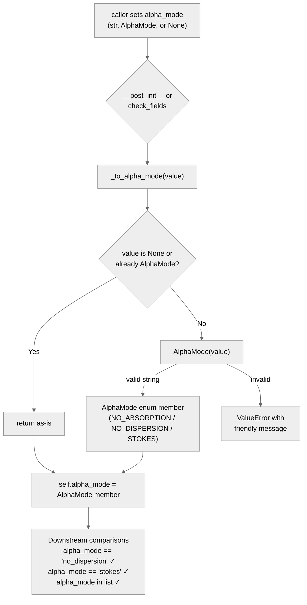

# Issue

**Title:** Add AlphaMode enum for stringly-typed alpha_mode field

## Description

- AlphaMode(str, Enum) with NO_ABSORPTION, NO_DISPERSION, STOKES
- kWaveMedium.__post_init__ normalizes string inputs to enum
- Backward compatible: AlphaMode == "no_dispersion" works via str inheritance
- __str__ returns the value so f-strings render cleanly

<!-- greptile_comment -->

<h3>Greptile Summary</h3>

Adds `AlphaMode(str, Enum)` to replace the stringly-typed `alpha_mode` field and introduces a `_to_alpha_mode` helper that normalises the value at construction time (`__post_init__`) and again inside `check_fields` to cover post-construction string reassignment. Because `AlphaMode` inherits from `str`, all existing equality/membership comparisons across the codebase (`checks.py`, `create_absorption_variables.py`, `kWaveSimulation.py`) continue to work without modification.

<h3>Confidence Score: 5/5</h3>

Safe to merge — only P2 style findings, no logic or correctness issues.

All three changed files are correct. The str-Enum design preserves backward compatibility with every existing string comparison in the codebase. The two previous review concerns (post-construction bypass, unhelpful error message) are both addressed. Only minor style findings remain.

No files require special attention.

<h3>Important Files Changed</h3>

| Filename | Overview |
|----------|----------|
| kwave/enums.py | Adds AlphaMode(str, Enum) with three members and an explicit __str__ that returns self.value for clean f-string rendering. |
| kwave/kmedium.py | Introduces _to_alpha_mode helper, normalizes alpha_mode in __post_init__ and check_fields, handles post-construction string reassignment; field comment omits AlphaMode.STOKES. |
| tests/test_kmedium.py | New test file covering construction normalization, invalid-input errors, post-construction string assignment, and backward-compatible string comparisons. |

<h3>Flowchart</h3>

Reviews (3): Last reviewed commit:  | [Re-trigger Greptile](https://app.greptile.com/api/retrigger?id=27063623)

<!-- /greptile_comment -->

## Task

Modify the repository so that the issue described above is resolved. The repository is checked out at base commit `ba553eb2545e`. Edit files in place; the verifier captures your changes via `git diff` and scores them against an oracle patch using SWE-RL-style diff-similarity reward.