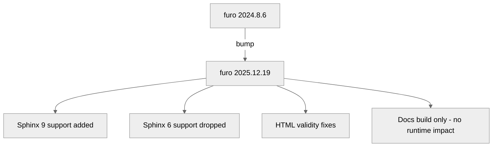

# Issue

**Title:** Bump furo from 2024.8.6 to 2025.12.19

## Description

Bumps [furo](https://github.com/pradyunsg/furo) from 2024.8.6 to 2025.12.19.

Release notes

<em>Sourced from <a href="https://github.com/pradyunsg/furo/releases">furo's releases</a>.</em>

<blockquote>
<h2>2025.12.19</h2>
<ul>
<li>Bump the supported Sphinx version range</li>
</ul>

<strong>Full Changelog</strong>: <a href="https://github.com/pradyunsg/furo/compare/2025.09.25...2025.12.19">https://github.com/pradyunsg/furo/compare/2025.09.25...2025.12.19</a>

<h2>2025.09.25</h2>
<h2>What's Changed</h2>
<ul>
<li>page.html: fix invalid HTML5 by <a href="https://github.com/haampie"><code>@​haampie</code></a> in <a href="">pradyunsg/furo#894</a></li>
<li>base.html: fix trailing slash on void elements by <a href="https://github.com/haampie"><code>@​haampie</code></a> in <a href="">pradyunsg/furo#895</a></li>
<li>_scaffold.sass: remove old scrollbar selectors by <a href="https://github.com/haampie"><code>@​haampie</code></a> in <a href="">pradyunsg/furo#892</a></li>
<li>Add Blender to &quot;used by&quot; section by <a href="https://github.com/struffel"><code>@​struffel</code></a> in <a href="">pradyunsg/furo#898</a></li>
</ul>
<h2>New Contributors</h2>
<ul>
<li><a href="https://github.com/haampie"><code>@​haampie</code></a> made their first contribution in <a href="">pradyunsg/furo#894</a></li>
<li><a href="https://github.com/struffel"><code>@​struffel</code></a> made their first contribution in <a href="">pradyunsg/furo#898</a></li>
</ul>

<strong>Full Changelog</strong>: <a href="https://github.com/pradyunsg/furo/compare/2025.07.19...2025.09.25">https://github.com/pradyunsg/furo/compare/2025.07.19...2025.09.25</a>

<h2>2025.07.19</h2>
<h2>What's Changed</h2>
<ul>
<li>Remove &quot;debug printf&quot; for headerTop value by <a href="https://github.com/ferdnyc"><code>@​ferdnyc</code></a> in <a href="">pradyunsg/furo#847</a></li>
<li>[pre-commit.ci] pre-commit autoupdate by <a href="https://github.com/pre-commit-ci"><code>@​pre-commit-ci</code></a>[bot] in <a href="">pradyunsg/furo#826</a></li>
<li>[pre-commit.ci] pre-commit autoupdate by <a href="https://github.com/pre-commit-ci"><code>@​pre-commit-ci</code></a>[bot] in <a href="">pradyunsg/furo#861</a></li>
<li>[pre-commit.ci] pre-commit autoupdate by <a href="https://github.com/pre-commit-ci"><code>@​pre-commit-ci</code></a>[bot] in <a href="">pradyunsg/furo#873</a></li>
<li>Add rel=edit attribute to &quot;Edit this page&quot; link/icon by <a href="https://github.com/capjamesg"><code>@​capjamesg</code></a> in <a href="">pradyunsg/furo#880</a></li>
<li>[pre-commit.ci] pre-commit autoupdate by <a href="https://github.com/pre-commit-ci"><code>@​pre-commit-ci</code></a>[bot] in <a href="">pradyunsg/furo#879</a></li>
<li>Fix flickering header drop shadow by <a href="https://github.com/holesch"><code>@​holesch</code></a> in <a href="">pradyunsg/furo#884</a></li>
<li>Make current page section detection resilient to sticky elements above header by <a href="https://github.com/Eric-Arellano"><code>@​Eric-Arellano</code></a> in <a href="">pradyunsg/furo#664</a></li>
</ul>
<h2>New Contributors</h2>
<ul>
<li><a href="https://github.com/capjamesg"><code>@​capjamesg</code></a> made their first contribution in <a href="">pradyunsg/furo#880</a></li>
<li><a href="https://github.com/holesch"><code>@​holesch</code></a> made their first contribution in <a href="">pradyunsg/furo#884</a></li>
</ul>

<strong>Full Changelog</strong>: <a href="https://github.com/pradyunsg/furo/compare/2024.08.06...2025.07.19">https://github.com/pradyunsg/furo/compare/2024.08.06...2025.07.19</a>

</blockquote>

Changelog

<em>Sourced from <a href="https://github.com/pradyunsg/furo/blob/main/docs/changelog.md">furo's changelog</a>.</em>

<blockquote>
<h2>2025.12.19 -- Harmonious Honeydew</h2>
<ul>
<li>✨ Add support for Sphinx 9.</li>
<li>Drop support for Sphinx 6.</li>
</ul>
<h2>2025.09.25 -- Gleaming Green</h2>
<ul>
<li>Change the dark mode code back to <code>native</code>.</li>
</ul>
<h2>2025.07.19 -- Frozen Flame</h2>
<ul>
<li>✨ Switch to accessible-pygments themes</li>
<li>✨ Prefetch the sidebar logos</li>
<li>✨ Fix flickering header drop shadow on Safari</li>
<li>Add <code>rel=edit</code> attribute to &quot;Edit this page&quot; link/icon</li>
<li>Bump NodeJS and npm dependency versions</li>
<li>Bump Saas &amp; Webpack major versions</li>
<li>Improve current page detection to be resilient to sticky elements above header</li>
<li>Modernise Sass and use <code>@use</code> + <code>@forward</code></li>
<li>Remove top of code <code>border-radius</code> with captions</li>
<li>Remove &quot;debug printf&quot; for headerTop value</li>
<li>Use distinct images for light and dark mode in the documentation</li>
<li>Use the modern Saas Modules</li>
</ul>
<h2>2024.08.06 -- Energetic Eminence</h2>
<ul>
<li>✨ Add support for Sphinx 8</li>
<li>✨ Add smoother transitions between breakpoints</li>
<li>Increase specificity of table-wrapper selector</li>
<li>Avoid page breaks inside paragraphs</li>
</ul>
<h2>2024.07.18 -- Dull Denim</h2>
<ul>
<li>Improve how icons are handled and aligned.</li>
<li>Improve scroll event handler.</li>
<li>Hide the copybutton by default.</li>
<li>Fix <code>source_view_link</code> configuration handling.</li>
<li>Fix close tag on pencil icon.</li>
</ul>
<h2>2024.05.06 -- Cheerful Cerulean</h2>
<ul>
<li>✨ Add new custom icons for auto mode, reflecting the currently active theme.</li>
<li>✨ Add a view this page button.</li>
<li>✨ Add colours and highlighting to &quot;version modified&quot; API helpers.</li>
<li>✨ Add release information to various customisation knobs.</li>
<li>Make all icons bigger and use a thinner stroke with them.</li>
</ul>
<h2>2024.04.27 -- Bold Burgundy</h2>
<ul>
<li>Add a skip to content link.</li>
</ul>
<!-- raw HTML omitted -->
</blockquote>

... (truncated)

Commits

<ul>
<li><a href=""><code>dd9e9f9</code></a> Prepare release: 2025.12.19</li>
<li><a href=""><code>d43f7e9</code></a> Update changelog</li>
<li><a href=""><code>d27cab5</code></a> Bump the supported Sphinx version range</li>
<li><a href=""><code>12f288e</code></a> Back to development</li>
<li><a href=""><code>7c5f8fa</code></a> Prepare release: 2025.09.25</li>
<li><a href=""><code>8bfdc54</code></a> Update changelog</li>
<li><a href=""><code>d92b62f</code></a> Switch the dark mode theme back to <code>native</code></li>
<li><a href=""><code>83c3446</code></a> Add Blender to &quot;used by&quot; section (<a href="">#898</a>)</li>
<li><a href=""><code>426ea05</code></a> Remove old scrollbar selectors (<a href="">#892</a>)</li>
<li><a href=""><code>d22d31c</code></a> Remove trailing slash on void elements (<a href="">#895</a>)</li>
<li>Additional commits viewable in <a href="https://github.com/pradyunsg/furo/compare/2024.08.06...2025.12.19">compare view</a></li>
</ul>

 

Dependabot will resolve any conflicts with this PR as long as you don't alter it yourself. You can also trigger a rebase manually by commenting `@dependabot rebase`.

[//]: # (dependabot-automerge-start)
[//]: # (dependabot-automerge-end)

---

Dependabot commands and options

 

You can trigger Dependabot actions by commenting on this PR:
- `@dependabot rebase` will rebase this PR
- `@dependabot recreate` will recreate this PR, overwriting any edits that have been made to it
- `@dependabot show <dependency name> ignore conditions` will show all of the ignore conditions of the specified dependency
- `@dependabot ignore this major version` will close this PR and stop Dependabot creating any more for this major version (unless you reopen the PR or upgrade to it yourself)
- `@dependabot ignore this minor version` will close this PR and stop Dependabot creating any more for this minor version (unless you reopen the PR or upgrade to it yourself)
- `@dependabot ignore this dependency` will close this PR and stop Dependabot creating any more for this dependency (unless you reopen the PR or upgrade to it yourself)

<!-- greptile_comment -->

<h3>Greptile Summary</h3>

This PR bumps the `furo` documentation theme from `2024.8.6` to `2025.12.19`, a docs-only optional dependency with no runtime impact. The new version adds Sphinx 9 support, drops Sphinx 6, and includes HTML validity fixes and accessibility improvements to the generated documentation.

<h3>Confidence Score: 5/5</h3>

Safe to merge — docs-only dependency bump with no runtime impact.

Single-line version bump in an optional docs dependency group. No logic changes, no runtime dependencies affected. No P0/P1 issues found.

No files require special attention.

<h3>Important Files Changed</h3>

| Filename | Overview |
|----------|----------|
| pyproject.toml | Bumps furo docs theme from 2024.8.6 to 2025.12.19 in the optional docs dependency group; no runtime impact. |

<h3>Flowchart</h3>

Reviews (1): Last reviewed commit:  | [Re-trigger Greptile](https://app.greptile.com/api/retrigger?id=27512222)

<!-- /greptile_comment -->

## Task

Modify the repository so that the issue described above is resolved. The repository is checked out at base commit `ba553eb2545e`. Edit files in place; the verifier captures your changes via `git diff` and scores them against an oracle patch using SWE-RL-style diff-similarity reward.