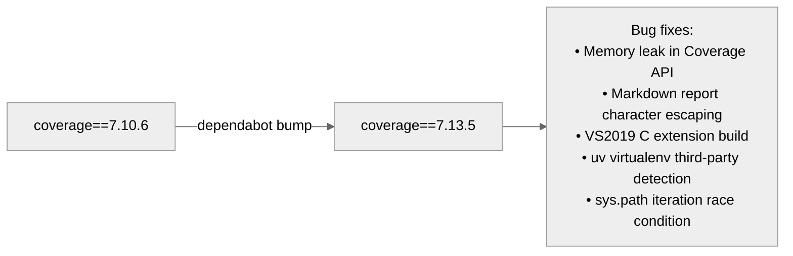

# Issue

**Title:** Bump coverage from 7.10.6 to 7.13.5

## Description

Bumps [coverage](https://github.com/coveragepy/coveragepy) from 7.10.6 to 7.13.5.

Changelog

<em>Sourced from <a href="https://github.com/coveragepy/coveragepy/blob/main/CHANGES.rst">coverage's changelog</a>.</em>

<blockquote>
<h2>Version 7.13.5 — 2026-03-17</h2>
<ul>
<li>

Fix: <code>issue 2138</code>_ describes a memory leak that happened when repeatedly
using the Coverage API with in-memory data. This is now fixed.

</li>
<li>

Fix: the markdown-formatted coverage report didn't fully escape special
characters in file paths (<code>issue 2141</code><em>). This would be very unlikely to
cause a problem, but now it's done properly, thanks to <code>Ellie Ayla &lt;pull 2142_&gt;</code></em>.

</li>
<li>

Fix: the C extension wouldn't build on VS2019, but now it does (<code>issue 2145</code>_).

</li>
</ul>

.. _issue 2138: <a href="">coveragepy/coveragepy#2138</a>
.. _issue 2141: <a href="">coveragepy/coveragepy#2141</a>
.. _pull 2142: <a href="">coveragepy/coveragepy#2142</a>
.. _issue 2145: <a href="">coveragepy/coveragepy#2145</a>

.. _changes_7-13-4:

<h2>Version 7.13.4 — 2026-02-09</h2>
<ul>
<li>

Fix: the third-party code fix in 7.13.3 required examining the parent
directories where coverage was run. In the unusual situation that one of the
parent directories is unreadable, a PermissionError would occur, as
described in <code>issue 2129</code>_. This is now fixed.

</li>
<li>

Fix: in test suites that change sys.path, coverage.py could fail with
&quot;RuntimeError: Set changed size during iteration&quot; as described and fixed in
<code>pull 2130</code>_. Thanks, Noah Fatsi.

</li>
<li>

We now publish ppc64le wheels, thanks to <code>Pankhudi Jain &lt;pull 2121_&gt;</code>_.

</li>
</ul>

.. _pull 2121: <a href="">coveragepy/coveragepy#2121</a>
.. _issue 2129: <a href="">coveragepy/coveragepy#2129</a>
.. _pull 2130: <a href="">coveragepy/coveragepy#2130</a>

.. _changes_7-13-3:

<h2>Version 7.13.3 — 2026-02-03</h2>
<ul>
<li>Fix: in some situations, third-party code was measured when it shouldn't have
been, slowing down test execution. This happened with layered virtual
environments such as uv sometimes makes. The problem is fixed, closing <code>issue 2082</code>_. Now any directory on sys.path that is inside a virtualenv is
considered third-party code.</li>
</ul>
<!-- raw HTML omitted -->
</blockquote>

... (truncated)

Commits

<ul>
<li><a href=""><code>c88da14</code></a> docs: sample HTML for 7.13.5</li>
<li><a href=""><code>e2ac3e1</code></a> build: sample HTML shouldn't include the status.json file</li>
<li><a href=""><code>910f8f3</code></a> docs: prep for 7.13.5</li>
<li><a href=""><code>3a4819c</code></a> style: make workflows more uniform</li>
<li><a href=""><code>2a53705</code></a> chore: bump the action-dependencies group across 1 directory with 4 updates (...</li>
<li><a href=""><code>e7c878d</code></a> chore: make upgrade</li>
<li><a href=""><code>ab4db40</code></a> build: use --generate-hashes when pinning</li>
<li><a href=""><code>a438753</code></a> chore: make upgrade</li>
<li><a href=""><code>7b33457</code></a> refactor: some leftover pyupgrade 3.10 bits</li>
<li><a href=""><code>2ff968d</code></a> refactor: this type wasn't used anywhere</li>
<li>Additional commits viewable in <a href="https://github.com/coveragepy/coveragepy/compare/7.10.6...7.13.5">compare view</a></li>
</ul>

 

Dependabot will resolve any conflicts with this PR as long as you don't alter it yourself. You can also trigger a rebase manually by commenting `@dependabot rebase`.

[//]: # (dependabot-automerge-start)
[//]: # (dependabot-automerge-end)

---

Dependabot commands and options

 

You can trigger Dependabot actions by commenting on this PR:
- `@dependabot rebase` will rebase this PR
- `@dependabot recreate` will recreate this PR, overwriting any edits that have been made to it
- `@dependabot show <dependency name> ignore conditions` will show all of the ignore conditions of the specified dependency
- `@dependabot ignore this major version` will close this PR and stop Dependabot creating any more for this major version (unless you reopen the PR or upgrade to it yourself)
- `@dependabot ignore this minor version` will close this PR and stop Dependabot creating any more for this minor version (unless you reopen the PR or upgrade to it yourself)
- `@dependabot ignore this dependency` will close this PR and stop Dependabot creating any more for this dependency (unless you reopen the PR or upgrade to it yourself)

<!-- greptile_comment -->

<h3>Greptile Summary</h3>

This PR bumps the `coverage` test dependency from `7.10.6` to `7.13.5`, bringing in several bug fixes including a memory leak fix for repeated Coverage API usage, improved markdown report character escaping, VS2019 C extension build support, and fixes for third-party code detection in `uv`-layered virtual environments. The `coverage` package is a test-only optional dependency and is not shipped with the library.

<h3>Confidence Score: 5/5</h3>

Safe to merge — routine test-dependency version bump with only bug fixes and no breaking changes

Single-line change to a test-only optional dependency. The coverage package is only used during test runs and not shipped with the library. All changes between 7.10.6 and 7.13.5 are bug fixes with no breaking changes.

No files require special attention.

<h3>Important Files Changed</h3>

| Filename | Overview |
|----------|----------|
| pyproject.toml | Bumps coverage test dependency from 7.10.6 to 7.13.5; routine bug-fix-only version bump with no breaking changes |

<h3>Flowchart</h3>

Reviews (1): Last reviewed commit:  | [Re-trigger Greptile](https://app.greptile.com/api/retrigger?id=27512236)

<!-- /greptile_comment -->

## Task

Modify the repository so that the issue described above is resolved. The repository is checked out at base commit `ba553eb2545e`. Edit files in place; the verifier captures your changes via `git diff` and scores them against an oracle patch using SWE-RL-style diff-similarity reward.