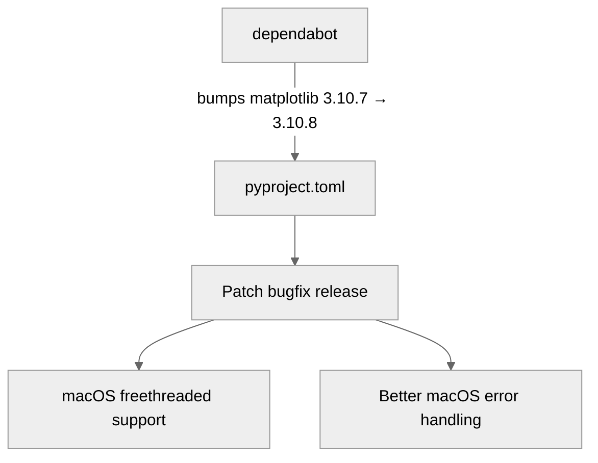

# Issue

**Title:** Bump matplotlib from 3.10.7 to 3.10.8

## Description

Bumps [matplotlib](https://github.com/matplotlib/matplotlib) from 3.10.7 to 3.10.8.

Release notes

<em>Sourced from <a href="https://github.com/matplotlib/matplotlib/releases">matplotlib's releases</a>.</em>

<blockquote>
<h2>REL: v3.10.8</h2>

This is a bugfix release in the 3.10.x series.

The primary highlights of this release are:

<ul>
<li>Properly allow freethreaded mode in the MacOS backend</li>
<li>Better error handling for MacOS backend</li>
</ul>
</blockquote>

Commits

<ul>
<li><a href=""><code>1392cbe</code></a> REL: v3.10.8</li>
<li><a href=""><code>0b9ebb3</code></a> Doc release prep v3.10.8</li>
<li><a href=""><code>bc7b5c4</code></a> Merge branch 'v3.10.7-doc' into v3.10.x</li>
<li><a href=""><code>86b38d3</code></a> Github stats v3.10.8</li>
<li><a href=""><code>9512188</code></a> Merge pull request <a href="">#30717</a> from meeseeksmachine/auto-backport-of-pr-30714-on-v...</li>
<li><a href=""><code>d300769</code></a> Backport PR <a href="">#30714</a>: FIX: Gracefully handle numpy arrays as input to check_in_...</li>
<li><a href=""><code>799bc95</code></a> Merge pull request <a href="">#30711</a> from ngoldbaum/v3.10.x</li>
<li><a href=""><code>134000b</code></a> Merge pull request <a href="">#30697</a> from ngoldbaum/fix-plotting-on-worker-threads</li>
<li><a href=""><code>5b8e219</code></a> TST: Run macosx backends in a subprocess</li>
<li><a href=""><code>878e71a</code></a> Backport PR <a href="">#29810</a>: Declare free-threaded support in MacOS backend extension ...</li>
<li>Additional commits viewable in <a href="https://github.com/matplotlib/matplotlib/compare/v3.10.7...v3.10.8">compare view</a></li>
</ul>

 

Dependabot will resolve any conflicts with this PR as long as you don't alter it yourself. You can also trigger a rebase manually by commenting `@dependabot rebase`.

[//]: # (dependabot-automerge-start)
[//]: # (dependabot-automerge-end)

---

Dependabot commands and options

 

You can trigger Dependabot actions by commenting on this PR:
- `@dependabot rebase` will rebase this PR
- `@dependabot recreate` will recreate this PR, overwriting any edits that have been made to it
- `@dependabot show <dependency name> ignore conditions` will show all of the ignore conditions of the specified dependency
- `@dependabot ignore this major version` will close this PR and stop Dependabot creating any more for this major version (unless you reopen the PR or upgrade to it yourself)
- `@dependabot ignore this minor version` will close this PR and stop Dependabot creating any more for this minor version (unless you reopen the PR or upgrade to it yourself)
- `@dependabot ignore this dependency` will close this PR and stop Dependabot creating any more for this dependency (unless you reopen the PR or upgrade to it yourself)

<!-- greptile_comment -->

<h3>Greptile Summary</h3>

Routine patch-level dependency bump of `matplotlib` from `3.10.7` to `3.10.8`, a bugfix release that improves freethreaded support and error handling in the macOS backend. No API changes are introduced and no k-wave-python code is affected.

<h3>Confidence Score: 5/5</h3>

Safe to merge — patch-level bugfix dependency bump with no API changes

Single-line pin change to a patch bugfix release with no breaking changes, no API surface modifications, and no k-wave-python logic affected

No files require special attention

<h3>Important Files Changed</h3>

| Filename | Overview |
|----------|----------|
| pyproject.toml | Bumps matplotlib pin from 3.10.7 to 3.10.8 (patch bugfix release) |

<h3>Flowchart</h3>

Reviews (1): Last reviewed commit:  | [Re-trigger Greptile](https://app.greptile.com/api/retrigger?id=27512239)

<!-- /greptile_comment -->

## Task

Modify the repository so that the issue described above is resolved. The repository is checked out at base commit `ba553eb2545e`. Edit files in place; the verifier captures your changes via `git diff` and scores them against an oracle patch using SWE-RL-style diff-similarity reward.