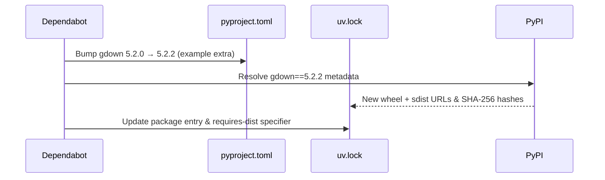

# Issue

**Title:** Bump gdown from 5.2.0 to 5.2.2

## Description

Bumps [gdown](https://github.com/wkentaro/gdown) from 5.2.0 to 5.2.2.

Release notes

<em>Sourced from <a href="https://github.com/wkentaro/gdown/releases">gdown's releases</a>.</em>

<blockquote>
<h2>v5.2.2</h2>
<h2>Security</h2>
<ul>
<li>Fix path traversal vulnerability in extractall() that allowed zip/tar archives with ../ entries to write files outside the target directory (GHSA-76hw-p97h-883f)</li>
<li>Reject symlinks, hardlinks, and special files in tar archives</li>
<li>Use Python 3.12+ filter=&quot;data&quot; for safe tar extraction when available</li>
<li>Sanitize filenames from HTTP responses and URLs to prevent path traversal via /, , .., and null bytes</li>
<li>Sanitize root folder name in download_folder() before building directory paths</li>
</ul>
<h2>v5.2.1</h2>
<h2>Fixes</h2>
<ul>
<li>cached_download: Verify file hash before moving to final location instead of after (<a href="">wkentaro/gdown#417</a>)
<ul>
<li>Previously, the hash was verified after moving to the final path, which could leave corrupted files in place if hash verification failed</li>
</ul>
</li>
<li>download: Fix speed limit throttling logic to use independent byte counter instead of pbar.n (<a href="">wkentaro/gdown#407</a>)
<ul>
<li>The speed limiter now correctly tracks downloaded bytes independently from the progress bar</li>
<li>Also fixes unnecessary sleep when resuming downloads with speed limit (since pbar.n includes start_size from resumed downloads)</li>
</ul>
</li>
</ul>
<h2>Chores</h2>
<ul>
<li>Fix missing space in --output help text (<a href="">wkentaro/gdown#398</a>)</li>
<li>Fix concatenated string literal in extractall.py error message</li>
</ul>
</blockquote>

Commits

<ul>
<li><a href=""><code>af569fc</code></a> fix: prevent path traversal in archive extraction and filename handling</li>
<li><a href=""><code>7f4cb68</code></a> Merge pull request <a href="">#417</a> from wkentaro/fix_cached_download_verify_file_hash_be...</li>
<li><a href=""><code>9697a53</code></a> fix(cached_download): verify file hash before moving to final location</li>
<li><a href=""><code>c7c1b9d</code></a> Merge pull request <a href="">#407</a> from wkentaro/fix_speed_limit</li>
<li><a href=""><code>940bd40</code></a> Fix throttling logic to use independent byte counter instead of <code>pbar.n</code></li>
<li><a href=""><code>a55ce67</code></a> Fix unnecessary sleep when resuming downloads with speed limit</li>
<li><a href=""><code>c3c8102</code></a> Merge pull request <a href="">#398</a> from hmaarrfk/lint</li>
<li><a href=""><code>a095aaa</code></a> chore: add missing space for help of --output</li>
<li><a href=""><code>10e8c85</code></a> lint other files</li>
<li>See full diff in <a href="https://github.com/wkentaro/gdown/compare/v5.2.0...v5.2.2">compare view</a></li>
</ul>

 

<!-- greptile_comment -->

<h3>Greptile Summary</h3>

This is a Dependabot-generated dependency bump of `gdown` from 5.2.0 to 5.2.2 in the `example` optional dependency group. The update includes a security fix for a path traversal vulnerability (GHSA-76hw-p97h-883f) in `extractall()`, bug fixes for hash verification ordering in `cached_download`, and a speed-limit throttling correction.

<h3>Confidence Score: 5/5</h3>

Safe to merge — minimal, automated dependency bump with no logic changes.

Only two files change: a single-line version pin in pyproject.toml and the corresponding lock-file update. The new version carries a security fix (path traversal CVE) and two bug fixes, making it strictly better than the current pin. No application code is modified.

No files require special attention.

<h3>Important Files Changed</h3>

| Filename | Overview |
|----------|----------|
| pyproject.toml | Updates gdown pin in the `example` extra from 5.2.0 to 5.2.2; single-line change, correct and expected. |
| uv.lock | Lock file updated with new PyPI URLs, SHA-256 hashes, and file sizes for gdown 5.2.2 wheel and sdist; `requires-dist` specifier also updated to match. |

<h3>Sequence Diagram</h3>

Reviews (3): Last reviewed commit:  | [Re-trigger Greptile](https://app.greptile.com/api/retrigger?id=28292734)

<!-- /greptile_comment -->

## Task

Modify the repository so that the issue described above is resolved. The repository is checked out at base commit `fb73e4d1fcda`. Edit files in place; the verifier captures your changes via `git diff` and scores them against an oracle patch using SWE-RL-style diff-similarity reward.