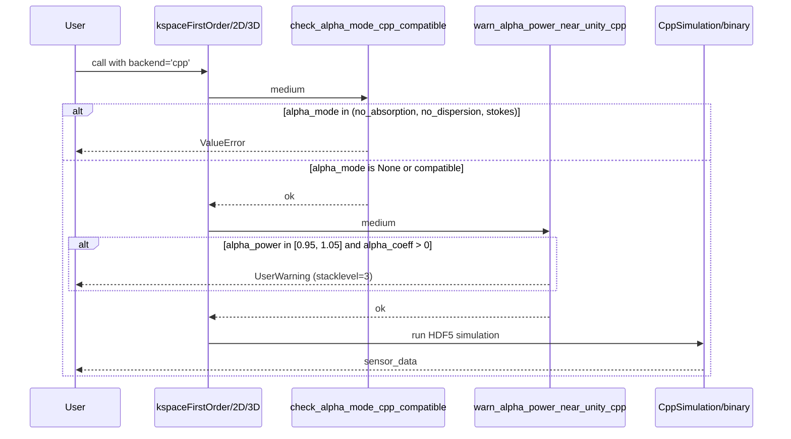

# Issue

**Title:** Fix #664: respect alpha_mode + reject silent C++ ignore

## Description

.

## What

Three-part fix for the silent NaN issue when `alpha_power` is near 1 with the C++ backend:

1. **Python solver respects `alpha_mode`** — `kwave/solvers/kspace_solver.py` honors `medium.alpha_mode='no_absorption'` (both terms off) and `'no_dispersion'` (only dispersion off). The minimal change to the existing case-based `_setup_physics_operators`; no refactor.
2. **C++ backend rejects modes it cannot honor** — `check_alpha_mode_cpp_compatible` raises `ValueError` when `alpha_mode` is `'no_absorption'` or `'no_dispersion'`. The C++ HDF5 input format does not carry `alpha_mode`, so the binary always applies full power-law absorption + dispersion; previously this was silently ignored.
3. **C++ backend warns near the singular range** — `warn_alpha_power_near_unity_cpp` emits a `UserWarning` when `alpha_coeff > 0` and `alpha_power ∈ [0.95, 1.05]`. The dispersion coefficient `η = 2 α c₀^y · tan(π y / 2)` blows up as `y → 1` and the C++ binary (float32 internally) returns NaN well before the formal singularity. The user's escape hatch on the Python backend is `alpha_mode='no_dispersion'`; this PR adds the equivalent guidance for the C++ path.

The two helpers are wired into the C++ branches of the modern API (`kspaceFirstOrder.py`) and both legacy entry points (`kspaceFirstOrder2D.py`, `kspaceFirstOrder3D.py`).

## Why split out

Originally part of a larger branch (`fix-alpha-mode-near-unity`) that bundled this fix with a refactor of `_setup_physics_operators` and a sentinel-cleanup pass. Splitting so each piece can be reviewed on its own merits. Follow-up PRs will land the refactor (with the GPU regression fixed) and the cleanup separately.

## Test plan

- [x] `tests/test_issue_664_alpha_power_near_unity.py` — 22 tests covering Python `no_dispersion` correctness across `alpha_power ∈ {0.97, 0.99, 1.005, 1.03}`, modern + legacy API `ValueError` paths, modern API `UserWarning` path, helper unit tests in/out of the singular range, no-absorption silence, and a legacy-cpp baseline that verifies the warning does not fire outside the singular range.
- [x] All 22 tests pass locally.
- [x] `ruff check` clean on touched files.
- [ ] CI green.

<!-- greptile_comment -->

<h3>Greptile Summary</h3>

This PR is a targeted three-part fix for the silent NaN issue (#664): the Python kspace solver now honours `alpha_mode` (both `no_absorption` and `no_dispersion`), the C++ entry points reject all incompatible `alpha_mode` values with a `ValueError` instead of silently ignoring them, and a `UserWarning` is emitted when `alpha_power` falls in the dispersion-singular range `[0.95, 1.05]` on the C++ path. The logic is clean, the helper ordering (reject → warn) is correct, and `AlphaMode(str, Enum)` ensures the string-literal comparisons in `kspace_solver.py` remain valid.

<h3>Confidence Score: 5/5</h3>

Safe to merge — no correctness, security, or data-loss issues found in the changed code.

All three fix parts are logically sound: the solver skips `eta`/`nabla2` evaluation (not just zeroes the result) when `no_dispersion` is set, so the singularity is genuinely avoided; the C++ guards fire before any HDF5 file is written; the warning stacklevel (3) correctly attributes to caller code for both entry points. Previously raised concerns about `flat[0]` and missing `STOKES` guard have been addressed upstream. No P1/P0 findings.

No files require special attention.

<h3>Important Files Changed</h3>

| Filename | Overview |
|----------|----------|
| kwave/utils/checks.py | Adds two new guard helpers: `check_alpha_mode_cpp_compatible` (raises ValueError for incompatible modes) and `warn_alpha_power_near_unity_cpp` (warns on dispersion-singular range); correctly handles heterogeneous alpha_power arrays and AlphaMode str-enum comparisons. |
| kwave/kspaceFirstOrder.py | Wires the two new guard helpers into the `backend='cpp'` branch before any binary execution; ordering is correct (reject first, then warn). |
| kwave/kspaceFirstOrder2D.py | Adds the same two guards to the legacy C++ path after the Python-backend early-return; placement is correct and mirrors kspaceFirstOrder3D. |
| kwave/kspaceFirstOrder3D.py | Symmetric change to kspaceFirstOrder2D; guards placed identically and correctly. |
| kwave/solvers/kspace_solver.py | Python solver now respects `alpha_mode='no_absorption'` (zeroes both terms) and `'no_dispersion'` (skips dispersion only); `eta`/`nabla2` computation moved inside the else-branch so they are never evaluated for the no_dispersion case, correctly avoiding the tan(πy/2) singularity. |
| tests/test_issue_664_alpha_power_near_unity.py | 22-test suite covering Python backend correctness, C++ ValueError paths for all three incompatible modes, UserWarning smoke test, helper unit tests (in/out of range, scalar and array alpha_power), and a legacy-cpp baseline with C++ binary skip guard. |

<h3>Sequence Diagram</h3>

Reviews (5): Last reviewed commit:  | [Re-trigger Greptile](https://app.greptile.com/api/retrigger?id=30629031)

<!-- /greptile_comment -->

## Task

Modify the repository so that the issue described above is resolved. The repository is checked out at base commit `1ec4bc645bc2`. Edit files in place; the verifier captures your changes via `git diff` and scores them against an oracle patch using SWE-RL-style diff-similarity reward.