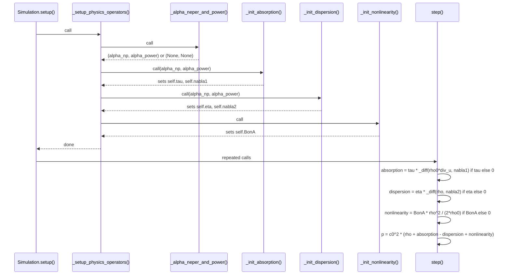

# Issue

**Title:** Refactor _setup_physics_operators into four single-purpose methods

## Description

## Summary

Pure refactor of the Python solver's physics-operator setup, plus a GPU regression fix discovered while doing it.

**This PR depends on #712 (`fix-664-alpha-mode-cpp-guards`)** and is stacked on its branch. Review and merge after #712.

## Refactor

Splits the case-based `_setup_physics_operators` (one ~35-line method building four lambdas) into four single-purpose methods on `Simulation`:

- `_alpha_neper_and_power()` -> `(alpha_np, alpha_power)`, computed once and shared between the absorption and dispersion paths. Uses `kwave.utils.conversion.db2neper` instead of inlining `100 * alpha_coeff * (1e-6 / (2*pi))**y / (20 * log10(e))`.
- `_init_absorption(alpha_np, alpha_power)` sets `self.tau` / `self.nabla1`. Honors `alpha_mode='no_absorption'`. Stokes (`alpha_power == 2`) keeps `nabla1 = None` and `_diff` treats that as the identity operator, skipping a redundant FFT round-trip.
- `_init_dispersion(alpha_np, alpha_power)` sets `self.eta` / `self.nabla2`. Honors `alpha_mode in ('no_absorption', 'no_dispersion')` and the Stokes case.
- `_init_nonlinearity()` sets `self.BonA` (`None` when disabled).

`_setup_physics_operators` becomes a 3-line dispatch and `step()`'s equation-of-state block reads the explicit attributes instead of calling closures, so the code lines up 1:1 with the documented power-law formulation:

    p = c0^2 * (rho + absorption - dispersion + nonlinearity)

## GPU regression fix

`db2neper` is `@beartype`-decorated against `kt.ArrayLike`, which was `Union[np.ndarray, np.bool_, np.number, bool, int, float, complex]` -- no `cupy.ndarray`. On the GPU backend `alpha_coeff` is a `cupy.ndarray`, so the new dispatch would raise `TypeError` before the first time step.

**Picked option (a)**: widened `kt.ArrayLike` to include `cupy.ndarray` when CuPy is importable, so every `@beartype`'d `ArrayLike` API gains GPU support, not just `db2neper`. Built the union via `Union[tuple]` rather than a PEP-646 subscript splat because the project supports Python 3.10. When CuPy is missing the tuple is empty and the union collapses to the NumPy-only form.

Adds a CPU-skipping smoke test (`test_python_backend_gpu_with_absorption_smoke`) that runs a small absorbing 2D simulation on `device='gpu'` and asserts no NaNs. Skips cleanly on CPU-only machines (including CI) but catches the regression on any GPU runner.

## Test plan

- [x] `tests/test_issue_664_alpha_power_near_unity.py` -- 22 passed + 1 GPU skipped
- [x] `tests/test_native_solver.py` -- 35 passed
- [x] `tests/test_ivp_homogeneous_medium.py` -- 1 passed
- [x] `ruff check` clean on `kspace_solver.py`, `typing.py`, `conversion.py`
- [ ] On a GPU machine: `pytest tests/test_issue_664_alpha_power_near_unity.py::test_python_backend_gpu_with_absorption_smoke` should pass (currently skipped on CPU-only CI)

## Out of scope

Pre-existing format violations on master in `kspace_solver.py` (module-docstring blank line; an implicit-string-concat `f"..." f"..."` in the sensor-mask error) are intentionally left unchanged so this PR's diff stays focused on the refactor.

Generated with [Claude Code](https://claude.com/claude-code)

<!-- greptile_comment -->

<h3>Greptile Summary</h3>

Splits the monolithic `_setup_physics_operators` into four single-purpose setup methods (`_alpha_neper_and_power`, `_init_absorption`, `_init_dispersion`, `_init_nonlinearity`) that store plain attributes (`tau`, `nabla1`, `eta`, `nabla2`, `BonA`) consumed inline by `step()`. Also widens `kt.ArrayLike` to include `cupy.ndarray` when CuPy is importable, fixing a beartype `TypeError` on the GPU backend when `db2neper` is called with a CuPy array. All physics formulas (Stokes, general power-law, no-absorption / no-dispersion modes) are preserved identically and covered by the existing 22-test suite.

<h3>Confidence Score: 5/5</h3>

Safe to merge — pure refactor with no physics changes; all formulas verified equivalent to the original; GPU fix is correct and well-tested.

No P0 or P1 findings. All four physics paths (no-absorption, no-dispersion, Stokes, general power-law) were traced through the new code and produce identical expressions to the original lambdas. The Union[tuple] approach for beartype is valid on Python 3.10 and the CuPy guard is correct. The GPU smoke test is appropriately skipped on CPU-only CI.

No files require special attention.

<h3>Important Files Changed</h3>

| Filename | Overview |
|----------|----------|
| kwave/solvers/kspace_solver.py | Refactors _setup_physics_operators into four focused methods; preserves all physics formulas exactly across no-absorption, no-dispersion, Stokes, and general power-law paths; step() inlines the equation-of-state terms correctly. |
| kwave/utils/typing.py | Widens ArrayLike to include cupy.ndarray when CuPy is importable; uses Union[tuple] subscript (valid on Python 3.10) instead of PEP-646 splat; gracefully no-ops when CuPy is absent. |
| tests/test_issue_664_alpha_power_near_unity.py | Adds a GPU smoke test that skips on CPU-only machines; guards against the db2neper beartype regression on the GPU backend; assertion for both NaN-free and non-trivially-zero output is appropriate. |

<h3>Sequence Diagram</h3>

Reviews (2): Last reviewed commit:  | [Re-trigger Greptile](https://app.greptile.com/api/retrigger?id=30637748)

<!-- /greptile_comment -->

## Task

Modify the repository so that the issue described above is resolved. The repository is checked out at base commit `ac5b2fe784eb`. Edit files in place; the verifier captures your changes via `git diff` and scores them against an oracle patch using SWE-RL-style diff-similarity reward.