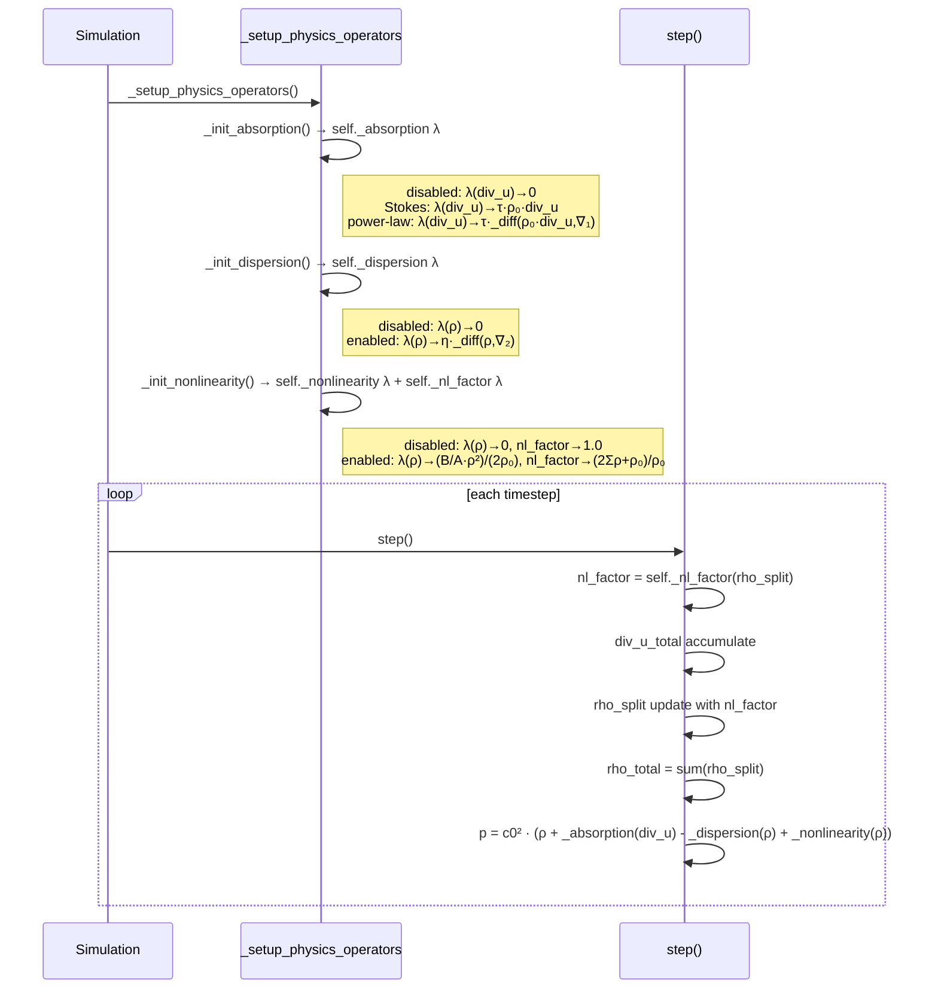

# Issue

**Title:** Make step() branch-free by binding lambdas at setup

## Description

## Why

After #713 landed the `_setup_physics_operators` refactor, `step()` had three runtime conditionals per timestep:

\`\`\`python
absorption    = self.tau  * self._diff(...) if self.tau is not None else 0
dispersion    = self.eta  * self._diff(...) if self.eta is not None else 0
nonlinearity  = self.BonA * rho_total**2 / ... if has_nonlinearity else 0
\`\`\`

These checks don't change during a simulation — they're decided once by the medium configuration. Move them to setup, where they belong.

## What

Each `_init_*` now binds a callable instead of setting raw attributes:

- `self._absorption(div_u)` — disabled / Stokes / full power-law
- `self._dispersion(rho)` — disabled / full power-law
- `self._nonlinearity(rho)` — disabled / enabled
- `self._nl_factor(rho_split)` — `1.0` for lossless or `(2 * sum(rho_split) + rho0) / rho0`

`step()` reduces to:

\`\`\`python
nl_factor = self._nl_factor(self.rho_split)
# ...
rho_total = sum(self.rho_split)
self.p = self.c0_sq * (
    rho_total
    + self._absorption(div_u_total)
    - self._dispersion(rho_total)
    + self._nonlinearity(rho_total)
)
\`\`\`

No branches in the hot loop.

## Performance

Disabled paths still short-circuit:
- Lossless `_nl_factor` returns `1.0` without summing `rho_split`
- Disabled absorption/dispersion/nonlinearity lambdas return `0` directly (no FFT, no array math)

Function-call dispatch (~100ns/call × 4 calls = 400ns/step) is in the same noise floor as `is not None` checks were. The expensive work (FFTs, array ops) is unchanged.

## Test plan

- [x] `tests/test_issue_664_alpha_power_near_unity.py` — 26 pass + 1 GPU skip
- [x] `tests/test_native_solver.py` — 35 pass (covers heterogeneous absorption, Stokes, BonA nonlinearity, sensors)
- [x] `tests/test_ivp_homogeneous_medium.py` — 1 pass
- [x] `ruff check` clean
- [ ] CI green

<!-- greptile_comment -->

<h3>Greptile Summary</h3>

This PR moves three per-timestep conditionals (`tau is not None`, `eta is not None`, `BonA is not None`) out of `step()` and into the `_init_*` setup methods, binding lambdas that either return `0`/`1.0` immediately or perform the full FFT-based computation. All four dispatch paths (`_absorption`, `_dispersion`, `_nonlinearity`, `_nl_factor`) produce results mathematically identical to the old inline expressions, including the Stokes short-circuit (`nabla1=None` → identity in `_diff`) and the DC-safe treatment noted in the `_diff` docstring.

<h3>Confidence Score: 5/5</h3>

Safe to merge — the refactoring is a clean, behavior-preserving reorganization with no functional changes to the physics.

Every new lambda maps 1-to-1 to the expression it replaced: disabled paths return the same sentinel values (integer `0` / `1.0`), Stokes avoids the FFT round-trip in the same way, full power-law forwards to `_diff` with the same operands, and `_nl_factor` is called at the same point in `step()` (before the mass-conservation loop) with the same `rho_split` list. No silent behavioral change was found.

No files require special attention.

<h3>Important Files Changed</h3>

| Filename | Overview |
|----------|----------|
| kwave/solvers/kspace_solver.py | Refactors three runtime conditionals in `step()` into lambdas bound at setup time; all four dispatch paths (absorption, dispersion, nonlinearity, nl_factor) are mathematically equivalent to the original expressions |

<h3>Sequence Diagram</h3>

Reviews (2): Last reviewed commit:  | [Re-trigger Greptile](https://app.greptile.com/api/retrigger?id=30639065)

<!-- /greptile_comment -->

## Task

Modify the repository so that the issue described above is resolved. The repository is checked out at base commit `8ae867349a93`. Edit files in place; the verifier captures your changes via `git diff` and scores them against an oracle patch using SWE-RL-style diff-similarity reward.