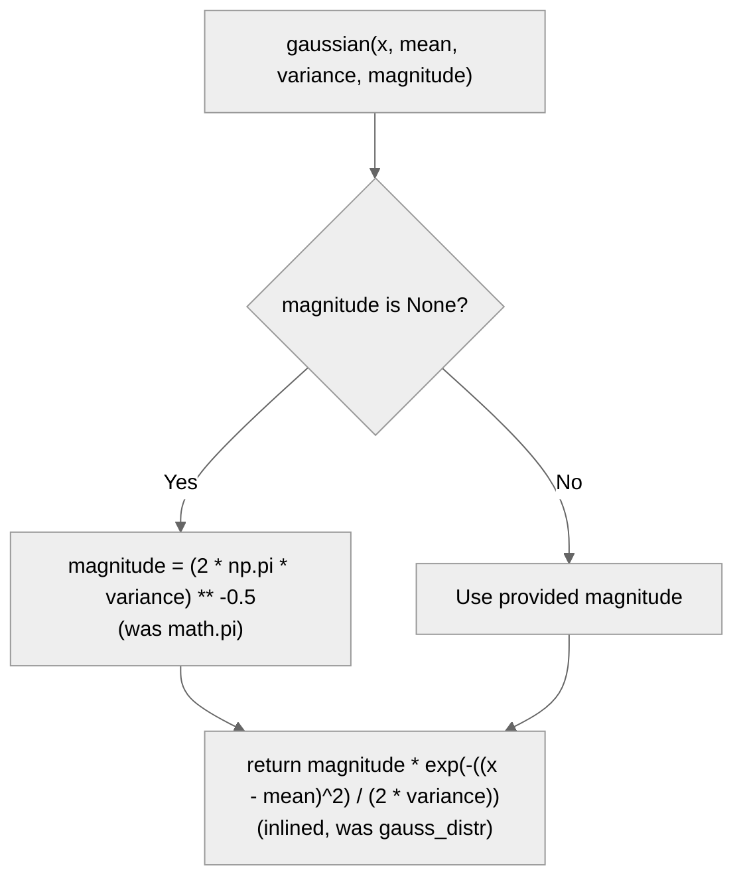

# Issue

**Title:** Use np.pi and remove redundant variable in gaussian function

## Description

Wow, this is a cool repo! I made a small cleanup to the `gaussian` function in `math.py`: replaced `math.pi` with `np.pi` for consistency with the rest of the file and removed redundant intermediate variable `gauss_distr`. Hope this helps!

<!-- greptile_comment -->

<h3>Greptile Summary</h3>

This PR makes minor cleanup to `kwave/utils/math.py`: replaces `math.pi` with `np.pi` in `gaussian()` for consistency and inlines the return expression by removing the intermediate `gauss_distr` variable. Two additional unrelated files are also touched — trailing whitespace cleanup in `create_absorption_variables.py` and a line-reformatting in `kspace_solver.py` — neither of which is mentioned in the PR description.

<h3>Confidence Score: 5/5</h3>

Safe to merge — all changes are non-functional cleanup with no risk to correctness.

The core change (math.pi → np.pi, inlined return) is functionally identical. The `import math` is still needed for `math.sqrt` elsewhere in the file, so no dead import is introduced. The kspace_solver.py reformatting stays within the project's 140-char limit. No logic, behaviour, or interface is altered.

No files require special attention.

<h3>Important Files Changed</h3>

| Filename | Overview |
|----------|----------|
| kwave/utils/math.py | Replaced `math.pi` with `np.pi` in `gaussian()` and inlined the return expression; no functional change. `import math` is correctly retained (still used for `math.sqrt` at line 176). |
| kwave/solvers/kspace_solver.py | Multi-line pressure equation reformatted to a single line (~135 chars, within the project's 140-char limit); no functional change. |
| kwave/kWaveSimulation_helper/create_absorption_variables.py | Trailing whitespace removed from docstring lines and newline added at end of file; purely cosmetic cleanup. |

<h3>Flowchart</h3>

Reviews (1): Last reviewed commit:  | [Re-trigger Greptile](https://app.greptile.com/api/retrigger?id=30721861)

<!-- /greptile_comment -->

## Task

Modify the repository so that the issue described above is resolved. The repository is checked out at base commit `a1b054c2fb22`. Edit files in place; the verifier captures your changes via `git diff` and scores them against an oracle patch using SWE-RL-style diff-similarity reward.