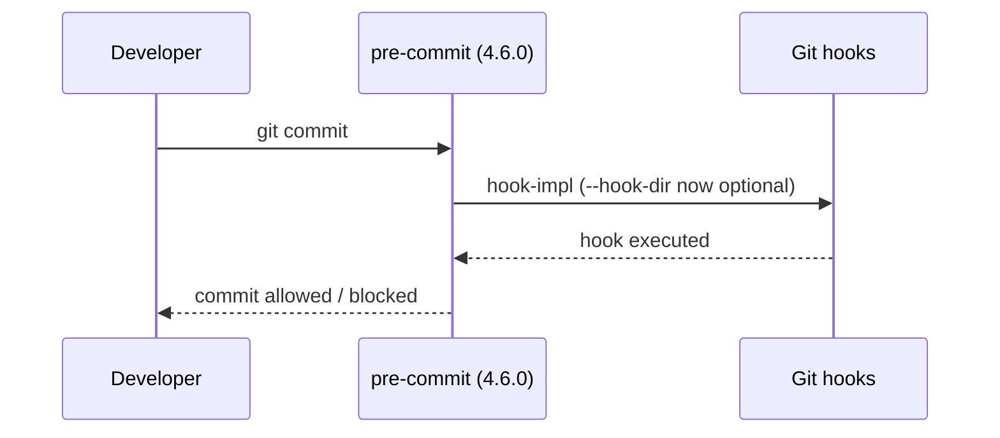

# Issue

**Title:** Bump pre-commit from 4.5.1 to 4.6.0

## Description

Bumps [pre-commit](https://github.com/pre-commit/pre-commit) from 4.5.1 to 4.6.0.

Release notes

<em>Sourced from <a href="https://github.com/pre-commit/pre-commit/releases">pre-commit's releases</a>.</em>

<blockquote>
<h2>pre-commit v4.6.0</h2>
<h3>Features</h3>
<ul>
<li><code>pre-commit hook-impl</code>: allow <code>--hook-dir</code> to be missing to enable easier usage with <code>git</code> 2.54+ git hooks.
<ul>
<li><a href="">#3662</a> PR by <a href="https://github.com/asottile"><code>@​asottile</code></a>.</li>
</ul>
</li>
</ul>
<h3>Fixes</h3>
<ul>
<li><code>pre-commit hook-impl</code>: <code>--hook-type</code> is required.
<ul>
<li><a href="">#3661</a> PR by <a href="https://github.com/asottile"><code>@​asottile</code></a>.</li>
</ul>
</li>
</ul>
</blockquote>

Changelog

<em>Sourced from <a href="https://github.com/pre-commit/pre-commit/blob/main/CHANGELOG.md">pre-commit's changelog</a>.</em>

<blockquote>
<h1>4.6.0 - 2026-04-21</h1>
<h3>Features</h3>
<ul>
<li><code>pre-commit hook-impl</code>: allow <code>--hook-dir</code> to be missing to enable easier
usage with <code>git</code> 2.54+ git hooks.
<ul>
<li><a href="">#3662</a> PR by <a href="https://github.com/asottile"><code>@​asottile</code></a>.</li>
</ul>
</li>
</ul>
<h3>Fixes</h3>
<ul>
<li><code>pre-commit hook-impl</code>: <code>--hook-type</code> is required.
<ul>
<li><a href="">#3661</a> PR by <a href="https://github.com/asottile"><code>@​asottile</code></a>.</li>
</ul>
</li>
</ul>
</blockquote>

Commits

<ul>
<li><a href=""><code>f35134b</code></a> v4.6.0</li>
<li><a href=""><code>2a51ffc</code></a> Merge pull request <a href="">#3662</a> from pre-commit/hook-impl-optional-hook-dir</li>
<li><a href=""><code>d7dee32</code></a> make --hook-dir optional for hook-impl</li>
<li><a href=""><code>965aeb1</code></a> Merge pull request <a href="">#3661</a> from pre-commit/hook-impl-required</li>
<li><a href=""><code>2eacc06</code></a> --hook-type is required for hook-impl</li>
<li><a href=""><code>f5678bf</code></a> Merge pull request <a href="">#3657</a> from pre-commit/pre-commit-ci-update-config</li>
<li><a href=""><code>054cc5b</code></a> [pre-commit.ci] pre-commit autoupdate</li>
<li><a href=""><code>5c0f302</code></a> Merge pull request <a href="">#3652</a> from pre-commit/pre-commit-ci-update-config</li>
<li><a href=""><code>a5d9114</code></a> [pre-commit.ci] pre-commit autoupdate</li>
<li><a href=""><code>129a1f5</code></a> Merge pull request <a href="">#3641</a> from pre-commit/mxr-patch-1</li>
<li>Additional commits viewable in <a href="https://github.com/pre-commit/pre-commit/compare/v4.5.1...v4.6.0">compare view</a></li>
</ul>

 

Dependabot will resolve any conflicts with this PR as long as you don't alter it yourself. You can also trigger a rebase manually by commenting `@dependabot rebase`.

[//]: # (dependabot-automerge-start)
[//]: # (dependabot-automerge-end)

---

Dependabot commands and options

 

You can trigger Dependabot actions by commenting on this PR:
- `@dependabot rebase` will rebase this PR
- `@dependabot recreate` will recreate this PR, overwriting any edits that have been made to it
- `@dependabot show <dependency name> ignore conditions` will show all of the ignore conditions of the specified dependency
- `@dependabot ignore this major version` will close this PR and stop Dependabot creating any more for this major version (unless you reopen the PR or upgrade to it yourself)
- `@dependabot ignore this minor version` will close this PR and stop Dependabot creating any more for this minor version (unless you reopen the PR or upgrade to it yourself)
- `@dependabot ignore this dependency` will close this PR and stop Dependabot creating any more for this dependency (unless you reopen the PR or upgrade to it yourself)

<!-- greptile_comment -->

<h3>Greptile Summary</h3>

This PR bumps the `pre-commit` dev dependency from 4.5.1 to 4.6.0 in `pyproject.toml`. The release adds optional `--hook-dir` support for compatibility with git 2.54+ hooks and fixes `--hook-type` being incorrectly treated as optional — neither change affects runtime behavior of k-wave-python.

<h3>Confidence Score: 5/5</h3>

Safe to merge — single-line dev dependency bump with no runtime impact.

No logic changes; only the `pre-commit` dev tool version is updated. The new release contains no breaking changes and the Dependabot compatibility score is high.

No files require special attention.

<h3>Important Files Changed</h3>

| Filename | Overview |
|----------|----------|
| pyproject.toml | Bumps `pre-commit` dev dependency from 4.5.1 to 4.6.0 — a minor version update with no breaking changes. |

<h3>Sequence Diagram</h3>

Reviews (1): Last reviewed commit:  | [Re-trigger Greptile](https://app.greptile.com/api/retrigger?id=30775502)

<!-- /greptile_comment -->

## Task

Modify the repository so that the issue described above is resolved. The repository is checked out at base commit `a1b054c2fb22`. Edit files in place; the verifier captures your changes via `git diff` and scores them against an oracle patch using SWE-RL-style diff-similarity reward.