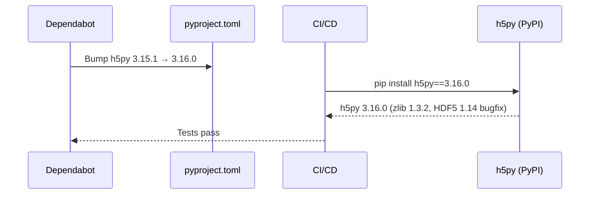

# Issue

**Title:** Bump h5py from 3.15.1 to 3.16.0

## Description

Bumps [h5py](https://github.com/h5py/h5py) from 3.15.1 to 3.16.0.

Commits

<ul>
<li><a href=""><code>b2f0347</code></a> Merge pull request <a href="">#2807</a> from takluyver/prepare-3.16</li>
<li><a href=""><code>f0dedaa</code></a> Add zlib update to release notes</li>
<li><a href=""><code>1e04026</code></a> Merge pull request <a href="">#2808</a> from takluyver/zlib-1.3.2</li>
<li><a href=""><code>c5c8f06</code></a> Fix another reference to zlib DLL</li>
<li><a href=""><code>d872c0c</code></a> Use a newer bugfix release of HDF5 1.14 on Azure pipelines</li>
<li><a href=""><code>71c655a</code></a> Fix calling zlib script on Windows Azure CI</li>
<li><a href=""><code>2f5bf86</code></a> Fix for new names z.lib &amp; z.dll</li>
<li><a href=""><code>47ce1d8</code></a> Reduce duplicated code building zlib on Windows</li>
<li><a href=""><code>d5c8b5d</code></a> Try building zlib directly from source on Windows ARM64 as well</li>
<li><a href=""><code>846abfc</code></a> Update zlib to 1.3.2 for Windows &amp; Mac wheels</li>
<li>Additional commits viewable in <a href="https://github.com/h5py/h5py/compare/3.15.1...3.16.0">compare view</a></li>
</ul>

 

Dependabot will resolve any conflicts with this PR as long as you don't alter it yourself. You can also trigger a rebase manually by commenting `@dependabot rebase`.

[//]: # (dependabot-automerge-start)
[//]: # (dependabot-automerge-end)

---

Dependabot commands and options

 

You can trigger Dependabot actions by commenting on this PR:
- `@dependabot rebase` will rebase this PR
- `@dependabot recreate` will recreate this PR, overwriting any edits that have been made to it
- `@dependabot show <dependency name> ignore conditions` will show all of the ignore conditions of the specified dependency
- `@dependabot ignore this major version` will close this PR and stop Dependabot creating any more for this major version (unless you reopen the PR or upgrade to it yourself)
- `@dependabot ignore this minor version` will close this PR and stop Dependabot creating any more for this minor version (unless you reopen the PR or upgrade to it yourself)
- `@dependabot ignore this dependency` will close this PR and stop Dependabot creating any more for this dependency (unless you reopen the PR or upgrade to it yourself)

<!-- greptile_comment -->

<h3>Greptile Summary</h3>

This PR bumps the `h5py` dependency from `3.15.1` to `3.16.0` (a minor release) in `pyproject.toml`. The release includes a zlib update to 1.3.2 for Windows/macOS wheels and a newer HDF5 1.14 bugfix release in CI, with no breaking API changes expected.

<h3>Confidence Score: 5/5</h3>

Safe to merge — single exact-pin version bump with no API changes.

The change is a single-line exact-version bump for a well-maintained library. h5py 3.16.0 is a minor release focused on build-system updates (zlib 1.3.2, HDF5 bugfix), with no breaking API changes. All other dependencies are untouched.

No files require special attention.

<h3>Important Files Changed</h3>

| Filename | Overview |
|----------|----------|
| pyproject.toml | Bumps h5py exact pin from 3.15.1 to 3.16.0; no other changes. |

<h3>Sequence Diagram</h3>

Reviews (1): Last reviewed commit:  | [Re-trigger Greptile](https://app.greptile.com/api/retrigger?id=30775515)

<!-- /greptile_comment -->

## Task

Modify the repository so that the issue described above is resolved. The repository is checked out at base commit `a1b054c2fb22`. Edit files in place; the verifier captures your changes via `git diff` and scores them against an oracle patch using SWE-RL-style diff-similarity reward.