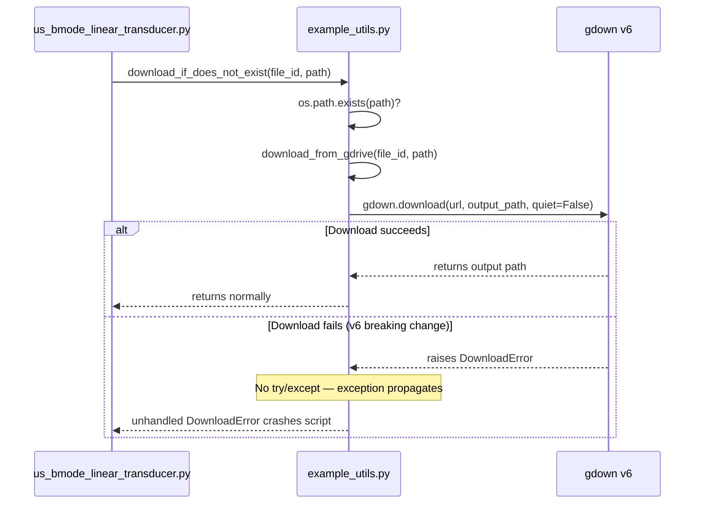

# Issue

**Title:** Bump gdown from 5.2.2 to 6.0.0

## Description

Bumps [gdown](https://github.com/wkentaro/gdown) from 5.2.2 to 6.0.0.

Release notes

<em>Sourced from <a href="https://github.com/wkentaro/gdown/releases">gdown's releases</a>.</em>

<blockquote>
<h2>v6.0.0</h2>

A lot has changed since v5.2.1 back in January. 33 pull requests (109 commits) went into this release, touching nearly every part of the codebase.

<h3>Highlights</h3>
<ul>
<li><code>gdown --folder</code> / <code>download_folder()</code> now supports folders with more than 50 files</li>
<li><code>download()</code> raises <code>DownloadError</code> on failure instead of returning <code>None</code></li>
<li>New <code>progress</code> parameter in <code>download()</code></li>
<li>Path traversal vulnerability fixed in <code>extractall()</code> (<a href="https://github.com/wkentaro/gdown/security/advisories/GHSA-76hw-p97h-883f">GHSA-76hw-p97h-883f</a>)</li>
<li>All deprecated APIs from v5 have been (finally) removed</li>
<li>Python 3.10+ required (3.8 and 3.9 dropped)</li>
</ul>

Most users should be able to upgrade without issues. The one change that will likely need code updates is the switch from returning <code>None</code> to raising <code>DownloadError</code> on failure.

<h3>Breaking changes</h3>
<ul>
<li>

<strong><code>download()</code> and <code>download_folder()</code> now raise <code>DownloadError</code> instead of returning <code>None</code></strong> (<a href="">#451</a>)

Previously, <code>download()</code> and <code>download_folder()</code> returned <code>None</code> when a download failed. Now, they raise <code>DownloadError</code> (or its subclass <code>FileURLRetrievalError</code>).

If your code looks like this:

<pre lang="python"><code>output = gdown.download(url, output=&quot;file.txt&quot;)
if output is None:
    print(&quot;Download failed&quot;)
</code></pre>

Change it to:

<pre lang="python"><code>try:
    output = gdown.download(url, output=&quot;file.txt&quot;)
except gdown.DownloadError as e:
    print(f&quot;Download failed: {e}&quot;)
</code></pre>
</li>
<li>

<strong><code>fuzzy</code> parameter and <code>--fuzzy</code> CLI flag removed</strong> (<a href="">#455</a>)

Previously, you needed <code>fuzzy=True</code> (or <code>--fuzzy</code>) to download from Google Drive share links like <code>https://drive.google.com/file/d/FILE_ID/view</code>. gdown now always extracts the file ID from any Google Drive URL format. Just pass the URL directly.

</li>
<li>

<strong><code>--remaining-ok</code> flag and <code>FolderContentsMaximumLimitError</code> removed</strong> (<a href="">#453</a>)

Folder downloads used to be limited to 50 files due to a Google Drive API constraint, and <code>--remaining-ok</code> let you proceed with a partial download. gdown now uses the <code>embeddedfolderview</code> endpoint, which has no file count limit. The flag and exception class are no longer needed.

</li>
<li>

<strong><code>md5</code> parameter removed from <code>cached_download()</code></strong> (<a href="">#450</a>)

The <code>md5</code> parameter was deprecated in v5. Use the <code>hash</code> parameter instead:

<pre lang="python"><code></code></pre>
</li>
</ul>
<!-- raw HTML omitted -->
</blockquote>

... (truncated)

Commits

<ul>
<li><a href=""><code>bff6f0d</code></a> Merge pull request <a href="">#455</a> from wkentaro/refactor/remove-fuzzy-option</li>
<li><a href=""><code>aab3d52</code></a> test: add unit test for Google Drive URL rewriting</li>
<li><a href=""><code>b1c6e1c</code></a> refactor!: remove fuzzy option, always extract file ID from Google Drive URLs</li>
<li><a href=""><code>6a43500</code></a> docs: document --no-check-certificate, --no-cookies, --user-agent options</li>
<li><a href=""><code>37b6377</code></a> docs: remove stale md5 reference from cached_download docstring</li>
<li><a href=""><code>a8b4d49</code></a> docs: add Python version requirement and clarify cookie FAQ</li>
<li><a href=""><code>59fc661</code></a> docs: center README hero section</li>
<li><a href=""><code>5bb1faa</code></a> docs: remove stale 50-file folder limit from README</li>
<li><a href=""><code>64ceaa7</code></a> Merge pull request <a href="">#454</a> from wkentaro/chore/add-3-14-to-test-yml-ci-matrix</li>
<li><a href=""><code>aedf0af</code></a> ci: disable fail-fast for unit test matrix</li>
<li>Additional commits viewable in <a href="https://github.com/wkentaro/gdown/compare/v5.2.2...v6.0.0">compare view</a></li>
</ul>

 

Dependabot will resolve any conflicts with this PR as long as you don't alter it yourself. You can also trigger a rebase manually by commenting `@dependabot rebase`.

[//]: # (dependabot-automerge-start)
[//]: # (dependabot-automerge-end)

---

Dependabot commands and options

 

You can trigger Dependabot actions by commenting on this PR:
- `@dependabot rebase` will rebase this PR
- `@dependabot recreate` will recreate this PR, overwriting any edits that have been made to it
- `@dependabot show <dependency name> ignore conditions` will show all of the ignore conditions of the specified dependency
- `@dependabot ignore this major version` will close this PR and stop Dependabot creating any more for this major version (unless you reopen the PR or upgrade to it yourself)
- `@dependabot ignore this minor version` will close this PR and stop Dependabot creating any more for this minor version (unless you reopen the PR or upgrade to it yourself)
- `@dependabot ignore this dependency` will close this PR and stop Dependabot creating any more for this dependency (unless you reopen the PR or upgrade to it yourself)

<!-- greptile_comment -->

<h3>Greptile Summary</h3>

This PR bumps `gdown` from 5.2.2 to 6.0.0 in the `example` optional dependency group. gdown v6 introduced a breaking change where `download()` raises `DownloadError` on failure instead of returning `None`, but `example_utils.py` — the only call site in this repo — is not updated to handle the new exception.

<h3>Confidence Score: 3/5</h3>

Not safe to merge as-is: example_utils.py needs to handle the new DownloadError before the version bump lands.

A P1 breaking-change is present — gdown v6's DownloadError will propagate unhandled through download_from_gdrive, changing the failure mode from silent to a crash. The fix is small but it is not included in this PR.

examples/legacy/us_bmode_linear_transducer/example_utils.py — needs a try/except around gdown.download() to handle DownloadError.

<h3>Important Files Changed</h3>

| Filename | Overview |
|----------|----------|
| pyproject.toml | Bumps gdown optional dependency from 5.2.2 to 6.0.0; the downstream usage in example_utils.py is not updated to handle the new DownloadError exception. |

<h3>Sequence Diagram</h3>

<!-- greptile_failed_comments -->

<h3>Comments Outside Diff (1)</h3>

1. `examples/legacy/us_bmode_linear_transducer/example_utils.py`, line 11 ([link](https://github.com/waltsims/k-wave-python/blob/10a1d5584467990522a70c4521d848c2e0e98f7d/examples/legacy/us_bmode_linear_transducer/example_utils.py#L11))

    **Unhandled `DownloadError` from gdown v6**

   gdown v6 changed `download()` to raise `DownloadError` on failure instead of returning `None`. This call has no `try/except` around it, so any download failure will now propagate as an unhandled exception up through `download_if_does_not_exist` and crash the example script. In v5.2.2 the same failure was a silent `None` return. The PR description explicitly flags this as the one breaking change requiring code updates.

<!-- /greptile_failed_comments -->

Reviews (1): Last reviewed commit:  | [Re-trigger Greptile](https://app.greptile.com/api/retrigger?id=30775526)

<!-- /greptile_comment -->

## Task

Modify the repository so that the issue described above is resolved. The repository is checked out at base commit `a1b054c2fb22`. Edit files in place; the verifier captures your changes via `git diff` and scores them against an oracle patch using SWE-RL-style diff-similarity reward.